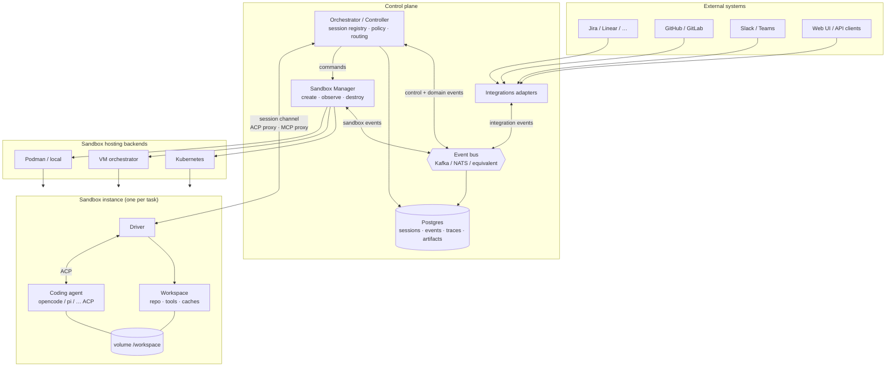
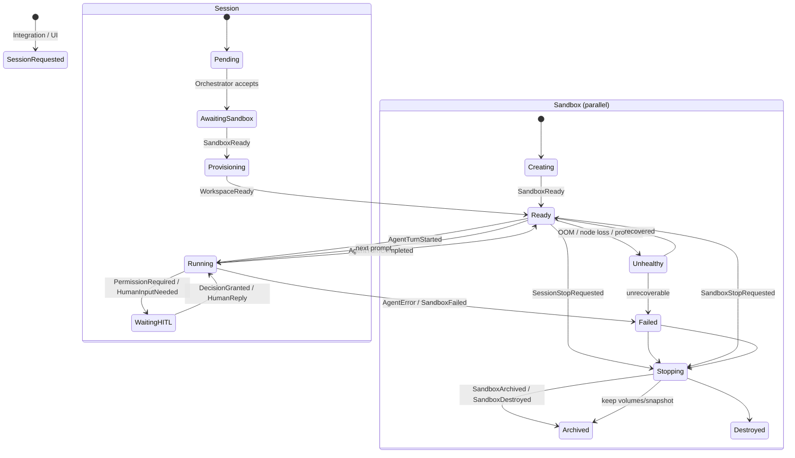
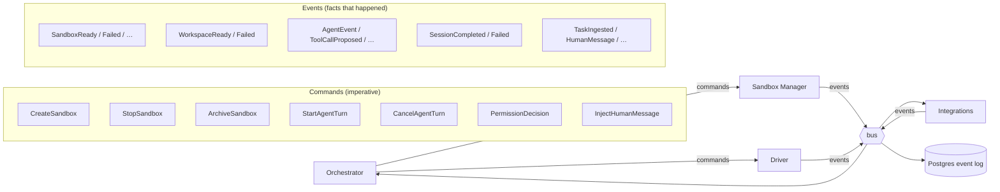
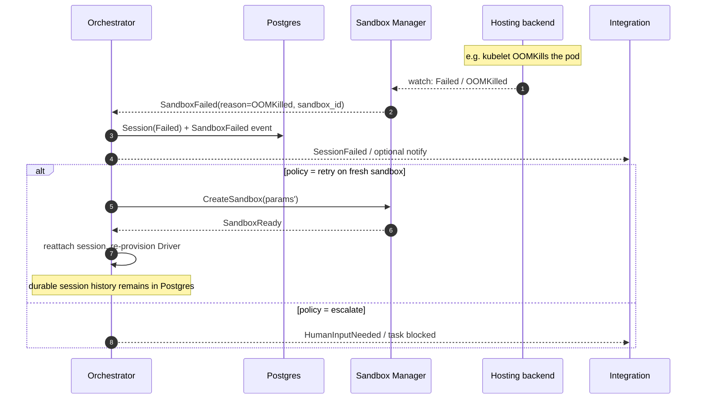
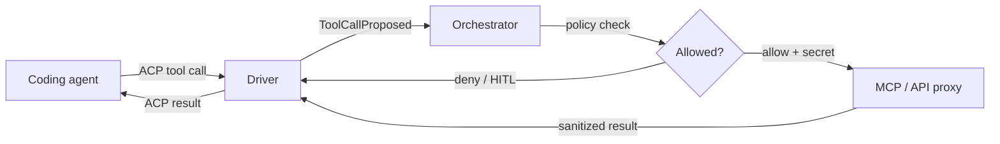

# Architecture — Orchestration Control Plane

This document describes the layered orchestration architecture for Agent Fleet:
how integrations feed work into the system, how sandboxes are created and
provisioned, and how coding-agent sessions are driven, observed, and torn down.

It is intentionally **event-oriented**. A pure request/response API is enough
to *ask* for a sandbox, but not enough to operate one: sandboxes fail
asynchronously (OOMKill, node loss, VM death), interactive sessions need
bidirectional streaming, and tool-call / permission decisions must be
evaluated out-of-band of the agent process.

Related component folders (stubs for deeper specs):

| Component | Path | Role |
| --- | --- | --- |
| Integrations | [`docs/components/integrations/`](../components/integrations/) | Ingest tasks / HITL / notifications from external systems |
| Orchestrator | [`docs/components/orchestrator/`](../components/orchestrator/) | Session control plane; durable state; event routing |
| Sandbox Manager | [`docs/components/sandbox-manager/`](../components/sandbox-manager/) | Create / observe / destroy sandboxes on hosting backends |
| Sandbox Hosting Tool | [`docs/components/sandbox-hosting-tool/`](../components/sandbox-hosting-tool/) | Concrete runtime backends (k8s, VM, podman, …) |
| Web UI | [`docs/components/ui/`](../components/ui/) | Browser app (Dioxus): landing, auth, workspace-scoped shell |
| Auth & workspaces | [`docs/components/auth/`](../components/auth/) | Signup/login cookies, default workspace, list/create APIs |
| Worker hosts | [`docs/components/worker-host/`](../components/worker-host/) | Paired self-hosted machines; outbound HTTPS pair + lease |
| Runners | [`docs/components/runners/`](../components/runners/) | Product surface for where work runs (kinds + isolation) |

**Implemented today (HTTP):** `fleet-server` on `:8080` mounts `fleet-auth`
(auth + workspaces) and `fleet-integrations` (catalog) over `fleet-db`
(Postgres). UI on `:3030` talks to the API with cookie credentials.
Orchestrator tick + process sandbox (`fleet-worker`) and the Kubernetes
`FleetSandbox` operator are on `main`. `SANDBOX_BACKEND=k8s` creates CRs
(the operator still makes the pods). OAuth connect is live.
**Cases (general durable workflows):** workspace-scoped `cases` + `case_events`
with backend wake loop and free-form stages — see
[`docs/components/cases/`](../components/cases/). Agent fleets remain the
executor for coding plans; cases are the long-lived state machine.
**Sandbox driver:** [`crates/fleet-sandbox-driver`](../../crates/fleet-sandbox-driver/)
runs OpenCode/Pi over ACP in a per-task compose sandbox (see
[`sandbox-workspace.md`](./sandbox-workspace.md)). Not `PROCESS_WORKER_BIN`
(that is [`crates/fleet-driver`](../../crates/fleet-driver/)).
**Worker hosts:** workspace owners create a host and copy a one-time pair
token. The machine installs `fleet-host` and pairs outbound (HTTPS); no
inbound port on the worker. Tick prefers an online matching host, else
today's local `SANDBOX_BACKEND`. See
[`docs/components/worker-host/`](../components/worker-host/).

Diagram sources live in [`diagrams/`](./diagrams/).

| Doc | Contents |
| --- | --- |
| [`events-overview.md`](./events-overview.md) | Typical events outline (lifecycle map, domains, MVP set) |
| [`events.md`](./events.md) | Field-level catalogue + **JSON serialization** recommendation |
| [`sandbox-workspace.md`](./sandbox-workspace.md) | **Harness vs workspace**, per-task isolation, named tools, OpenCode/Pi invoices lab |
| [`crates/agent-fleet-contracts`](../../crates/agent-fleet-contracts/) | Rust structs (`serde`) implementing the catalogue |
| [`transport-zenoh.md`](./transport-zenoh.md) | Zenoh as live control-plane transport (evaluation + key-space) |

---

## 1. Why multiple layers?

There are three distinct jobs that are easy to conflate:

1. **Spin up a sandbox** — allocate compute (k8s pod, VM, container, …) with
   the right resource limits, network policy, and isolation. A sandbox may
   contain **more than one container** (stable harness + project workspace).
2. **Provision the workspace** — prepare the **project environment** on the
   workspace side of the sandbox: clone the git repo; install **project**
   dependencies (e.g. `pip` / `npm` / `cargo`); restore artifact caches;
   optional smoke; install/configure the coding agent, skills, and plugins on
   the **harness** side without mutating harness image layers; apply network
   egress rules. See [`sandbox-workspace.md`](./sandbox-workspace.md).
3. **Drive the coding agent** — send prompts, manage ACP sessions, evaluate
   tool calls / permissions (including routing build/test exec into the
   workspace container), store traces, and (for interactive work) forward
   model output to Slack / the web UI / etc.

These have different failure modes, different owners, and different lifetimes.
Keeping them as separate actors (Orchestrator, Sandbox Manager, Driver) lets
each layer recover independently and keeps secrets out of the sandbox
(MCP / external API calls are proxied by the control plane — see product
vision). **Harness images stay stable; project env variance stays in the
workspace volume/container.**

```
  Layer 1  Sandbox lifecycle     →  Sandbox Manager (+ hosting backend)
  Layer 2  Workspace provision   →  Driver (project env + harness config)
  Layer 3  Agent session control →  Driver ↔ Orchestrator (ACP + events)
```

---

## 2. Component model

### 2.1 High-level topology



### 2.2 Responsibilities

#### Orchestrator / Controller

- Owns the durable notion of a **session** (and higher-level *tasks* /
  *workflows* that may span multiple sessions).
- Receives inputs from **Integrations** (new ticket, PR review comment,
  Slack message, manual UI action).
- Talks to **Sandbox Manager** to create / resize / shut down / archive
  sandboxes with explicit parameters (image, CPU/mem, network policy,
  backend preference, multi-agent co-location, …).
- Talks to the **Driver** over a control channel to:
  - start / resume / cancel agent turns,
  - proxy **MCP** and other external calls (secrets stay here, never in the
    sandbox),
  - evaluate tool-call permissions (policy engine / HITL),
  - stream model output for interactive sessions back to Integrations.
- Persists every significant event and the full agent trace to **Postgres**
  (and optionally object storage for bulky artifacts).

#### Sandbox Manager

- Abstracts hosting backends (k8s, VMs, rootless podman, future self-hosted
  runners).
- Creates the sandbox process/pod/VM and injects the **Driver** as the entry
  process (or as a sidecar that then launches the agent).
- Watches the backend for lifecycle transitions and **emits sandbox events**
  (ready, OOMKilled, node lost, disk pressure, stopped, …). This is the
  primary reason the system is event-based rather than pure RPC.
- Handles teardown and archival (stop compute, keep volumes / snapshots if
  requested, release ports and network identities).

#### Driver (runs inside the sandbox)

- **Provisions** the workspace after sandbox create:
  - **Workspace / project env** (separate container + **sandbox-local volume**):
    clone repo, install project libraries, migrations/bootstrap, optional
    smoke tests — **not** into harness image layers.
  - **Harness side**: agent config (OpenCode providers, Pi `models.json`, …)
    on the **stable** harness image; no project `pip`/`npm` into that image.
- Launches and controls the coding agent through **ACP** (Agent Client
  Protocol): prompts, cancellations, session state, tool-call mediation.
  Project commands during turns go through **named allowlisted tools**
  (`fleet-wsexec <name>` → fixed argv in the workspace container).
- Enforces **path-scoped ACP permissions** (folder prefixes gate writes) and
  default-deny when `auto_approve` is false.
- Streams agent events / results upward (lab: Redis result key; target: bus
  to Orchestrator). Does **not** hold long-lived secrets; external credentials
  are injected only on proxied requests by the Orchestrator.

**Sandbox today** (`crates/fleet-sandbox-driver`): one Compose project + volume per task;
harnesses **opencode** and **pi** (plus images for codex/grok); dual 123-invoices
jobs. Details: [`sandbox-workspace.md`](./sandbox-workspace.md),
[`crates/fleet-sandbox-driver/README.md`](../../crates/fleet-sandbox-driver/README.md).

#### Integrations

- Translate external system webhooks / polls into **integration events**
  (`TaskIngested`, `ReviewFeedbackReceived`, `HumanMessage`, …).
- Translate control-plane events back into external actions (open PR, post
  Slack reply, transition Jira status, request HITL approval).
- Stay thin: no sandbox or agent knowledge beyond what the event payloads
  expose.

#### Sandbox Hosting Tool

- The pluggable backend that Sandbox Manager drives (k8s operators, VM
  APIs, local podman scripts such as the `aibox` reference). Not visible to
  the Orchestrator except via Sandbox Manager's interface and events.

---

## 3. Session and sandbox lifecycles

A **session** is the Orchestrator's unit of work with a coding agent.
A **sandbox** is the isolated compute environment a session (or several
co-located sessions) runs in.



Key invariants:

- The Orchestrator may recreate a Driver/session on a **new** sandbox after
  `SandboxFailed` without losing the durable session record (agent is
  disposable; workflow is durable — product vision).
- Multiple agents may share one sandbox (product vision); the Driver
  multiplexes ACP sessions, the Sandbox Manager still reports one sandbox
  lifecycle.
- Secrets never cross into the sandbox; MCP/API calls leave via the
  Orchestrator's proxy.

---

## 4. Event-driven control plane

### 4.1 Why events, not only RPC

| Concern | RPC alone? | Needs events |
| --- | --- | --- |
| Create sandbox with params | ✅ command | + `SandboxReady` / `SandboxFailed` async result |
| Shutdown / archive sandbox | ✅ command | + terminal `SandboxDestroyed` / `SandboxArchived` |
| Backend failure (OOM, VM death) | ❌ no caller waiting | **must** be pushed |
| Agent tool-call permission | half-duplex awkward | stream + decision reply |
| Interactive Slack conversation | ❌ | continuous stream both ways |
| Trace persistence / audit | fire-and-forget | durable event log |
| Multi-consumer (UI + Slack + metrics) | fan-out hard | bus / log |

Commands still exist (imperative verbs from Orchestrator → Sandbox Manager /
Driver). Outcomes and autonomous observations travel as **events** on a bus
(or as a durable outbox in Postgres polled by consumers — transport is an
implementation choice; the *contract* is event-shaped).

### 4.2 Command vs event



### 4.3 End-to-end happy path

```mermaid
sequenceDiagram
  autonumber
  participant Ext as Integration (Jira/GH/Slack)
  participant O as Orchestrator
  participant DB as Postgres
  participant SM as Sandbox Manager
  participant H as Hosting backend
  participant D as Driver
  participant A as Coding agent (ACP)

  Ext->>O: TaskIngested / HumanMessage
  O->>DB: persist Session(Pending)
  O->>SM: CreateSandbox(params)
  SM->>H: allocate pod/VM/container
  H-->>SM: running
  SM->>H: start Driver entrypoint
  SM-->>O: SandboxReady(sandbox_id, endpoint)
  O->>DB: Session(AwaitingSandbox → Provisioning)

  Note over D: provision: workspace env (clone, deps) + harness config
  D->>D: provision workspace (shared volume; project deps on workspace side)
  D-->>O: WorkspaceReady
  O->>DB: Session(Ready)

  O->>D: StartAgentTurn(prompt, session_id)
  D->>A: ACP session/prompt (cwd on shared /workspace)
  loop Agent loop
    A-->>D: ACP events (thoughts, tool calls, messages)
    D-->>O: AgentEvent / ToolCallProposed
    O->>DB: append trace
    alt needs permission
      O-->>Ext: PermissionRequired (HITL)
      Ext->>O: PermissionDecision
      O->>D: PermissionDecision
    else project build/test
      D->>D: exec tool in workspace container (not harness image)
    else MCP / external API
      O->>O: proxy with secrets
      O->>D: ToolCallResult
    else interactive surface
      O-->>Ext: AgentMessage (Slack/UI)
    end
  end
  A-->>D: turn complete
  D-->>O: AgentTurnCompleted
  O->>DB: Session(Ready) + artifacts

  opt done with sandbox
    O->>SM: StopSandbox / ArchiveSandbox
    SM->>H: teardown
    SM-->>O: SandboxDestroyed / SandboxArchived
  end
```

### 4.4 Failure path (sandbox dies mid-session)



---

## 5. Event catalogue (summary)

Full field-level catalogue: [`events.md`](./events.md).

| Domain | Examples |
| --- | --- |
| **Integration → Orchestrator** | `TaskIngested`, `ReviewFeedbackReceived`, `HumanMessage`, `CancelRequested` |
| **Orchestrator → Sandbox Manager** *(commands)* | `CreateSandbox`, `StopSandbox`, `ArchiveSandbox`, `ExecInSandbox` |
| **Sandbox Manager → bus** | `SandboxCreating`, `SandboxReady`, `SandboxUnhealthy`, `SandboxFailed`, `SandboxStopping`, `SandboxDestroyed`, `SandboxArchived` |
| **Driver → Orchestrator** | `WorkspaceProvisioning`, `WorkspaceReady`, `WorkspaceFailed`, `AgentTurnStarted`, `AgentEvent`, `ToolCallProposed`, `PermissionRequired`, `AgentTurnCompleted`, `AgentTurnFailed`, `DriverHeartbeat` |
| **Orchestrator → Driver** *(commands)* | `ProvisionWorkspace`, `StartAgentTurn`, `CancelAgentTurn`, `PermissionDecision`, `InjectHumanMessage`, `ShutdownDriver` |
| **Orchestrator → Integrations** | `AgentMessage`, `PermissionRequired`, `SessionCompleted`, `SessionFailed`, `ArtifactPublished`, `PROpened` |
| **Cross-cutting** | `SessionCreated`, `SessionStateChanged`, `TraceAppended`, `PolicyDenied` |

Correlation IDs on every message:

- `session_id` — Orchestrator-owned durable session
- `sandbox_id` — Sandbox Manager-owned compute instance
- `task_id` / `workflow_id` — higher-level work item (optional parent)
- `turn_id` — single agent turn within a session
- `causation_id` / `correlation_id` — event lineage

---

## 6. Trust, secrets, and networking

Aligned with the product vision:

- Sandboxes start with **no internet** (or tightly allowlisted egress:
  package registries, git hosts). Full open egress is discouraged.
- **Secrets never enter the sandbox.** Model provider keys, GitHub tokens,
  Jira tokens live in the control plane. The Driver requests external
  actions; the Orchestrator (or a dedicated egress proxy it controls)
  attaches credentials and returns results.
- MCP servers are reached through an **MCP proxy** in the Orchestrator so
  tool implementations that need secrets stay outside the untrusted
  workspace.
- Multi-agent sandboxes may reach each other on an internal bridge
  (see `aibox` reference networking) without granting wider egress.



---

## 7. Mapping to product planes

| Product plane (vision) | This architecture |
| --- | --- |
| Integrations (Jira, GH, Slack, …) | Integrations adapters + their events |
| Orchestration layer | Orchestrator + event bus + Postgres |
| Runtime / sandbox | Sandbox Manager + Hosting Tool + Driver + agent |
| HITL | `PermissionRequired` / `HumanMessage` loops via Integrations |
| Web UI | Another Integration/client of the Orchestrator event stream |

Daniel's earlier four-part split (connectors, analyzer, scheduler,
controller) folds into this model as: connectors → Integrations;
analyzer/scheduler → Orchestrator policies & queueing; controller →
Orchestrator + Sandbox Manager + Driver.

---

## 8. Open implementation choices (intentionally deferred)

These do not change the component/event shape:

- Event transport: Kafka, NATS, Postgres LISTEN/NOTIFY + outbox, etc.
- Whether Driver↔Orchestrator is gRPC streaming, WebSocket, or ACP-over-SSH.
- Whether Sandbox Manager is in-process with the Orchestrator for MVP or a
  separate service from day one.
- Exact coding-agent set (Grok CLI, Claude Code, Codex, …) — all behind ACP
  (or a thin adapter that looks like ACP to the Driver).
- Multi-tenancy and self-hosted workers (Anthropic-style self-hosted
  sandboxes) as alternate Sandbox Hosting Tool backends.
- Event transport implementation (Zenoh is the leading candidate — see
  [`transport-zenoh.md`](./transport-zenoh.md); domain events stay
  transport-agnostic).

What *is* fixed by this doc: the three layers, the three primary actors
(Orchestrator, Sandbox Manager, Driver), Integrations as event sources/
sinks, durable session state in Postgres, and the event catalogue needed to
operate sandboxes and agent sessions safely at scale.
