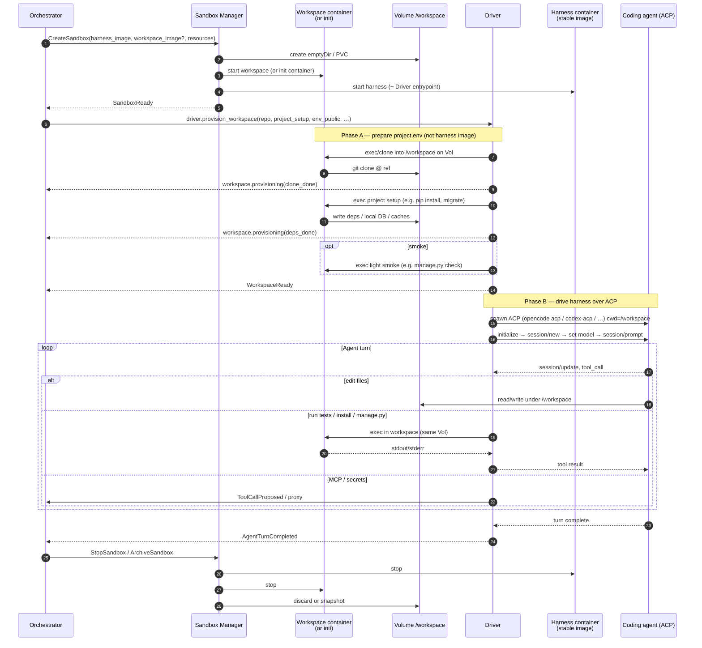

# Sandbox layout — harness vs workspace (project env)

This document refines **Layer 2 (workspace provision)** and how a sandbox is
composed so that:

1. **Harness images stay stable** (`opencode` / `pi` / `codex` / `grok` agent images).
2. **Project / dev environment setup is separate** — dependencies, language
   toolchains, migrations, and tests do **not** mutate harness image layers.
3. Driver and agent still work end-to-end on a real repo (clone → install → ACP).

Related:

- Layers and components: [`README.md`](./README.md)
- Commands/events: [`events.md`](./events.md), [`events-overview.md`](./events-overview.md)
- Sandbox driver (current prototype): [`crates/fleet-sandbox-driver/`](../../crates/fleet-sandbox-driver/) ([`sandbox-lab/`](../../crates/fleet-sandbox-driver/sandbox-lab/), [`agents/`](../../crates/fleet-sandbox-driver/agents/))
- Process worker: [`crates/fleet-driver/README.md`](../../crates/fleet-driver/README.md)
- Contracts: `ProvisionWorkspace` in `crates/agent-fleet-contracts`

---

## 1. Why split harness and project env?

| Concern | Harness container | Workspace (project env) container / volume |
| --- | --- | --- |
| Role | Run coding agent over **ACP** | Hold **source + deps + build/test** tooling |
| Image stability | **High** — rebuild rarely | **Low / per-project** — every app differs |
| Mutates on the job | Config under `$HOME`, not project installs | `node_modules`, venv, `target/`, DB files, caches |
| Examples | `agent-fleet-opencode:alpine`, `agent-fleet-pi:alpine`, … | `python:3.13`, project Dockerfile, or lab workspace image |

Installing `pip install -r requirements.txt` **into** the OpenCode/Codex/Grok
image would make those images non-reproducible and project-specific. The fleet
must not do that.

**Rule:** harness images remain boring and immutable. Project variance lives in
a **workspace** side of the same sandbox (volume + optional second container).

---

## 2. Topology

A **sandbox** is one unit of isolation (pod / compose project / VM). Internally
it may contain **more than one container**:

```
┌─ Sandbox ─────────────────────────────────────────────────────────────┐
│                                                                        │
│  Orchestrator ──control channel──► Driver                              │
│                                      │                                 │
│                    ┌─────────────────┴─────────────────┐               │
│                    │                                   │               │
│                    ▼                                   ▼               │
│  ┌─ harness ──────────────────┐     volume: workspace-data            │
│  │ stable agent image         │◄════ /workspace ═══════════════════╗  │
│  │ opencode|pi|codex|grok+ACP │                                    ║  │
│  │ (driver often co-located)  │     ┌─ workspace ────────────────┐ ║  │
│  └────────────────────────────┘     │ project / language image   │═╝  │
│                                     │ clone, install deps, tests │    │
│                                     │ (or one-shot init only)    │    │
│                                     └────────────────────────────┘    │
└────────────────────────────────────────────────────────────────────────┘
```

### How they connect

| Link | Mechanism |
| --- | --- |
| **Same files** | Shared volume mounted at `/workspace` (or equivalent) on both |
| **Same lifecycle** | Sandbox Manager creates/destroys the whole unit |
| **Control** | Driver: provision/exec on workspace, ACP stdio on harness |
| **Build/test from agent** | Tool calls routed by driver as **exec into workspace**, not into harness rootfs |
| **Network** | Internal pod/compose network; optional workspace helper HTTP on loopback only |

UID/GID for writers on the volume must match (e.g. both `1000:1000`).

---

## 3. End-to-end sequence

Happy path from task accept through first agent turn and teardown.



### Milestone events (provision)

Recommended `workspace.provisioning` milestones (extend existing catalogue):

| Milestone | Meaning |
| --- | --- |
| `clone_started` / `clone_done` | Source on volume |
| `workspace_image_ready` | Workspace container/init available |
| `deps_install_started` / `deps_install_done` | Project libraries installed **on volume** (or into workspace container FS that backs the mount) |
| `project_bootstrap_done` | Migrations, `.env` template, generated dirs, etc. |
| `smoke_ok` | Optional success criteria before agent turns |
| `harness_configured` | Provider/config for OpenCode/Codex/Grok under harness `$HOME` |

`workspace.ready` means: **agent can run turns with cwd on a prepared tree** —
not merely “git clone finished.”

---

## 4. What stays in which image

| In **harness** image (stable) | In **workspace** (per job / per project) |
| --- | --- |
| Agent binary (`opencode`, `pi-acp`/`pi`, `codex-acp`, `grok`) | Language runtimes matching the **app** (e.g. Python 3.13) |
| Minimal OS + git (if needed for agent) | `requirements.txt` / lockfile installs |
| ACP entry + driver (optional co-location) | App services for local smoke (DB files, migrate) |
| Provider config under `$HOME` | Playwright/Node **if** the project’s evidence needs them in-env |
| No project `node_modules` / venv in image layers | Caches optionally restored via `caches[]` mounts |

---

## 5. Project setup contract (direction)

Today `ProvisionWorkspace` carries `repo`, `agent`, `caches`, `env_public`,
`network_profile`, `success_criteria`. Project dependency install is only
**implied**. Direction for the contract (not all implemented yet):

```text
project_setup?: {
  # How to prepare the app env on the workspace side
  strategy: "detect" | "commands" | "image" | "script"

  # Prefer in-repo contract when present (cf. managed-repo scripts)
  script?: "scripts/fleet-setup.sh"   # or ci/bootstrap

  # Explicit commands if no script (workspace container exec)
  commands?: string[]                 # e.g. ["python -m pip install -r requirements.txt", …]

  # Optional workspace container image override
  workspace_image?: string            # e.g. python:3.13-bookworm or project Dockerfile tag

  # Optional smoke after setup
  smoke_commands?: string[]
}
```

**Detection** can use lockfiles (`package-lock.json`, `Cargo.lock`, …) but
**in-repo scripts** are preferred when the team owns a known bootstrap path
(same idea as Ultramac managed-repo `ci.sh` / setup templates).

---

## 6. Sample project: `123-invoices`

Public sample for designing workspace setup:

**https://github.com/eugenepyvovarov/123-invoices**

Django invoices app: Python **3.13**, `requirements.txt`, optional **npm** for
Playwright, Docker/Compose for deploy, migrations, and operational scripts.

### Observed layout (signals for setup)

| Signal | Path / note |
| --- | --- |
| App kind | Django (`manage.py`, `requirements.txt`) |
| Python | 3.13 (README + Dockerfile) |
| Python deps | `pip install -r requirements.txt` |
| Env template | `env.example` → `.env` |
| Local data dirs | `db/`, `media/` |
| Bootstrap | `python manage.py migrate` |
| Dev server | `python manage.py runserver` |
| Node (evidence) | `package.json` + Playwright for smoke/UI evidence |
| Container truth | Root `Dockerfile` (multi-stage, Alpine builder with system libs) |
| Compose | `docker-compose.yml` (web / scheduler / MCP in full deploy) |

### Suggested workspace preparation (illustrative)

**Workspace image options:**

1. **Generic:** `python:3.13-bookworm` (or slim) + install system packages as needed for WeasyPrint/cairo if not using app Dockerfile.  
2. **Better fidelity:** build workspace from the repo **`Dockerfile`** (or `Dockerfile` target `test` / builder) so system libs match CI.  
3. **Harness:** remains `agent-fleet-opencode:alpine` / `agent-fleet-pi:alpine` (or codex/grok) with **no** `pip install` of app deps into that image.

**Provision commands** (run **in workspace**, on shared `/workspace`):

```bash
# after git clone into /workspace
cp -n env.example .env || true
mkdir -p db media
python -m pip install -r requirements.txt
python manage.py migrate --noinput
# optional smoke:
python manage.py check
# optional evidence toolchain (heavier; may be a second stage):
# npm ci && npx playwright install --with-deps
```

Or a single in-repo script if the project adds e.g. `scripts/fleet-setup.sh`
wrapping the above.

**During an agent turn:**

- File edits: harness ACP, files on volume.  
- `pytest` / `manage.py test` / Playwright: driver **exec in workspace** so Python/Node match the project image.  
- Full stack preview: optional Compose **inside** workspace network namespace (advanced); not required for MVP.

### Mapping to fleet job fields (lab / future)

```json
{
  "harness": "opencode",
  "repo_url": "https://github.com/eugenepyvovarov/123-invoices.git",
  "git_ref": "main",
  "model": "provider_id/model_id",
  "project_setup": {
    "strategy": "commands",
    "workspace_image": "python:3.13-bookworm",
    "commands": [
      "cp -n env.example .env || true",
      "mkdir -p db media",
      "python -m pip install -r requirements.txt",
      "python manage.py migrate --noinput"
    ],
    "smoke_commands": [
      "python manage.py check"
    ]
  },
  "prompt": "…"
}
```

When the repo ships a canonical bootstrap script, prefer
`"strategy": "script", "script": "scripts/fleet-setup.sh"` (or the project’s
existing CI entrypoint) over hard-coding commands in the orchestrator.

---

## 7. Sandbox prototype vs target

| | **Sandbox today** (`crates/fleet-sandbox-driver`) | **Target** |
| --- | --- | --- |
| Sandbox unit | **One Compose project per task** (`fleet-task-<id>`) | One pod/VM per task (Sandbox Manager) |
| Containers | redis + workspace + driver (harness base image) | Same pattern in k8s pod |
| Volume | **Own volume per task** (`{project}_sandbox-workspace`) — never share across tasks | PVC / emptyDir per sandbox |
| Deps install | Workspace agent on **that** volume only | Workspace-only install |
| Coordination | `/workspace/.fleet/request-*.json` + named tools | Exec API / k8s exec as needed |
| Project commands during turn | **`fleet-wsexec <tool>`** → workspace agent | Same model |
| Harnesses | **opencode**, **pi** ([pi.dev](https://pi.dev) via `pi-acp`), images for codex/grok | Multi-harness registry |
| Sample validation | dual invoices jobs (OpenCode + Pi) + minimal-node | Broader project matrix |
| Git branches | **Not** created by driver (fresh clone of `git_ref`) | Orchestrator / VCS integration |

Sandbox path implemented:

1. **Per-task sandbox:** `COMPOSE_PROJECT_NAME=fleet-task-<id>` → isolated redis + workspace + volume + driver. Torn down after run (`KEEP_SANDBOX=1` to keep).  
2. Driver writes provision request; workspace agent clones + runs `project_setup` under **`/workspace/jobs/{job_id}/repo`** on **that** volume.  
3. Workspace writes `.fleet-tools.json` (named allowlist) + installs `fleet-wsexec`.  
4. ACP only on harness (`opencode acp` or `pi-acp`) with `cwd` = job tree; file edits on the volume.  
5. Agent runs project checks via **`fleet-wsexec <name>`** (no free shell into workspace).  
6. Result on **task redis** + compact host-side summary (quiet by default; `VERBOSE=1` / `FULL_TRANSCRIPT=1`).  
7. **Two-harness dual sample:** OpenCode marker job + Pi model-field job, sequential sandboxes (`run-invoices-dual.sh`).

---

## 8. Invariants

1. **Harness images are not project install targets.**  
2. **Workspace holds project env variance** (container and/or volume content).  
3. **Volume is the file connection within one sandbox**; **driver** is the control connection.  
4. **One task → one sandbox → one volume** — tasks must not share a workspace volume.  
5. **Secrets** stay short-lived / proxied (existing product rule).  
6. **`workspace.ready`** implies prepared env, not only a bare git checkout.  
7. **Project commands during turns** go through named allowlisted tools, not free shell.

---

## 9. Open questions

- Workspace image selection: generic language matrix vs build-from-repo Dockerfile always.  
- Whether Playwright/`npm` evidence runs in the same workspace container or a dedicated evidence image.  
- Cache strategy: mount `caches[]` for pip/npm keyed by lockfile hash.  
- Contract fields for `project_setup` in `agent-fleet-contracts` (follow-up PR).
- Harness matrix (OpenCode / Pi / Codex / Grok): model config surface + permission UX differences.
- Parallel sandboxes vs sequential lab dual-run; Sandbox Manager ownership of compose/k8s lifecycle.

---

## 10. Harness access model: volume + allowlisted tools

The harness does **not** get a free shell into the workspace. It gets:

1. **Code via shared volume** — job tree at `/workspace/jobs/{job_id}/repo` (read/write via ACP file tools).
2. **A fixed set of named tools** defined **per project** (narrowed per job if needed).

```
Harness (stable image)
  ├─ volume mount → job source tree
  └─ fleet-wsexec <tool-name>  ──► workspace agent
                                      ├─ loads .fleet-tools.json (allowlist)
                                      ├─ runs fixed argv only
                                      └─ cwd must be under /workspace/jobs/{job_id}/
```

### Project tool definition (job / project config)

```json
"project_setup": {
  "commands": ["python -m pip install -r requirements.txt", "..."],
  "tools": {
    "django_check": {
      "argv": ["python", "manage.py", "check"],
      "description": "Django system check"
    },
    "django_test_fleet": {
      "argv": ["python", "manage.py", "test", "tests.test_fleet_smoke", "--verbosity", "2"],
      "description": "Single targeted unit test"
    },
    "django_test": {
      "argv": ["python", "manage.py", "test"],
      "description": "Full suite (optional / may timeout)"
    }
  }
}
```

- Provision writes `.fleet-tools.json` (+ `FLEET_TOOLS.md`) into the job work_dir.
- Agent is instructed to use `fleet-wsexec django_check`, not arbitrary shell.
- Raw `action=exec` is **disabled** unless `FLEET_ALLOW_RAW_EXEC=1` (debug only).

### ACP permissions

- `auto_approve` defaults to **false**.
- `permission_allow` is an explicit allowlist (no `"*"` in production-minded samples).
- **Path-like entries** (`app/`, `tests/`, `invoices/`) **gate file mutations** (write/edit/create): the permission haystack must contain a matching prefix.
- Other tokens match as substrings (`fleet-wsexec`, `read`, …). Bare `bash`/`sh` is denied unless `"*"`.
- Prefer named workspace tools (`fleet-wsexec`); no free shell.

### Working lab example: 123-invoices

```bash
# once: harness images (opencode, pi, …)
./crates/fleet-sandbox-driver/agents/build.sh

cd crates/fleet-sandbox-driver/sandbox-lab
cp -n .env.example .env
# OPENCODE_BASE_URL / MODEL / OPENCODE_API_KEY / SSH_KEY_HOST_PATH
# (must reach LM Studio from inside the driver container)

# single task sandbox (quiet by default)
./scripts/run-invoices-example.sh config/job.123-invoices.opencode.json
./scripts/run-invoices-example.sh config/job.123-invoices.pi.json

# two tasks = two sandboxes (sequential; same model OK)
./scripts/run-invoices-dual.sh

# VERBOSE=1 FULL_TRANSCRIPT=1  — more log / full model transcript
# KEEP_SANDBOX=1               — leave volume for inspection
```

What each run does (**one task = one sandbox**):

1. Unique Compose project + **own volume** (`fleet-task-<id>_sandbox-workspace`)
2. Task redis + workspace (no host redis port; no shared `/workspace`)
3. Publish job → run driver once on harness base image (`DRIVER_BASE_IMAGE`)
4. Compact result + truncated transcript; teardown (`down -v`) unless `KEEP_SANDBOX=1`

| Job | Harness | Agent task | Edit allowlist | Required tools |
| --- | --- | --- | --- | --- |
| [`job.123-invoices.opencode.json`](../../crates/fleet-sandbox-driver/sandbox-lab/config/job.123-invoices.opencode.json) | opencode | `app/fleet_marker.py` + smoke unit test | `app/`, `tests/` | check → migrate → `django_test_fleet` (→ full `django_test` optional) |
| [`job.123-invoices.pi.json`](../../crates/fleet-sandbox-driver/sandbox-lab/config/job.123-invoices.pi.json) | pi | `Animal.notes` field + migration + test | `invoices/`, `tests/` | makemigrations → migrate → check → `django_test_fleet` (→ full suite optional) |

Full suite timeout/fail is OK to report (stretch). Git **branches are not** created; each task is a fresh clone of `git_ref` into its sandbox volume.

Non-Django shape: [`job.minimal-node.json`](../../crates/fleet-sandbox-driver/sandbox-lab/config/job.minimal-node.json).

### Policy defaults (production-minded lab)

| Control | Default | Notes |
| --- | --- | --- |
| `auto_approve` | **false** | Never auto-allow all ACP permissions |
| `permission_allow` | **[]** | Empty = deny; path prefixes gate writes; samples avoid `"*"` |
| Sandbox volume | **per task** | Lab compose project prefixes the volume name |
| work_dir | `/workspace/jobs/{job_id}/repo` | Under the task volume; outside `/workspace/jobs/` rejected for tools |
| Raw workspace shell | off | `FLEET_ALLOW_RAW_EXEC=1` debug only |
| Project commands | named tools | `fleet-wsexec <name>` → fixed argv in workspace |

Driver policy: `crates/fleet-sandbox-driver/src/policy.rs`.  
Harness registry + Pi models.json: `crates/fleet-sandbox-driver/src/{harness,pi_config,opencode_config}.rs`.  
Images: `crates/fleet-sandbox-driver/agents/`.
