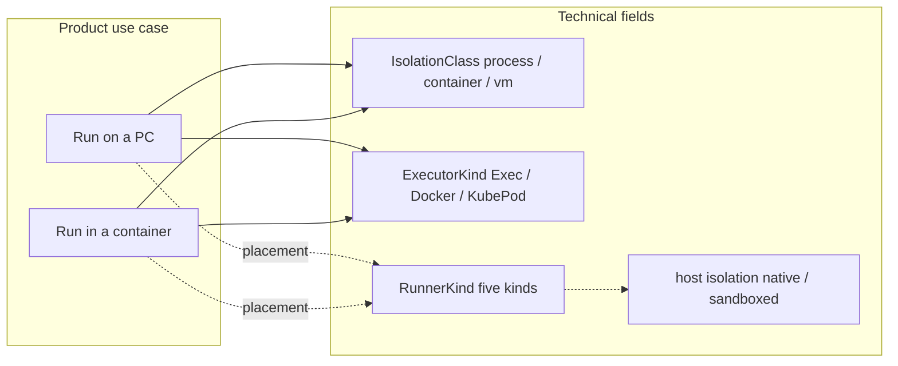

# Run on a PC vs Run in a container

| Field | Value |
| --- | --- |
| **Author** | Agent Fleet |
| **Date** | 2026-09-12 |
| **Status** | Draft |
| **Tree** | `origin/main` (includes MR 45, `4ca6f20` fleet workers on paired runners) |
| **Audience** | Implementers of `fleet-db`, `fleet-server`, `fleet-orchestrator`, `fleet-host`, `fleet-driver`, `fleet-operator`, `fleet-ui` |

This is the user-facing use-case split for **how a guest runs**. It is not a
sixth runner kind. The five kinds in
[`README.md`](README.md) stay placement / ownership
(self-hosted native, self-hosted sandbox, public cloud, Fleet Cloud,
Partners). Isolation `process < container < vm` and host
`native | sandboxed` stay as the existing technical fields in
[`crates/agent-fleet-contracts/src/isolation.rs`](../../../crates/agent-fleet-contracts/src/isolation.rs)
and `worker_hosts.isolation`.

Do **not** rename `fleet-host`, `fleet-driver`, `worker_hosts`, or the
API paths `/api/workspaces/{id}/worker-hosts` and `/api/worker-hosts/…`.
Do **not** invent a second spawn path or a second claims table. Tick
still enqueues `work_claims` (`kind = spawn_session` / `chat_turn` /
`signal_session`); `fleet-host` still leases and execs.

---

## Overview

Agent Fleet today has one assignment path
(`select_assignable_runner` / `select_assignable_runner_preferring` in
[`crates/fleet-orchestrator/src/store/host_pool.rs`](../../../crates/fleet-orchestrator/src/store/host_pool.rs))
and two *technical* ways a guest can start. The **picker** speaks
`HostRuntime` (`Host` \| `Container`) in `host_pool.rs`. The **claim**
speaks `JobRuntime` (`Host` \| `Container` \| `Vm`) in
[`crates/fleet-host/src/client.rs`](../../../crates/fleet-host/src/client.rs).
`fleet-host` then execs `run_host` / `run_container` in
[`spawn.rs`](../../../crates/fleet-host/src/spawn.rs).
The product does not yet say which of those is a **use case**. That
ambiguity is why the Kind bootstrap host (`labels` contains `cluster`,
`created_by IS NULL`) is in every workspace’s **assignable set**
(`list_assignable` is `workspace_id = $1 OR cluster`), why Settings
`min_isolation` can look like a mode switch, and why docs still say
container is “not v1” while in-cluster `fleet-host` advertises
`KubePod`.

This design locks two first-class use cases. A given **machine** is only
one of them. A given **job** is only one of them. A **workspace** can
use both (Maya’s laptop + a Kind/k8s farm). There is no silent
fallback: no host of that kind → the task stays `ready`.

**Run on a PC** — the computer *is* the place. The agent is a normal
program on that machine. Credential is the official CLI login already
on that `$HOME` (`grok login`, Claude, Ollama). Chat and fleet jobs
both run this way. Session dirs are one household under
`~/.local/share/fleet-host/work/<session>/`. This is not a vault.

**Run in a container** — you *send* the work into a container. That
container may live on your PC, a machine you own, someone else’s
machine, a cloud VM, or your k8s. Location does not change the use
case. Plane I/O stays the per-job `FLEET_WORKER_TOKEN`. A real
vendor CLI in the guest needs a **workspace LLM/API key** (for
example `XAI_API_KEY`), encrypted like OAuth, never a copied
`~/.grok/auth.json`. Jobs do not share a home directory.

---

## Background & Motivation

### Current state (what the tree actually does)

| Layer | What exists | File |
| --- | --- | --- |
| Five kinds | Self-hosted native is the only assignable kind. Cloud / Partners / public-cloud are placeholders. | [`docs/components/runners/README.md`](README.md), `RunnerKind` in `host_pool.rs` |
| Host isolation | `worker_hosts.isolation` is `native` (assignable) or `sandboxed` (not assignable). | [`015_runner_isolation.sql`](../../../crates/fleet-db/migrations/015_runner_isolation.sql) |
| Workspace floor | `workspaces.min_isolation` is `process \| container \| vm`, default `process`. | [`020_workspace_min_isolation.sql`](../../../crates/fleet-db/migrations/020_workspace_min_isolation.sql) |
| Plane ∩ advertised | `allow_host` / `allow_container` × `advertised_host` / `advertised_container`. | `WorkerHost::effective_host` / `effective_container` |
| Tick | `schedule_and_spawn` → `select_assignable_runner_preferring` → `enqueue_remote_spawn` → `work_claims`. No host → leave `ready`. | [`orch/spawn.rs`](../../../crates/fleet-orchestrator/src/orch/spawn.rs) |
| V1 picker | Production tick is `select_assignable_runner_preferring` (`orch/spawn.rs`). It does **not** filter to `HostRuntime::Host`. It calls `effective_runtime_for` → `pick_isolation` (weakest offer ≥ need), so a process-need can enqueue `runtime=container`. `select_assignable_runner` (unused by tick) keeps Host only. | `host_pool.rs` |
| Lease gate | Live `/me/lease` calls `host_accepts_leases` (`fleet-server/src/worker_hosts.rs`): native + `effective_host()` + not paused/drain/updating/at-cap. **No** cluster/container exception. `WorkerHost::accepts_v1_leases` (native + host **or** cluster+container) is **not** the production gate. | `worker_hosts.rs` `http_lease` |
| Cluster assignable-set leak | `list_assignable_filtered` is `WHERE (workspace_id = $1 OR CLUSTER_LABEL_SQL)` plus `last_seen_at IS NOT NULL` and the usual taking-jobs filters. Encoded by `list_cluster_and_assignable_match_cluster_label_case`, `patch_cp_settings_omitted_labels_keeps_cluster_cross_ws`, `cluster_host_completes_claim_in_other_workspace`. | [`worker_hosts.rs`](../../../crates/fleet-db/src/repos/worker_hosts.rs) |
| Cluster GET list | HTTP GET is already home-workspace-only for foreign cluster cards (`cluster_host_not_injected_into_other_workspace_list`). `load_visible_host` still returns any `is_cluster_host` (chat `?runner_id=`). | `http_list`, `load_visible_host` |
| Cluster lease scope | Cluster and this-machine IP use unscoped `claim_next_spawn_for_host`; regular hosts use `claim_next_spawn_for_host_in_workspace`. | `http_lease` |
| This-machine share | `list_assignable_by_hostnames` + advertised IP adds the CP laptop to every workspace on this plane. | `list_assignable_hosts` in `host_pool.rs` |
| Chat | `POST /chat` requires `runner_id`; `runner_chat::require_taking` requires `effective_host()`. Official CLI on the box; plane never reads `auth.json`. | [`runner_chat.rs`](../../../crates/fleet-server/src/runner_chat.rs) |
| Inbox / cases | `require_taking_runner` + `preferred_host_id` on the plan. | [`tickets.rs`](../../../crates/fleet-server/src/tickets.rs), [`cases.rs`](../../../crates/fleet-server/src/cases.rs) |
| Preferred host | MR 45: `plan.policy.preferred_host_id`; tick prefers that id when still assignable. | `chat_tools.rs` `stamp_plan_llm`, `spawn.rs` |
| Guest I/O | Plane packs `TEAM.md` / `work/` / `fleet-tool.sh` into `spawn_session.workspace_files`. Guest posts back via `POST /v1/.../workers/{id}/io`. | [`guest_files.rs`](../../../crates/agent-fleet-contracts/src/guest_files.rs), [`remote.rs`](../../../crates/fleet-orchestrator/src/sandbox/remote.rs) |
| KubePod | In-cluster `fleet-host` creates `FleetSandbox` CRs. Operator turns them into pods. No `auth.json` in the CR today; `FLEET_*` only. | [`exec_k8s.rs`](../../../crates/fleet-host/src/exec_k8s.rs) |
| Docs lie | Worker-host README: “Container mode: not supported in v1”. Infra README: in-cluster host advertises `KubePod`. | [`worker-host/README.md`](../worker-host/README.md), [`infra/README.md`](../../../infra/README.md) |

### Pain points

1. **Cluster host is in every workspace’s assignable set.**
   Bootstrap (`POST /api/worker-hosts/bootstrap`, `created_by IS NULL`,
   `labels = ['cluster']`) matches `list_assignable` for workspace B.
   That is an **assignable-set leak**, not “leases as a PC.” Kind’s
   real bootstrap is container-only (`FLEET_HOST_RUN_HOST=false` /
   `FLEET_HOST_RUN_CONTAINER=true` in `infra/base/host.yaml`); tick
   may enqueue `runtime=container` via `preferring`+`pick_isolation`,
   but `/me/lease` still requires `effective_host()` so a container-only
   farm cannot take the claim today. Tests that pair a normal host
   then stamp `cluster` (`cluster_host_completes_claim_in_other_workspace`)
   are the “as if it were a PC” case. HTTP GET list does **not** show
   foreign cluster cards. After this design the farm is a
   **plane-global in-container lab farm** (any workspace may use it
   for **Run in a container** jobs only).
2. **`min_isolation` looks like a mode switch.** Settings
   (`fleet-ui` Isolation select, `PATCH /api/workspaces/{id}/fleet/settings`)
   cannot promote an on-pc household into a container guest. Today
   `pick_isolation` will upgrade a process-need to Container when the
   only offer is container (`container_only_host_is_assignable` in
   `host_pool.rs`; `select_assignable_host_process_need_assigns_container_only`
   in `host_picker_product.rs`). That is a silent fallback across use cases.
3. **Chat and fleet share a picker that does not know about send-ACL.**
   Anyone who can see the host card can send chat_turn and
   `preferred_host_id` fleet work. “People I allow → my PC” does not
   exist. `created_by` is stored on `WorkerHost` and unused for
   assignment (`AssignableHost` has no `created_by` today).
4. **Credentials are implied, not declared.** On-pc work needs
   `grok login` on that `$HOME`. In-container plane I/O already has
   `FLEET_WORKER_TOKEN`. A real Grok-in-pod needs a workspace
   `XAI_API_KEY` (or sibling vendor key), not a second plane token
   and not `auth.json`. Heartbeat reports `agent_runtimes[].logged_in`
   from a **local parse** of `auth.json` (`grok_session_fresh` reads
   the file, checks `key` non-empty + `expires_at`; bytes never go
   on the wire).
5. **Copy contradicts the executor.** UI SandboxBlock still says
   “Allow process jobs” / “Allow container jobs” as if those were
   the product. Worker-host README says container is not v1.
   In-cluster host already creates CRs.

---

## Goals & Non-Goals

### Goals

- Two use cases, both first-class, named **Run on a PC** and **Run in a
  container**. The same sentence is true at product, workspace, machine,
  and job.
- Several PCs per workspace, each with a **who-may-send** permission
  (only me / people I allow / anyone in the workspace). Permissions
  are not extra products.
- Every surface that assigns, lists, or describes a runner includes
  the split. Same picker, extra predicates. No silent fallback.
- Fail closed: no host of that kind, send-ACL deny, or (real
  in-container vendor harness) no matching workspace LLM key →
  task stays `ready` (fleet) or HTTP 400 (chat / on-pc inbox finish).
  Kind mock/lab guests do not need a vendor key.
- One MR, implemented in order: send-ACL + stop global cluster
  assign first, then stamps, vendor keys, Kind guest, copy. Kind
  green at merge.

### Non-goals

- Renaming `fleet-host`, `fleet-driver`, `worker_hosts`, or API paths.
- A second spawn path, second claims table, or a new executor binary.
- Making Cloud / Partners assignable. They inherit the
  **Run in a container** sentence; they stay placeholders
  (`RunnerKind` still not assignable).
- Changing isolation `process < container < vm` or host
  `native | sandboxed`. Those remain technical.
- Attaching a TUI leader (`grok agent` without `--no-leader`). We
  never attach.
- Copying `~/.grok/auth.json` / Claude session keys into pods, CRs,
  env, or images.
- A vault, per-job homedir encryption, or multi-tenant hardening of
  the on-pc household.
- Money, Partners credit, or a cloud provider key flow.

### Names we will not use as the product split

Do **not** ship this as Small/Enterprise, Assist/Delegate,
Workstation/Sandbox, or Native/Sandboxed. Those words already mean
other things (SKU, chat vs fleet, five kinds, `worker_hosts.isolation`).

---

## Mental model

A stranger should be able to repeat this:

> **Run on a PC** means the computer is the place. The agent is a
> normal program next to your files. You (and only the people you
> explicitly allow) send work to *that machine*. Chat lives here
> because that is where you typed `grok login`. Sibling jobs can see
> each other’s session folders. This is not a vault.
>
> **Run in a container** means you send the work away into a box
> that is not your desktop. The box might sit on your desk, in the
> studio, or in k8s — that does not change what it is. The guest
> talks to the plane with the job token. A real model needs a
> workspace LLM key, not your login file. Jobs do not share
> a home. If you have no container host, the task waits.
>
> A workspace can have both (laptop + farm). A machine is only one.
> A job is only one. We never quietly move a job from your PC into
> a container, or from a container onto your desktop.

Several PCs are normal. Maya’s laptop is “only me”. The studio Mac
mini is “anyone in the workspace”. A second laptop Maya shares with
Jordan is “people I allow”, and the UI must sound like a security
issue.

---

## Mapping to existing technical fields

The product split is **not** any of the columns we already have. Those
columns stay; this table is the contract so they do not contradict
the use case.

| Existing field | Where | Stays meaning | Relation to the split |
| --- | --- | --- | --- |
| Five kinds (`RunnerKind`) | `host_pool.rs`, runners README | Who owns the machine / pool | Orthogonal. Self-hosted native is how you *place* an on-pc machine. Cloud / Partners / self-hosted sandbox are how you *place* an in-container farm later. |
| `worker_hosts.isolation` `native \| sandboxed` | `015_runner_isolation.sql`, `parse_worker_host_isolation` | Host-level product isolation. Only `native` is assignable today. | On-pc hosts are `native`. In-container hosts may be `native` (Kind `fleet-host` process) while the *guest* is a container. `sandboxed` remains the five-kind placeholder (Self-hosted sandbox / Cloud / Partners) and stays **not assignable** until a later kind PR. Do not flip this column to express the use case. |
| `IsolationClass` `process < container < vm` | `isolation.rs`, `workspaces.min_isolation` | Weakest isolation a *job* is promised | On-pc jobs are `process`. In-container jobs are `container` (or `vm` when that executor exists). `min_isolation=container` must **not** take an on-pc host. `min_isolation=process` must **not** take an in-container host as a silent upgrade. |
| `allow_host` / `allow_container` | `worker_hosts`, UI SandboxBlock | Plane restriction on executor class | Intersection with advertised flags. On-pc requires effective host (`allow_host && advertised_host && local.run_host`). In-container requires effective container. These are **not** the use-case stamp. |
| `advertised_host` / `advertised_container` | heartbeat | What the box can actually exec | Capability, not use case. A PC that also has Docker still does not become in-container until the host row is stamped `in_container`. |
| `ExecutorKind` `Exec \| Docker \| KubePod \| …` | `isolation.rs`, `spawn.rs` `pick_container_executor` | How the host starts a guest | On-pc → `Exec`. In-container → `Docker` or `KubePod` (in-cluster / kubeconfig). Never fall back `KubePod` → `Exec`. |
| `HostRuntime` `Host \| Container` | `host_pool.rs` | What the picker chose | Maps 1:1 to claim `runtime` after this design (`on_pc`→Host, `in_container`→Container). |
| `JobRuntime` `Host \| Container \| Vm` | `fleet-host/src/client.rs`, spawn payload `runtime` | What the claim asks the host to start | On-pc jobs enqueue `runtime=host`. In-container jobs enqueue `runtime=container`. |
| `labels` `cluster` | `022` / `023`, `is_cluster_host` | Bootstrap-only in-cluster guest | **Plane-global in-container lab farm.** Any workspace may use it for **Run in a container** jobs. No tenant isolation on that host. Card stays home-workspace. Never a **Run on a PC** runner. HTTP PATCH must still refuse to stamp `cluster` on a UI-paired PC (`created_by` set). |
| `created_by` | `worker_hosts.created_by` | Who created the pair row | Default subject of “only me”. Bootstrap is `NULL`. Not on `AssignableHost` today — PR 1 adds it. |
| `host_accepts_leases` | `fleet-server/src/worker_hosts.rs` `http_lease` | Live lease gate: native + `effective_host()` + pause/drain/update/cap | **The one gate.** After PR 2: on-pc → `effective_host()`; in-container → `effective_container()` (plus existing pause/drain/update/cap). Delete or alias `WorkerHost::accepts_v1_leases` so it cannot drift. |
| `use_host_git_credentials` | `LocalConfig`, `run_host` in `spawn.rs` | Child sees host `~/.git-credentials` | On-pc default `true` (the household). In-container must be `false` (no host HOME). |
| `preferred_host_id` | `plan.policy` | MR 45 this-machine / composer runner | Still honored, **after** send-ACL and run-mode match. |



---

## Proposed Design

### 1. Stamp the use case on four layers

The same vocabulary, persisted in four places. No layer infers the
other.

| Layer | New field | Allowed values | Who writes it | Default |
| --- | --- | --- | --- | --- |
| **Machine** (`worker_hosts`) | `run_mode` | `on_pc` \| `in_container` | Pair / bootstrap / owner PATCH | UI pair: `on_pc`. Bootstrap cluster: `in_container`. |
| **Job / plan** | `policy.run_mode` (PR 2) and `policy.requested_by` (**PR 1**) | `run_mode` same; `requested_by` is a user UUID | Chat / inbox / cases / Start run stamp the **clicker** | Chat: always `on_pc` + cookie user. Fleet Start run (`post_fixture`): cookie user. Inbox/cases: finishing / launching user. |
| **Workspace** | `default_run_mode` (chunk 2) | same | Owner or admin only (not `require_member`) | `on_pc` (chat-shaped default). |
| **Workspace** | `default_send_policy` (chunk 1) | `owner_only` \| `allowlist` \| `workspace` | Owner or admin | `owner_only`. Ceiling for each new pair (see pairing). |
| **Claim payload** | `run_mode` next to existing `runtime` | same | `enqueue_remote_spawn` copies from the plan | Must equal the host’s `run_mode`. Host refuses mismatch. |

`runtime` (`host` \| `container`) stays the *executor* the host
starts. `run_mode` is the *use case*. Mapping is fixed:

| `run_mode` | `runtime` enqueued | `IsolationClass` promised |
| --- | --- | --- |
| `on_pc` | `host` | `process` |
| `in_container` | `container` | `container` (or `vm` if `min_isolation=vm` and a VM executor exists — not this series) |

If `min_isolation` is stronger than the use case can satisfy, **do
not switch use case**. Leave the task `ready` and write
`board_tasks.block_reason` (see §3.2 / Observability).

### 2. Send-ACL (who may send work to this computer)

This exists only for **Run on a PC**. In-container dispatch is a
workspace permission (who may *send container jobs*), not “come onto
my desktop”.

| Policy | Wire value | Meaning | Default |
| --- | --- | --- | --- |
| **Only me → my PC** | `owner_only` | Only `created_by` (the pairer) may land chat or fleet work. | **Yes** for a new personal pair. |
| **People I allow → my PC** | `allowlist` | Explicit user ids. Off by default. UI must sound unsafe. | No. |
| **Anyone in the workspace → a shared PC** | `workspace` | Any workspace member. Pairing asks “is this your computer or a shared box?”. | Only when the pairer picks “shared box”. |

Schema (new table, existing `worker_hosts` stays the machine):

```sql
-- PR 1: 033_worker_host_send_policy.sql
ALTER TABLE worker_hosts
    ADD COLUMN send_policy TEXT NOT NULL DEFAULT 'owner_only';

ALTER TABLE worker_hosts
    ADD CONSTRAINT worker_hosts_send_policy_check
    CHECK (send_policy IN ('owner_only', 'allowlist', 'workspace'));

CREATE TABLE worker_host_send_allowlist (
    host_id  UUID NOT NULL REFERENCES worker_hosts (id) ON DELETE CASCADE,
    user_id  UUID NOT NULL REFERENCES users (id) ON DELETE CASCADE,
    added_by UUID REFERENCES users (id) ON DELETE RESTRICT,
    added_at TIMESTAMPTZ NOT NULL DEFAULT now(),
    PRIMARY KEY (host_id, user_id)
);

ALTER TABLE workspaces
    ADD COLUMN default_send_policy TEXT NOT NULL DEFAULT 'owner_only';
ALTER TABLE workspaces
    ADD CONSTRAINT workspaces_default_send_policy_check
    CHECK (default_send_policy IN ('owner_only', 'allowlist', 'workspace'));
-- Allowlisted user MUST be a current workspace member at write time
-- (checked in the repo, not a composite FK — users persist after
-- remove_member). remove_member deletes matching allowlist rows.
```

**PR 1 cluster / bootstrap rule (no `run_mode` column yet):**
split **chat** vs **tick**. Cluster / `created_by IS NULL` is
**not a PC** for humans. Chat picker, `require_taking` 400
(`This runner is not Run on a PC`), `list_assignable_by_hostnames`
extras, and `load_visible_host` on the chat path (`?runner_id=` /
`chat_turn`) omit it. Rewrite
`chat_cluster_runner_id_status_on_other_workspace_is_200` in PR 1
to expect **400**.

**Tick in PR 1 does not run send-ACL on those rows.**
`send_acl_allows` stays false for cluster / `created_by IS NULL`
(so chat cannot use it). Preferring / tick applies
`send_acl_allows` only to **non-cluster** hosts. A home-workspace
bootstrap row that SQL still returns stays assignable for fleet
(today’s Kind fixture) until PR 2 stamps `in_container` and
`host_matches_job` excludes on-pc. Do not filter Kind tick
through `send_acl_allows` in PR 1.

Who may change the policy (field-level rules on the existing
`PATCH /api/workspaces/{id}/worker-hosts/{hid}`, today’s
`require_owner` is too coarse):

| Field | `created_by` (even if later demoted to member) | Other workspace owner | Admin / member |
| --- | --- | --- | --- |
| `send_policy` → `owner_only` (revoke share) | yes | yes | no |
| `send_policy` → `allowlist` or `workspace` | yes (warning on `workspace`) | `workspace` only | no |
| `send_allowlist` add/remove | yes, and only while `send_policy=allowlist` (else **400**) | no | no |
| `name`, `paused`, `drain`, `allow_*`, … | no (still workspace owner, unchanged) | yes | no |
| `run_mode` (PR 2) | yes if `current_jobs=0` | no | no |

`http_patch` stays one endpoint. After `require_user` +
`require_mutable_host`, apply the table above per field; forbidden
field → 403. `created_by` may PATCH `send_policy` /
`send_allowlist` without being a workspace owner.

Allowlist rules (locked):

- Allowlisted users **must be current `workspace_members`**. PATCH
  that names a non-member → 400.
- `created_by` may include themselves (redundant, allowed).
- Empty allowlist ≡ `owner_only` at assign time.
- `remove_member` (`workspaces.rs`) **must** delete
  `worker_host_send_allowlist` rows for that `(workspace, user)`
  (repo hook in the same transaction). Users are not deleted, so
  `ON DELETE CASCADE` on `users(id)` does nothing here.
- Tick `SendPolicy::Workspace` **re-checks** `workspace_members`
  for `requested_by` (fail-closed). Do not trust insert-time
  membership.

Pause / drain (already on the row) are orthogonal: they stop *new*
leases for everyone, including the owner. They do not change who
*would* be allowed. Update-in-progress already stops claiming
without flipping pause/drain — keep that.

### 3. Picker predicates (same functions, extra filters)

Do not add `select_assignable_on_pc` as a second path. Extend
`list_assignable` / `select_assignable_runner_preferring` /
`require_taking` with explicit predicates. Production tick stays
`select_assignable_runner_preferring` in
[`orch/spawn.rs`](../../../crates/fleet-orchestrator/src/orch/spawn.rs).

#### 3.1 Candidate set (SQL)

Today
[`list_assignable_filtered`](../../../crates/fleet-db/src/repos/worker_hosts.rs):

```sql
WHERE (workspace_id = $1 OR {CLUSTER_LABEL_SQL})
  AND enabled AND NOT paused AND NOT drain
  AND (allow_host OR allow_container)
  AND isolation <> 'sandboxed'
  AND status = 'online'
  AND machine_token_hash IS NOT NULL
  AND last_seen_at IS NOT NULL
  AND last_seen_at >= $2
```

(`CLUSTER_LABEL_SQL` =
`EXISTS (SELECT 1 FROM unnest(labels) l WHERE lower(trim(l)) = 'cluster')`.)

**PR 1 change (correctness, still on-pc only):** drop the global
`OR cluster` from `list_assignable_filtered` (also used by
`list_online_runners`). Cluster hosts remain in `list_cluster` and
in the Self-hosted **card** list of their *home* workspace only
(`cluster_host_not_injected_into_other_workspace_list` stays).

```sql
-- PR 1 transitional (no run_mode column yet)
WHERE workspace_id = $1
  AND enabled AND NOT paused AND NOT drain
  AND (allow_host OR allow_container)
  AND isolation <> 'sandboxed'
  AND status = 'online'
  AND machine_token_hash IS NOT NULL
  AND last_seen_at IS NOT NULL
  AND last_seen_at >= $2
```

Drop **`OR cluster` only**. Do **not** add `AND NOT cluster`.
Home-workspace bootstrap stays in `list_assignable` so
`test_tick_creates_and_cancel_deletes_fleetsandbox` (signup is
usually the host’s home workspace) still *lists* the Kind host
until PR 2 stamps `in_container`. Foreign-workspace farm share is
the leak and is gone. Chat still treats cluster as **not a PC**
(400). Tick still must **skip send-ACL** on that row (see §3.3)
or Kind stays `ready`. `AND NOT cluster` would also red Kind in
PR 1 — we do not do that.

**PR 2 replacement** (cluster is a plane-global in-container farm):

```sql
WHERE (
        workspace_id = $1
     OR (run_mode = 'in_container' AND {CLUSTER_LABEL_SQL})
      )
  AND enabled AND NOT paused AND NOT drain
  AND isolation <> 'sandboxed'
  AND status = 'online'
  AND machine_token_hash IS NOT NULL
  AND last_seen_at IS NOT NULL
  AND last_seen_at >= $2
```

Callers that want on-pc bind `run_mode = 'on_pc'` (or filter in
Rust via `host_matches_job`) so the `OR cluster` branch never
matches. There is **no** per-workspace grant and **no** tenant
isolation on the Kind/bootstrap farm. Any workspace may land
**Run in a container** jobs there. Do not promise otherwise.

`list_assignable_by_hostnames` (this-machine extra) stays, but
**PR 1 omits `cluster` / `created_by IS NULL`**, and **on-pc
extras must still pass send-ACL**. Hostname match is not consent.
`host_advertises_local_addr` remains the anti-spoof for
cross-workspace *visibility*; send-ACL is the anti-spoof for
*assignment*.

Preload allowlists in the same assignable query (LEFT JOIN /
`allowlist_user_ids UUID[]` on the row) so `host_matches_job` is
not N+1.

#### 3.2 Run-mode + isolation (Rust, after the SQL list)

Add to `AssignableHost` (today it has no `created_by`):

```rust
pub struct AssignableHost {
    // existing fields…
    pub run_mode: RunMode,          // PR 2; PR 1 treats every non-cluster row as OnPc
    pub created_by: Option<Uuid>,
    pub send_policy: SendPolicy,
    pub allowlist_user_ids: Vec<Uuid>, // preloaded; empty unless allowlist
    pub is_cluster: bool,
    pub settings_acked: bool,       // PR 2: settings_gen == settings_ack_gen
}

pub enum RunMode { OnPc, InContainer }

/// What the picker is trying to place. Built once per task / chat turn.
pub struct JobNeed {
    pub run_mode: RunMode,
    pub actor: Option<Uuid>,          // plan.policy.requested_by, or cookie user
    pub min_isolation: IsolationClass,
    pub provider: Option<String>,     // grok/claude/… for vendor-key gate
}
```

`host_matches_job` is the **only** assign predicate. Tick, chat,
inbox, and cases must not call `pick_isolation` / the old
`effective_runtime_for` upgrade.

```rust
pub fn host_matches_job(host: &AssignableHost, job: &JobNeed) -> bool {
    if host.is_cluster && job.run_mode == RunMode::OnPc {
        return false;
    }
    if host.run_mode != job.run_mode {
        return false; // no silent fallback
    }
    if !host.isolation.is_assignable() {
        return false;
    }
    if !host.settings_acked {
        return false; // PR 2: run_mode PATCH not acked
    }
    match job.run_mode {
        RunMode::OnPc => {
            host.allow_host
                && host.advertised_host
                && send_acl_allows(host, job.actor)
                && job.min_isolation <= IsolationClass::Process
        }
        RunMode::InContainer => {
            host.allow_container
                && host.advertised_container
                && job.min_isolation <= IsolationClass::Container
                && in_container_vendor_ok(job)
        }
    }
}

/// Kind mock/lab: no vendor key. Real grok/claude-in-pod: matching
/// workspace LLM key. Optional `container_dispatch_enabled`.
fn in_container_vendor_ok(job: &JobNeed) -> bool { /* see §6 */ }

/// Pure mapping. Not a picker. Replaces the old upgrade helper on
/// the tick path.
pub fn runtime_for_run_mode(mode: RunMode) -> HostRuntime {
    match mode {
        RunMode::OnPc => HostRuntime::Host,
        RunMode::InContainer => HostRuntime::Container,
    }
}
```

**Callers and the new contract**

| Caller | Today | After |
| --- | --- | --- |
| `select_assignable_runner_preferring` (tick) | `effective_runtime_for` → `pick_isolation` (process may become Container) | Filter `host_matches_job`; enqueue `runtime_for_run_mode(job.run_mode)` only. |
| `select_assignable_runner` | Host-runtime only | Same filter; on-pc jobs only. Unused by tick; keep for chat fallback. |
| `select_assignable_host` | process-need can pick Container (`select_assignable_host_process_need_assigns_container_only`) | Same as preferring. Rewrite that test. |
| `pick_assignable_host` / `pick_assignable_runner` | in-memory wrappers using `effective_runtime_for` | Take `JobNeed`; no upgrade. Rewrite `container_only_host_is_assignable` in the PR that lands `run_mode` (PR 2): container-only host matches **in-container** jobs only. |
| `select_online_runner` | first native host-runtime, even at cap | on-pc + send-ACL only. Inbox stamp, not assign. |
| `composer_or_fallback` | `select_assignable_runner` then `select_online_runner` | Pass `JobNeed { run_mode: OnPc, actor: cookie/launch user, … }`. **Must not** stamp a cluster / in-container id onto an on-pc plan. |

Delete `effective_runtime_for` from the tick path (keep a unit
test that it is unused, or make it the pure mapping above).
`pick_assignable_host_in` may remain as load/cap/oldest ranking
**after** `host_matches_job` has filtered the list.

`select_assignable_runner_preferring`:

1. Build the candidate list (SQL above + this-machine extras).
2. Filter `host_matches_job`.
3. If `preferred` is set **and** that host is still in the filtered
   list — use it (PR 1: `pr1_tick_allows`; PR 2+: `host_matches_job`).
4. Else rank the filtered list (lowest load/cap, home workspace,
   oldest heartbeat).
5. Empty → `None` → task stays `ready`; spawn writes
   `block_reason` (see below).

Preferred host that fails send-ACL is **not** used and is **not**
replaced by a different mode. Log
`preferred_host_denied_send_acl` and fall through to another
**same-mode** host, or stay ready.

**`block_reason` writes (PR 2, `orch/spawn.rs`):** today tick
logs `"no assignable host; leaving task ready"` and does **not**
set `board_tasks.block_reason` (`tick_ops.rs` only writes it on
HITL `blocked`). Add `Store::set_ready_block_reason(task_id,
reason)` and call it when preferring returns `None`. Stable
strings: `no_host_for_run_mode`, `send_acl`, `no_vendor_key`,
`min_isolation`, `no_host`. Clear to NULL on the next successful
pick (`begin_spawn_assignment`). UI renders those strings.

#### 3.3 Send-ACL predicate

```rust
/// Desktop ACL only. False for cluster / created_by IS NULL
/// (those are not PCs). Chat always uses this.
pub fn send_acl_allows(host: &AssignableHost, actor: Option<Uuid>) -> bool {
    if host.is_cluster || host.created_by.is_none() {
        return false;
    }
    match host.send_policy {
        SendPolicy::OwnerOnly => actor == host.created_by,
        SendPolicy::Allowlist => match actor {
            Some(id) if Some(id) == host.created_by => true,
            Some(id) => host.allowlist_user_ids.contains(&id),
            None => false,
        },
        SendPolicy::Workspace => match actor {
            Some(id) => workspace_member(host.workspace_id, id), // live check
            None => false,
        },
    }
}

/// PR 1 tick / preferring only. Do not use this for chat.
pub fn pr1_tick_allows(host: &AssignableHost, actor: Option<Uuid>) -> bool {
    if host.is_cluster || host.created_by.is_none() {
        return true; // home-workspace Kind fixture; SQL already scoped
    }
    send_acl_allows(host, actor)
}
```

**PR 1 implementer rule:** chat / extras / `require_taking` call
`send_acl_allows` (cluster → 400). Tick / `select_assignable_*`
call `pr1_tick_allows` (cluster home row stays). After PR 2,
delete `pr1_tick_allows`; `host_matches_job` excludes on-pc ×
cluster and in-container jobs never call send-ACL.

In-container jobs (PR 2+) do **not** call `send_acl_allows` (see
`host_matches_job`). Cluster farm share is the plane-global
in-container rule, not a desktop ACL.

**`requested_by` ships in PR 1** (`PlanPolicy` in
[`domain/plan.rs`](../../../crates/fleet-orchestrator/src/domain/plan.rs)
gains `requested_by: Option<Uuid>`; it has no actor field today).
Stamp at insert:

| Path | Actor |
| --- | --- |
| `POST /chat` / `launch_agent_plan` | cookie user |
| `finish_and_launch` | finishing user (`tickets.rs`) |
| case `launch_agents` | `case.created_by` |
| Start 2-task run `post_fixture` | cookie user (`require_member` already loads it) |

Tick reads `plan.policy.requested_by` as `job.actor`. Chat always
has the cookie user even before the plan exists.

**Backfill of in-flight plans (PR 1 migration / one-shot repo):**
`work_plans` has no `created_by`. Infer `requested_by` only from
columns that exist:

| `source` | Backfill from | In the tree? |
| --- | --- | --- |
| `case` | `cases.created_by` | yes |
| `chat` | conversation `user_id` | yes |
| `inbox` | — | **No.** `ticket_inbox` (`006_ticket_inbox.sql`) has no user column. `claim_launch` does not record who finished. `attach_run_to_goal` passes `user_id: None`. |
| `ui` (Start 2-task fixture) | — | **No** actor on the plan today. |
| else | `preferred_host_id.created_by` if that host is `owner_only` | optional best-effort |

`source=inbox` and `source=ui` stay `requested_by = NULL`.
`owner_only` / `allowlist` hosts will **not** take those in-flight
plans until someone relaunches (changelog). Do **not** add
`ticket_inbox.launched_by` in PR 1. New launches always stamp the
clicker (`finish_and_launch` / `post_fixture` already have the
cookie user). Unknown actor never matches `owner_only`.

#### 3.4 Chat stays on-pc

[`runner_chat::require_taking`](../../../crates/fleet-server/src/runner_chat.rs)
already requires `effective_host()`, online, not paused/drain, not
updating, under cap. Add (PR 1, before `run_mode` exists):

- `labels ∋ cluster` **or** `created_by IS NULL` → 400
  `This runner is not Run on a PC`.
- `send_acl_allows(host, Some(user.id))` (Jordan → Maya only-me →
  400 `You cannot send work to this computer`).
- CLI provider still required (`grok` / `claude` / `ollama`).
  OpenAI stays plane-only (`require_runner_worker_llm`).

After PR 2, also require `host.run_mode == OnPc`.

Chat composer picker
([`fleet-ui/src/pages/chat/page.rs`](../../../crates/fleet-ui/src/pages/chat/page.rs)
defaults to `is_this_machine` then `is_control_plane_box` then
first online): **filter to PCs the user may send to**. Do not
auto-select the Kind cluster host. Do not auto-select a PC the
user cannot send to.

`GET /api/workspaces/:id/chat/status?runner_id=` inventory
(`providers_from_runner_agents`) is on-pc only.
`load_visible_host` must **not** return a cluster host for this
path (rewrite
`chat_cluster_runner_id_status_on_other_workspace_is_200` → 400).
An in-container host has no `~/.grok/auth.json` to advertise.

#### 3.5 Cannot raise a job by flipping Settings isolation

[`workspace_need`](../../../crates/fleet-orchestrator/src/store/host_pool.rs)
today reads `min_isolation` and feeds `pick_isolation`. After this
design:

```
on_pc job:
    promised class = process
    if workspace.min_isolation > process:
        do not assign; stay ready
        UI: “This workspace requires stronger isolation than
             Run on a PC allows. Start the job as Run in a
             container, or lower the isolation floor.”
        (isolation class belongs only in the technical/advanced
         line, not the badge.)

in_container job:
    promised class = max(container, min_isolation)
    host must offer that class
    if only on-pc hosts exist:
        stay ready
        UI: “No runner is set to Run in a container.”
```

`PATCH /fleet/settings` `min_isolation=container` stays legal. It
does **not** rewrite host `run_mode`. Existing test
`container_min_isolation_skips_process_only_host` remains true and
gains a sibling: `container_min_isolation_does_not_convert_on_pc_job`.
There is no
`fleet_settings_min_isolation_default_process_patch_container_rejects_native_host_k8s`
in the tree (`settings_http.rs` has
`fleet_settings_patch_min_isolation_container_persists` and
`fleet_settings_patch_min_isolation_native_is_409`). Keep: save
the floor; fail-closed happens at assign time.

### 4. Pairing and the machine mode

Pairing stays create-then-pair
([`docs/components/worker-host/README.md`](../worker-host/README.md)).
`POST /api/workspaces/{id}/worker-hosts` still returns
`{ host, pair_token, pair_expires_at, install_hint }`.

**UI pair panel**
([`crates/fleet-ui/src/pages/runners/self_hosted/page.rs`](../../../crates/fleet-ui/src/pages/runners/self_hosted/page.rs)
`PairPanel` + `request_create_host`):

1. **How should this machine run?** Radio, default **Run on a PC**.
   Second option **Run in a container** (advanced; copy: “Send work
   into a container on this machine. Chat will not use this box.
   A real vendor model needs a workspace LLM key.”).
2. If on-pc: **Who may send work to this computer?** Ask
   **every time** (including a second workspace on the same box).
   Offered choices are the workspace **baseline**
   (`default_send_policy`) and every **more restrictive** policy.
   Never offer a more open policy than the baseline.
   - Baseline `workspace` → offer anyone in the workspace /
     people I allow / only me.
   - Baseline `allowlist` → offer people I allow / only me.
   - Baseline `owner_only` → only me (no other radio).
   “Anyone in the workspace” still gets the second confirm:
   “Anyone in this workspace will be able to run programs on
   this computer.”
3. “People I allow” is on the pair form only when the baseline
   allows it. New allowlist starts **empty** in this workspace
   (never copy names from another workspace). Unsafe copy
   still required.

`CreateHostBody` gains `run_mode` and `send_policy`. Server
defaults if omitted: `on_pc` + the workspace baseline (not
silently only-me, not copied from another pair). Reject
`send_policy` more open than `default_send_policy` (400).
Reject `send_policy` on `in_container` (400). Reject
`run_mode=on_pc` together with bootstrap (`created_by IS NULL`).

Restrictiveness (most closed → most open): `owner_only` <
`allowlist` < `workspace`.

**Bootstrap** (`POST /api/worker-hosts/bootstrap`,
[`http_bootstrap`](../../../crates/fleet-server/src/worker_hosts.rs)):
force `run_mode=in_container`, `send_policy` unused, keep
`labels=['cluster']`, `created_by=NULL`. Do not advertise this row
as a chat runner.

**Same physical box, second workspace.** `machine_id`
(`~/.config/fleet-host/machine.id`) already reclaims a row *inside
one workspace*. Pairing the same box to a second workspace is a
**new row** (new pair token). The pair form **asks every time**.
The pairer may pick the **workspace B baseline** or anything
**more restrictive**. They cannot pick more open than B’s
baseline. Never copy workspace A’s policy or allowlist. Example:
B baseline is “anyone in the workspace”; Maya may still pick
“only me” for her laptop. If B baseline is “only me”, she cannot
pick “people I allow”.

### 5. Pause / drain / preferred / this-machine

| Control | Exists | Interaction |
| --- | --- | --- |
| `paused` | yes | Host drops out of `list_assignable`. Chat 400. Send-ACL unchanged. |
| `drain` | yes | Same as paused for *new* work. In-flight finish. |
| `enabled=false` / revoke | yes | Status `disabled`; leftover `runner_id` 400s (`host_is_removed`). |
| `software_updating` | yes | Hold ready 120s (`HOST_UPDATE_HOLD_SECS`); do not fail over to the other use case. |
| Preferred host (MR 45) | yes | Must pass send-ACL + run-mode. Else skip, same-mode pick or ready. |
| This-machine (`host_is_this_machine`, loopback plane URL) | yes | Still drops off-box *host-runtime* rows when the orchestrator URL is loopback. Applies to on-pc. In-container + loopback URL is already refused (`url_is_loopback` in `spawn.rs` / `exec_k8s.rs`). |
| `is_this_machine` / `is_control_plane_box` on `HostPublic` | yes | Chat default only among on-pc + ACL-allowed hosts. |

### 6. In-container guest (after stamps + vendor keys)

No new binary. Same `fleet-host` lease loop. Payload
`runtime=container` → `pick_container_executor` → `Docker` or
`KubePod`. Kind in-cluster path is `KubePod`
(`in_cluster_picks_kube_pod`). **`/me/lease` must use
`host_accepts_leases`** with the in-container branch
(`effective_container()`), or Kind stays `claim: null`.

Guest contract (already mostly true after MR 45):

- Plane packs `TEAM.md`, `work/`, `PERSONA.md`, `fleet-tool.sh`
  into `workspace_files` (`collect_workspace_files`).
- Plane I/O stays **`FLEET_WORKER_TOKEN`** (`fleet-tool.sh` →
  `POST /v1/projects/{id}/workers/{session}/io`). Do **not**
  invent a second plane credential (`flw_` / `FLEET_WORKSPACE_TOKEN`)
  that duplicates the job token.
- Guest env is built in **three steps** (plane then host). The
  current `FLEET_*` filter **drops** `XAI_API_KEY` — inject must
  happen *after* that copy, or the key never reaches the pod.

  1. **Plane** (`spawn_payload` in `remote.rs`): copy `FLEET_*`
     as today. If `run_mode=in_container` and the harness needs a
     vendor CLI, **allow-list insert** the one decrypted
     `workspace_llm_keys` secret for `plan.policy.llm_provider`:
     `grok`/`xai` → `XAI_API_KEY`; `claude`/`anthropic` →
     `ANTHROPIC_API_KEY`. Source is the plane ciphertext, **not**
     the host process env, **not** `auth.json`.
  2. **Host** (`spec_from_payload` / `child_env_for_isolated_guest`):
     copy `FLEET_*` **and** those allow-listed vendor names from
     **payload.env**. Do not merge `LocalConfig.extra_env` vendor
     keys (host `XAI_API_KEY` stays on the box).
  3. **`deny_secret_env`** (same helper, Kube **and** Docker):
     drop `auth.json`-shaped / session keys (`GROK_SESSION`,
     `CLAUDE_SESSION`, `FLEET_GROK_SESSION`, `*_AUTH_JSON`,
     anything that looks like a session file). Keep only the
     plane-injected vendor name. If a deny-listed key remains,
     fail the claim (`ok=false`). Do not rely on the `FLEET_`
     prefix alone.
- `strip_isolated_guest_env` already drops host-absolute `*_BIN` /
  `*_CMD` and loopback URLs. Keep it.
- `HOME` in the pod is the container user, not the node’s
  `$HOME`. `use_host_git_credentials` is ignored / forced off.
- SessionDetail tails plane-side files after the guest posts
  `files` on status — not a kube exec attach.
- First Kind guest (PR 4) uses `FLEET_HARNESS=mock`. Official CLI
  login is **not** required in the pod. Mock/lab may run **without**
  a vendor key.

**Workspace LLM/API key (PR 3) — vendor credential, not plane auth:**

This is **not** a substitute for `auth.json` and **not** a
long-lived plane token. It is the org key the official CLI /
SDK inside the guest needs (e.g. `XAI_API_KEY` for Grok).

- Stored encrypted on the plane like OAuth
  (`fleet-integrations` AES-GCM), scoped to `(workspace_id,
  provider)`.
- Injected **only** into in-container guests via the three-step
  sequence above (`XAI_API_KEY` / `ANTHROPIC_API_KEY`). Never
  into on-pc guests. Never as a file named `auth.json`. Never
  from the host env. Never on `HostPublic` or heartbeat.
- Plane heartbeat / status / io keep using `FLEET_WORKER_TOKEN`.
- Picker gate for a **real** Grok-in-pod (or Claude): a matching
  provider key exists for `plan.policy.llm_provider`. Missing
  key → stay `ready` (`block_reason=no_vendor_key`).
- Kind mock/lab guest: **no** vendor key required.
- Optional workspace boolean `container_dispatch_enabled`
  (default false if shipped): extra opt-in for non-lab
  in-container dispatch. Do not mint a second job token.

Which key when several exist: the latest unrevoked row for that
`provider`. Rotation = insert new + revoke old (`revoked_at`).
DELETE is revoke. `last_used_at` updates on inject.

### 7. Trust model

| | Run on a PC | Run in a container |
| --- | --- | --- |
| You trust | The agent, as you would a program you started. | The plane and the image. **Not** other jobs. |
| Other people’s jobs | Only if you set allowlist / workspace send. That is a security issue. | Isolated guests. No shared HOME. |
| Credentials | Official CLI on that `$HOME`. Never copied off the box. | Workspace LLM/API key in guest env. Plane I/O is `FLEET_WORKER_TOKEN`. Never `auth.json`. |
| Session keys / TUI | We never attach. `grok agent --no-leader stdio`. | Same driver, no host login. |
| Task-to-task leak | Real. `~/.local/share/fleet-host/work/<session>/` is one household. Dedicated AI PC is the “only me” endgame. | Must not exist. Separate pod / container / emptyDir. |
| Git creds | `use_host_git_credentials=true` by default. | Off. Clone via plane-provided `FLEET_REPO_URL` if any; integrations via io. |

Dedicated AI PC: pair as on-pc, `owner_only`, leave it on a desk.
Nobody else can land work. Chat and fleet both use it. That is the
happy path this product already almost has.

---

## Everywhere the split appears

Walk of live surfaces. Each row is a required change, not a
suggestion.

### Runners UI — pair panel, card, pause/drain

**Files:**
[`crates/fleet-ui/src/pages/runners/self_hosted/page.rs`](../../../crates/fleet-ui/src/pages/runners/self_hosted/page.rs),
[`api.rs`](../../../crates/fleet-ui/src/pages/runners/self_hosted/api.rs),
[`crates/fleet-runners-view/`](../../../crates/fleet-runners-view/).

| Control | Today | Change |
| --- | --- | --- |
| Page blurb | “Pair a machine as a self-hosted worker… Jobs run on that machine, not in this process.” | Add one sentence: this page lists PCs and container hosts; the badge on each card is the use case. |
| Add worker | `CreateHostBody { name: Some("worker") }` | Pair wizard: run-mode radio (default on-pc) + “your computer / shared box”. |
| PairPanel | Install + pair token once | Show the chosen mode in the success copy: “This computer is **Run on a PC**. Only you can send work.” |
| Card identity | name, status, hostname, software, agents | Badge: **On a PC** / **In a container**. On-pc cards show send-policy in plain language (“Only you” / “People you allow — others can run programs here” / “Anyone in the workspace”). |
| Pause / “Stop taking new jobs” | `paused` / `allow_host`+`allow_container` toggled together in the save path | Keep. Copy: “Stop taking new jobs on this computer” (on-pc) vs “Stop taking new container jobs” (in-container). Do not call this isolation. |
| SandboxBlock | “Allow process jobs” / “Allow container jobs” / k3d vs docker | Demote to **advanced technical** under the use-case stamp. On an on-pc host, unchecking process is a misconfig warning (chat will 400). Checking container on an on-pc host does **not** accept in-container jobs. |
| Agent login hints | “On this machine: grok login” | On-pc only. In-container card: “Uses a workspace LLM key. Do not copy grok login into this host.” |
| Cluster / bootstrap row | May appear after signup | Badge **In a container**. Not selectable in Chat. Home workspace can pause it; foreign workspaces must not see it as “On a PC”. |
| Cloud / Partners | Placeholders | Inherit the in-container *sentence* in the coming-soon body. Still not assignable. |

### Chat — `runner_chat`, `chat_turn`, host picker

**Files:**
[`crates/fleet-server/src/runner_chat.rs`](../../../crates/fleet-server/src/runner_chat.rs),
[`chat.rs`](../../../crates/fleet-server/src/chat.rs),
[`chat_tools.rs`](../../../crates/fleet-server/src/chat_tools.rs),
[`crates/fleet-host/src/chat_cli.rs`](../../../crates/fleet-host/src/chat_cli.rs),
[`crates/fleet-ui/src/pages/chat/page.rs`](../../../crates/fleet-ui/src/pages/chat/page.rs).

| Surface | Today | Change |
| --- | --- | --- |
| Composer runner dropdown | All non-removed, non-`control_plane` hosts; default this-machine | Filter `run_mode=on_pc` ∧ send-ACL. Empty → “Pair a PC and run grok login. Chat does not run in a container.” |
| `POST /chat` | `require_taking` | Add run-mode + ACL. 400 text must name the computer and the policy. |
| `chat_turn` claim | Official CLI on the box | Unchanged executor. Refuse if host is in-container. |
| `launch_agent_plan` from chat | Stamps `preferred_host_id` from composer `runner_id` | Also stamp `policy.run_mode=on_pc` and `policy.requested_by=user`. Tick will not move that plan onto a container host. |
| `composer_or_fallback` | `select_assignable_runner` then `select_online_runner` | Both calls pass `RunMode::OnPc` + actor. Must not stamp a cluster host. |

### Fleet board / Start run / tick

**Files:**
[`crates/fleet-ui/src/pages/fleet/page.rs`](../../../crates/fleet-ui/src/pages/fleet/page.rs)
(`Start 2-task run`),
[`orch/spawn.rs`](../../../crates/fleet-orchestrator/src/orch/spawn.rs),
[`host_pool.rs`](../../../crates/fleet-orchestrator/src/store/host_pool.rs),
[`domain/plan.rs`](../../../crates/fleet-orchestrator/src/domain/plan.rs)
(`preferred_host_id`).

| Surface | Today | Change |
| --- | --- | --- |
| Start 2-task run | Fixture plan, no mode | Stamp workspace `default_run_mode` (usually on-pc). Show which mode the run will use. |
| Tick assignment | `select_assignable_runner_preferring` | Predicates in §3. No host of that mode → leave `ready`, log `no_host_for_run_mode`. |
| `hold_ready_for_host_update` | Mid-update holds ready | Still. Do not fail over to the other mode while a PC updates. |
| Loopback URL + container | Already refused | Keep. On-pc + loopback still allowed only for `host_is_this_machine`. |
| Task card `block_reason` | generic | When waiting on mode/ACL/token, set a stable reason the UI can render. |

### Inbox / tickets / cases

**Files:**
[`crates/fleet-server/src/tickets.rs`](../../../crates/fleet-server/src/tickets.rs)
`finish_and_launch` (calls `require_taking_runner`),
[`cases.rs`](../../../crates/fleet-server/src/cases.rs)
`launch_agents`,
[`chat_tools.rs`](../../../crates/fleet-server/src/chat_tools.rs)
`require_taking_runner` / `composer_or_fallback`.

| Surface | Today | Change |
| --- | --- | --- |
| Finish ticket | `composer_or_fallback` + `require_taking_runner` (host-runtime `runner_id`) | **Split the gate** (below). Stamp `run_mode` from workspace default and `requested_by` from the finishing user. |
| Auto-launch monitor | Same helper | Same split. |
| Case launch | Same | Same split. |
| Cross-workspace finish | Already 403 (`668a27a`) | Unchanged. Send-ACL is *inside* a workspace. |

**Inbox / cases launch matrix**

| Workspace default | Farm / PC present | Vendor key (real grok/claude) | HTTP | Board |
| --- | --- | --- | --- | --- |
| **Run on a PC** | PC the actor may send to, taking jobs | n/a (CLI on the box) | 200, launch | tick assigns |
| **Run on a PC** | no taking PC, or ACL deny | n/a | **400** (`require_taking` + send-ACL) | — |
| **Run in a container** | matching farm host (`effective_container`, including the plane-global cluster farm) | mock/lab: not required; real harness: matching workspace LLM key | 200, launch | tick assigns |
| **Run in a container** | no farm host | — | **leave the ticket/case open** (do not mark launched). Not a 400 that pretends a PC is required. | — |
| **Run in a container** | farm host | real harness, no matching key | **leave open** | — |
| **Run in a container** | `container_dispatch_enabled=false` (if the optional flag is set) | — | **leave open** | — |

Do **not** call `require_taking` / `effective_host()` for an
in-container finish. `composer_or_fallback` must not stamp a
cluster / in-container id onto an on-pc plan.

### Settings — `min_isolation`, fleet LLM, future API tokens

**Files:**
[`crates/fleet-ui/src/pages/settings/page.rs`](../../../crates/fleet-ui/src/pages/settings/page.rs),
[`crates/fleet-server/src/fleet_routes.rs`](../../../crates/fleet-server/src/fleet_routes.rs)
`PatchSettingsBody`.

| Control | Today | Change |
| --- | --- | --- |
| Isolation select | process / container / vm | Keep as **floor**, not mode. Help text: “Does not turn a PC into a container host.” If floor > process and the workspace has only on-pc hosts, save succeeds and a banner lists how many ready tasks will wait. |
| Fleet LLM | off / ollama fallback | Unchanged. Workers still use the composer model on the selected *mode*. |
| Members | owner / admin / member | Unchanged roles. Send-ACL is per-PC, not a new role. |
| **Default run mode** (new) | — | Radio: Run on a PC (default) / Run in a container. Inbox + Start run inherit it. |
| **Baseline who-may-send** (new) | `owner_only` | Owner/admin. Ceiling for each new pair. Copy: “New computers cannot be more open than this.” |
| **Workspace LLM keys** (new, PR 3) | — | Encrypted vendor keys (`XAI_API_KEY`, later Claude). Injected only into in-container guests. Not a second plane token. |
| **`container_dispatch_enabled`** (optional) | false if shipped | Owner/admin opt-in for non-lab in-container dispatch. Kind mock may ignore it. |

`PATCH min_isolation` must not 400 *because* only on-pc hosts
exist. Fail-closed happens at assign time, not at settings save
(operators need to raise the floor before the farm is paired).
`default_run_mode` PATCH is **owner or admin only** (today
`patch_settings` is `require_member` — too loose).

### Workspace create / members / roles

**Files:**
[`crates/fleet-db/src/repos/workspaces.rs`](../../../crates/fleet-db/src/repos/workspaces.rs)
(`normalize_member_role`: owner / admin / member),
[`crates/fleet-auth/`](../../../crates/fleet-auth/),
Settings members UI.

| Event | Change |
| --- | --- |
| Signup / create workspace | `default_run_mode=on_pc`, `default_send_policy=owner_only`, `min_isolation=process`. No LLM keys. No hosts. |
| Invite member | Does **not** grant send on anyone’s `owner_only` PC. Shared-box PCs (`send_policy=workspace`) become available to the new member on next tick. |
| Remove member | `workspaces::remove_member` deletes `worker_host_send_allowlist` rows for that user in the same transaction (repo hook). In-flight jobs they already launched finish. |
| Demote owner | Last owner cannot leave (`count_owners`). `created_by` on a PC stays; if that user leaves the workspace, treat `owner_only` as unassignable until a workspace owner re-pairs or sets shared-box. |
| Pair permission | Still workspace **owner** (`require_owner` in `worker_hosts.rs`). Members cannot add a PC. That is “who may attach a computer”, not “who may send”. |

### `list_assignable` leak (Kind bootstrap)

**Files:**
[`crates/fleet-db/src/repos/worker_hosts.rs`](../../../crates/fleet-db/src/repos/worker_hosts.rs)
`CLUSTER_LABEL_SQL`, `list_assignable_filtered`,
`list_assignable_by_hostnames`;
[`023_undo_inferred_cluster_label.sql`](../../../crates/fleet-db/migrations/023_undo_inferred_cluster_label.sql);
tests
`list_cluster_and_assignable_match_cluster_label_case`,
`patch_cp_settings_omitted_labels_keeps_cluster_cross_ws`,
`cluster_host_completes_claim_in_other_workspace`.
(There is no
`list_assignable_includes_cluster_host_from_other_workspace` in
the tree; `docs/qa-test-matrix.md` is stale.)

**Two different facts:**

1. **Assignable-set leak (true today).**
   `list_assignable_filtered` is `workspace_id = $1 OR CLUSTER_LABEL_SQL`
   with `last_seen_at IS NOT NULL`. A bootstrap row is a candidate
   in every workspace.
2. **“Leases as a PC” (only if the row is also `effective_host()`).**
   Kind’s real bootstrap is container-only
   (`FLEET_HOST_RUN_HOST=false`). Tick may enqueue
   `runtime=container` via `preferring`+`pick_isolation`, but
   `/me/lease` calls `host_accepts_leases` → `effective_host()`,
   so that farm **cannot** take the claim today. Tests that pair a
   normal host then stamp `cluster` encode the desktop-shaped
   share. HTTP GET list is already home-workspace-only
   (`cluster_host_not_injected_into_other_workspace_list`).

**Lock:** the Kind box is a lab container runner that belongs to
the workspace that bootstrapped it. Other workspaces may have
**Run in a container** jobs land there (plane-global assign, no
tenant isolation). **Do not show that machine on another
workspace’s Runners list.** If a job ran there, SessionDetail /
status text can say it ran in a container on the lab host — do
not add a card in workspace B.

**Fix:**

1. PR 1: drop **`OR cluster`** only (home-workspace bootstrap
   still assignable — Kind fixture). Rewrite
   `cluster_host_completes_claim_in_other_workspace` to expect no
   foreign assign. Treat cluster / `created_by IS NULL` as not a
   PC in **chat**. Keep `list_cluster` for operators.
2. PR 2: cluster rows stamp `run_mode=in_container`.
   `list_assignable` may include them **only** for in-container
   jobs. On-pc callers still never see them.
3. `list_assignable_by_hostnames` must not resurrect a cluster
   host as on-pc just because the API box hostname matches.
4. Foreign workspaces must not get pause/revoke
   (`cluster_host_foreign_workspace_cannot_pause_or_revoke` stays).

### `worker_hosts` model

**Files:**
[`crates/fleet-db/src/models/worker_host.rs`](../../../crates/fleet-db/src/models/worker_host.rs),
[`repos/worker_hosts.rs`](../../../crates/fleet-db/src/repos/worker_hosts.rs),
[`009_worker_hosts.sql`](../../../crates/fleet-db/migrations/009_worker_hosts.sql)
and follow-ons.

| Field | Action |
| --- | --- |
| `isolation` | Unchanged. Still `native \| sandboxed`. |
| `created_by` | Now load-bearing for `owner_only`. |
| `allow_host` / `allow_container` | Unchanged plane restrictions. |
| `paused` / `drain` | Unchanged. |
| `labels` / `cluster` | Unchanged token; assignment meaning narrowed. |
| `host_accepts_leases` | **Change this** (live `/me/lease` gate). On-pc → `effective_host()`; in-container → `effective_container()`; keep pause/drain/update/cap/native. Cluster is no longer a special case on the desktop path. |
| `accepts_v1_leases` | Delete, or make it a one-line alias of `host_accepts_leases` so there is **one gate**. |
| **`run_mode`** (new) | `on_pc \| in_container`. |
| **`send_policy`** (new) | `owner_only \| allowlist \| workspace`. Ignored when `run_mode=in_container`. |
| `advertised_*` | Unchanged heartbeat. |
| `agent_runtimes` | Still “which CLIs are logged in”. On-pc picker may prefer a host that has the requested provider `logged_in`; missing login is a 400 on chat, not a mode flip. In-container ignores CLI login. |

`HostPublic` grows `run_mode`, `send_policy`, `send_allowlist`
(user ids + emails, never tokens). Never serialize
`machine_token_hash`.

`HostCpSettings` / PATCH: owner of the host (`created_by`) or
workspace owner (shared-box only) may change `send_policy`.
Changing `run_mode` after pair: **409 while `current_jobs > 0`**.
The operator must drain (existing `drain` flag) and wait; there
is **no auto-drain**. After PATCH, do not assign until
`settings_ack_gen == settings_gen` (box still believes the old
mode otherwise and would `run_mode_mismatch`). Document it as
“this computer will stop being Run on a PC / stop being Run in a
container”.

### `fleet-host` spawn — process vs KubePod vs docker

**Files:**
[`crates/fleet-host/src/spawn.rs`](../../../crates/fleet-host/src/spawn.rs)
`run_claim_with`, `run_host`, `pick_container_executor`;
[`exec_k8s.rs`](../../../crates/fleet-host/src/exec_k8s.rs);
[`config.rs`](../../../crates/fleet-host/src/config.rs)
(`run_host`, `run_container`, `use_host_git_credentials`).

| Path | Today | Change |
| --- | --- | --- |
| `runtime=host` | `exec fleet-driver` in `{work_dir}/{session}` , optional `HOME=cwd` if `!use_host_git_credentials` | Only accept if local `run_mode` (from heartbeat `cp_settings`) is `on_pc`. |
| `runtime=container` + in-cluster | `ExecutorKind::KubePod` → `FleetSandbox` CR | Only accept if `run_mode=in_container`. `deny_secret_env` on CR env. |
| `runtime=container` + docker | `docker run` / `child_env_for_isolated_guest` | Same stamp. **Same** `deny_secret_env` (Docker is otherwise the copy path). |
| Vendor key inject | `spawn_payload` keeps only `FLEET_*` — `XAI_API_KEY` is dropped | After `FLEET_*` copy, plane inserts the decrypted workspace key. Host copies `FLEET_*` **plus** that allow-listed name. Never host env / `auth.json`. |
| Deny-listed key present | prefix-allow only | `deny_secret_env` after inject. Session keys fail the claim. The one plane-injected vendor name is allowed. Both executors. |
| Mismatch | — | Complete claim `ok=false` `error=run_mode_mismatch`. Do not exec. |
| Fallback | Explicitly none (`will not fall back to host`) | Keep. Add the use-case equivalent. |

Heartbeat advertises `run_mode` the box believes it is (echo of
`cp_settings`, not a local override). Local `run_host` /
`run_container` remain the *executor* intersect. A PC with
`run_container=true` in `config.toml` still does not take
in-container jobs unless the plane stamped the row.

### `fleet-driver` — ACP, `--no-leader`, HOME, git creds

**Files:**
[`crates/fleet-driver/src/harness.rs`](../../../crates/fleet-driver/src/harness.rs)
(`grok agent --no-leader … stdio`),
[`acp.rs`](../../../crates/fleet-driver/src/acp.rs),
[`README.md`](../../../crates/fleet-driver/README.md).

| Topic | Rule |
| --- | --- |
| TUI attach | Never. `--no-leader` stays. We do not session-attach. |
| HOME / auth **on-pc** | Driver does not change `HOME`. Official CLI uses host `~/.grok/auth.json` (`cached_token`). Unchanged. |
| HOME / auth **in-container** | Pod HOME is the image user. **No** `auth.json`. Guest uses the plane-injected vendor env (`XAI_API_KEY` / `ANTHROPIC_API_KEY`). |
| Grok ACP in-container | Today `fleet-driver` authenticates `cached_token` from `auth.json` only ([`README.md`](../../../crates/fleet-driver/README.md)). Real Grok-in-pod requires the driver to pick ACP `xai.api_key` when `XAI_API_KEY` is set and no login file — same selection as [`fleet-sandbox-driver/src/acp.rs`](../../../crates/fleet-sandbox-driver/src/acp.rs). Update the driver README in PR 4. If the shipped `grok` CLI does not advertise that method, **real Grok-in-pod is out of this series**; picker stays mock-only until that contract exists. |
| First Kind guest | `FLEET_HARNESS=mock` (no vendor key). |
| `use_host_git_credentials` | Host spawn only. Kube/docker path already uses `child_env_for_isolated_guest`. |

### `fleet-operator` / FleetSandbox CR

**Files:**
[`crates/fleet-operator/src/crd.rs`](../../../crates/fleet-operator/src/crd.rs),
[`reconcile.rs`](../../../crates/fleet-operator/src/reconcile.rs),
[`infra/samples/fleetsandbox.yaml`](../../../infra/samples/fleetsandbox.yaml).

No CRD field named `auth.json`. `spec.env` is `FLEET_*` (job
token, URLs, harness) plus the plane-injected vendor key
(`XAI_API_KEY` / `ANTHROPIC_API_KEY`) when the harness needs it.
Operator does not read node secrets or host `auth.json`.
NetworkPolicy stays default-deny + kube-dns + API. SessionDetail
does not kubectl-exec; files return via plane I/O (MR 45).

Still needed for Kubernetes (not blocked on this split): Kind
loop reliability, pulling pod artifacts if plane I/O misses a
file, no session-key copy (already forbidden).

### SessionDetail / worker I/O (MR 45)

**Files:**
[`crates/fleet-ui/src/pages/sessions/page.rs`](../../../crates/fleet-ui/src/pages/sessions/page.rs),
[`guest_files.rs`](../../../crates/agent-fleet-contracts/src/guest_files.rs),
[`work_io.rs`](../../../crates/fleet-server/src/work_io.rs),
[`MULTI_AGENT.md`](../orchestrator/MULTI_AGENT.md).

On-pc: SessionDetail can still tail host `DATA_DIR` *and* the
packed files. In-container: SessionDetail is plane files only
(status `files` + io). UI copy must not say “open the folder on
this computer” for an in-container session.

### Integrations

**Files:**
[`docs/components/integrations/README.md`](../integrations/README.md),
[`crates/fleet-integrations/`](../../../crates/fleet-integrations/).

Tokens already stay on the plane. `fleet-tool integration …` calls
the plane; `ControlPlaneIo` decrypts there. **Already correct.**
Do not put Slack/GitHub OAuth tokens in the claim, CR, or image.
A workspace `XAI_API_KEY` is a **vendor** credential for the
in-container guest only, not an integration token.

### Human-test / e2e / KIND

**Files:**
[`docs/human-testing.md`](../../human-testing.md),
[`docs/components/runners/testing-requirements.md`](testing-requirements.md),
[`tests/browser/test_app_e2e.py`](../../../tests/browser/test_app_e2e.py),
[`test_unify_usability.py`](../../../tests/browser/test_unify_usability.py),
[`scripts/human-test.sh`](../../../scripts/human-test.sh),
[`tests/browser/record_demo.py`](../../../tests/browser/record_demo.py),
[`crates/fleet-sandbox-driver/sandbox-lab/tests/test_kind_smoke.py`](../../../crates/fleet-sandbox-driver/sandbox-lab/tests/test_kind_smoke.py)
(live methods: `test_tick_creates_and_cancel_deletes_fleetsandbox`,
`test_control_plane_deployments_ready`, `test_kind_zenohd_listens_7447`,
`test_host_ui` — there is **no**
`test_second_workspace_cluster_host_still_creates_fsb`).

| Layer | Required new coverage |
| --- | --- |
| Unit / repo | Send-ACL matrix (Maya owner_only vs Jordan). Foreign cluster excluded from `list_assignable`; home-workspace cluster stays until PR 2. `host_matches_job` exclusivity. Real harness fail-closed without vendor key; mock does not. Preferred host denied by ACL. `min_isolation` does not flip mode. |
| HTTP | Create defaults `on_pc`+`owner_only`. Bootstrap stamps `in_container`. Chat 400 across ACL. Inbox on-pc finish 400 across ACL; in-container finish leaves open if no farm. PATCH run_mode while jobs > 0 → 409. |
| Browser e2e | Pair wizard radios. Card badges. Chat picker omits cluster / denied PCs. Settings default mode + LLM key create. |
| Human-test film | New scene `run-mode` (or extend `runners` + `unify`): pair as my PC; attempt send from a second user (expect deny); show container badge on bootstrap host. |
| Kind | Live test is `test_tick_creates_and_cancel_deletes_fleetsandbox`. Chunk 1 keeps the home-workspace cluster row in SQL **and** tick skips send-ACL on it. Chat still 400s. After chunk 2 the host is `in_container`; chunk 4 stamps the fixture **Run in a container** + mock so the **MR ends green**. Do not show the lab host on another workspace’s Runners list. |

### Docs that still say container is “not v1”

| Doc | Fix |
| --- | --- |
| [`docs/components/worker-host/README.md`](../worker-host/README.md) “Container mode: not supported in v1” | Split: on-pc is the v1 *use case*; in-container is first-class starting PR 4. `run_container` local flag is still the executor intersect. |
| Same file “v1 assigns host only” | Tick assigns by `run_mode`. |
| [`docs/components/runners/README.md`](README.md) | Pointer to this doc (product split ≠ five kinds). |
| [`docs/components/runners/testing-requirements.md`](testing-requirements.md) “native-only filter” | Filter is run-mode + native host-isolation + executor. |
| [`infra/README.md`](../../../infra/README.md) | Cluster host is in-container. |
| [`docs/components/orchestrator/PLAY.md`](../orchestrator/PLAY.md) | Kind path is **Run in a container** + mock (vendor key later). |
| Cloud / Partners copy | “When this ships, jobs run in a container, not on someone’s desktop.” |

### Cloud / Partners placeholders

**Files:**
[`crates/fleet-ui/src/pages/runners/cloud/page.rs`](../../../crates/fleet-ui/src/pages/runners/cloud/page.rs),
[`partners.md`](partners.md).

They inherit **Run in a container**. `RunnerKind` for Cloud /
Partners / public-cloud is still not assignable
(`pick_assignable_runner` / `RunnerIsolation::is_assignable` —
only Native). The qa-test-matrix name
`select_assignable_runner_ignores_planted_cloud_partners_public_cloud`
is stale (not in `assignable_runner.rs`). No spawn controls.
Native isolation remains forbidden on a partner host (existing
Partners design).

### Heartbeat advertised capabilities

**Files:**
[`crates/fleet-host/src/agents.rs`](../../../crates/fleet-host/src/agents.rs)
`heartbeat_agents` / `probe_grok` (`grok_session_fresh` **reads
the file**, parses JSON, checks `key` is non-empty and
`expires_at` is fresh; **bytes are never serialized** —
`sanitize_heartbeat_agents` keeps `logged_in` only),
heartbeat handler in
[`crates/fleet-server/src/worker_hosts.rs`](../../../crates/fleet-server/src/worker_hosts.rs).

| Advertised | On-pc meaning | In-container meaning |
| --- | --- | --- |
| `advertised_host` | Can exec `fleet-driver` on the box | Should be false for a farm-only host |
| `advertised_container` | Docker/k8s present (capability only) | Required true to take jobs |
| `agent_runtimes[].logged_in` | Chat/fleet can use that CLI | Ignored; do not show “log in on this machine” |
| `hardware.addrs` | This-machine / loopback gate | Optional |
| `run_mode` echo | Must match plane stamp | Must match plane stamp |

Heartbeat must **not** send session keys, `auth.json` bytes, or
API tokens. Existing sanitize path (`sanitize_heartbeat_agents`)
stays.

---

## Knobs

Every knob: default, who can change, fail-closed effect.

### Run on a PC

| Knob | Default | Who can change | Fail-closed effect |
| --- | --- | --- | --- |
| Machine `run_mode` | `on_pc` on UI pair | Pairer at create; later PATCH by `created_by` only if `current_jobs=0` | Host refuses the other runtime. Picker never crosses. |
| Send policy | `owner_only` on “my computer” | `created_by`; workspace owner only to *revoke* (set owner_only) or to mark shared-box | Jordan cannot land on Maya’s only-me PC (chat 400, fleet ready). |
| Allowlist members | empty | `created_by` only, with warning | Empty allowlist ≡ owner_only. |
| Shared-box confirm | off | Pairer must pick “shared box” twice | No accidental `workspace` policy. |
| Pause | false | Owner (GET list is any member; PATCH is owner) | No new jobs; in-flight continue. |
| Drain | false | Owner | Same as pause for new work. |
| Preferred / this-machine | composer `runner_id` / `is_this_machine` | User picks in Chat | Preferred id that fails ACL or mode is skipped, not swapped to a container. |
| `allow_host` | true | Owner (advanced) | `false` → on-pc host takes nothing (chat 400, fleet ready). Does not convert to in-container. |
| `allow_container` on an on-pc host | true in DB today (plane restriction) | Owner | **Ignored for assignment.** Capability only. |
| `min_isolation` | process | Any member can PATCH today (`require_member`) — keep, but it cannot promote the job | Floor > process + on-pc job → ready. |
| CLI login | whatever is on that `$HOME` | Human on the box (`grok login`) | Chat 400 if provider not `logged_in` / not installed. Fleet mock still runs. |

**UI copy for “people I allow”** (must sound unsafe):

> Allow specific people to run programs **on this computer**, as
> you. They will use your logged-in Grok/Claude and can see other
> session folders under the work directory. This is not a
> container. Off by default.

Button label: **Allow others to run on this computer** — not
“Share runner”, not “Add collaborator”.

### Run in a container

| Knob | Default | Who can change | Fail-closed effect |
| --- | --- | --- | --- |
| Machine `run_mode` | `in_container` on bootstrap; opt-in on UI pair | Pairer / bootstrap | On-pc jobs skip this host. Chat 400 if selected. |
| Workspace LLM key | none | Owner/admin create & revoke | Real Grok/Claude-in-pod: no matching key → stay ready. Mock/lab: not required. |
| `container_dispatch_enabled` | false if shipped | Owner/admin | Optional opt-in. Kind mock may ignore. |
| `min_isolation` | process | Member PATCH | Must be satisfiable by container/vm hosts. `vm` with only KubePod → ready. |
| Dispatch permission | any workspace member who can Finish / Start run / launch from chat | Existing roles | This is **not** “come onto my desktop”. No send-ACL table. |
| `auth.json` in CR/env/image | forbidden | n/a | `deny_secret_env` on Kube **and** Docker; claim `ok=false`. |
| Cluster / Kind host | `in_container` (plane-global lab farm) | Bootstrap only | Never an on-pc candidate. Any workspace may use it for in-container jobs. No tenant isolation. |
| Pause / drain | false | Home-workspace owner | Farm stops taking new container jobs. |
| Egress / NetworkPolicy | `none` (dns + API) | Host `runtime_settings` | Unchanged. |

### Cross-cutting

| Knob | Default | Who | Fail-closed |
| --- | --- | --- | --- |
| Silent fallback on-pc ↔ in-container | **never** | nobody | Picker / host / claim all refuse mismatch. |
| Chat use case | on-pc | not configurable | In-container host cannot take `chat_turn`. |
| Workspace `default_run_mode` | `on_pc` | Owner/admin | Inbox/Start run inherit. |
| Workspace `default_send_policy` | `owner_only` | Owner/admin | Ceiling for each new pair. Existing hosts unchanged. |
| Same picker | `select_assignable_runner_preferring` | — | Extra predicates only. |
| Tests | see below | CI | Exclusivity, no vendor key (real harness), cluster-not-on-pc. |

### Tests that must exist (names to add)

| Test | Where | Assert |
| --- | --- | --- |
| `jordan_cannot_land_on_maya_owner_only_pc` | `fleet-db/tests/worker_hosts_repos.rs` + `fleet-server/tests/worker_hosts_http.rs` | list_assignable / chat / tick skip Maya’s host for Jordan. |
| `cluster_host_not_assignable_for_on_pc` | rewrite `list_cluster_and_assignable_match_cluster_label_case` + `cluster_host_completes_claim_in_other_workspace` | empty for on-pc. |
| `in_container_real_harness_without_vendor_key_stays_ready` | `host_picker_product.rs` + e2e | grok-in-pod, no `XAI_API_KEY` → None / `ready`. Mock/lab still assigns. |
| `min_isolation_container_does_not_flip_on_pc_job` | `host_picker_product.rs` | on-pc plan + process-only host + floor=container → None. |
| `preferred_host_denied_by_send_acl_does_not_fallback_mode` | `host_picker_product.rs` | preferred in-container host ignored for on-pc plan. |
| `chat_cluster_runner_id_status_is_400` | rewrite `chat_cluster_runner_id_status_on_other_workspace_is_200` | 400. |
| `chat_picker_omits_cluster_and_denied_pcs` | `tests/browser/test_app_e2e.py` | dropdown ids. |
| `host_accepts_leases_container_only_in_container` | `fleet-server/tests/worker_hosts_http.rs` | container-only `in_container` cluster host leases `runtime=container`; does **not** lease `runtime=host`. |
| `deny_secret_env_kube_and_docker` | `fleet-host` spawn / `exec_k8s` | claim fails if deny-listed key present on either executor. |
| `test_tick_creates_and_cancel_deletes_fleetsandbox` | `test_kind_smoke.py` | After PR 4: fixture is **Run in a container** + mock; CR created. On-pc fixture must not. |

---

## Implications

### Trust

On a PC you trust the agent the way you trust a terminal you
opened. That is why send-ACL is a security setting, why the
household of session dirs is disclosed, and why a dedicated AI PC
is the endgame for “only me”.

In a container you do **not** trust other jobs. Shared HOME is a
bug. Copied `auth.json` is a bug. Integrations stay on the plane
so a compromised guest cannot mint a Slack token.

### Credentials

| Kind | Where it lives | How the guest sees it |
| --- | --- | --- |
| Grok/Claude session | `$HOME/.grok/auth.json` / Claude creds on the PC | Process child inherits HOME. Never in JSON, CR, or heartbeat. |
| Workspace LLM/API key | encrypted like OAuth (`XAI_API_KEY`) | Injected only into in-container guests as vendor env. |
| Integration OAuth | encrypted in `fleet-integrations` | Plane proxy only. |
| Machine token | `~/.config/fleet-host/machine.token` | Host→plane only (`flm_`). Not given to the guest. |
| Job token | `FLEET_WORKER_TOKEN` | Existing session heartbeat / status / **io**. Not duplicated. |

### Session keys / TUI

We never attach to a leader TUI. `fleet-driver` always uses
`grok agent --no-leader stdio` ([`harness.rs`](../../../crates/fleet-driver/src/harness.rs)).
There is no product for “open the agent’s screen on the PC”.
SessionDetail is logs + packed files.

### Task-to-task leak on a PC

`~/.local/share/fleet-host/work/<session>/` is readable by every
job on that box (same uid). TEAM.md packing does not isolate
siblings. Disclose this on the on-pc card. Mitigation is social
(dedicated AI PC, `owner_only`) not a new sandbox.

### What Kubernetes work remains

After MR 45, files already travel via the plane. Remaining:

- Kind loop: bootstrap host stamped `in_container`;
  `host_accepts_leases` uses `effective_container()`;
  `test_tick_creates_and_cancel_deletes_fleetsandbox` needs an
  in-container fixture (PR 4). On-pc jobs must not create an FSB.
- SessionDetail empty-until-io is acceptable; document it.
- Never copy session keys. `deny_secret_env` on Kube **and** Docker.
- Guest callback URL must not be loopback (already
  `loopback_worker_url_error`).
- No new operator feature is required for the split itself.

---

## API / Interface Changes

No new top-level routes. Same `/api/workspaces/{id}/worker-hosts`
and `/api/worker-hosts/…`.

### Create host

```json
POST /api/workspaces/{id}/worker-hosts
{
  "name": "maya-laptop",
  "run_mode": "on_pc",
  "send_policy": "owner_only"
}
```

Omitted fields default `on_pc` + `owner_only`. `run_mode` /
`send_policy` appear on `HostPublic`.

### Patch host

```json
PATCH /api/workspaces/{id}/worker-hosts/{hid}
{
  "send_policy": "allowlist",
  "send_allowlist": ["<user-id>", "<user-id>"],
  "run_mode": "on_pc",
  "paused": false
}
```

`run_mode` change with `current_jobs > 0` → **409** (operator
drains; no auto-drain). `send_allowlist` unless
`send_policy=allowlist` → **400**. Allowlist ⊆ current members.
`HostPublic.send_allowlist` (ids + emails) is visible only to
`created_by` / workspace owner; members see
`send_policy_label` only (`Only you` / `Restricted` / `Shared box`).

### Settings

```json
PATCH /api/workspaces/{id}/fleet/settings
{
  "min_isolation": "process",
  "default_run_mode": "on_pc",
  "default_send_policy": "owner_only"
}
```

`default_send_policy` is owner/admin. Changing the baseline does
**not** rewrite existing hosts. New pairs are capped by the new
baseline.

### Workspace LLM keys (PR 3)

```
POST   /api/workspaces/{id}/llm-keys     { "provider": "grok", "secret": "xai-…" }
  → { "id", "provider", "created_at" }   // secret never returned
GET    /api/workspaces/{id}/llm-keys     // metadata only (no secret)
DELETE /api/workspaces/{id}/llm-keys/{kid}  // sets revoked_at
```

Owner/admin only. Encrypted at rest like OAuth. Optional
`PATCH /fleet/settings { "container_dispatch_enabled": true }`.
No `flw_` prefix. Plane I/O is still `FLEET_WORKER_TOKEN`.

### Claim payload (additive)

```json
{
  "kind": "spawn_session",
  "runtime": "host",
  "run_mode": "on_pc",
  "host_id": "…",
  "workspace_files": { "TEAM.md": "…", "fleet-tool.sh": "…" }
}
```

`fleet-host` refuses if `run_mode` ≠ row stamp or
`runtime` disagrees with the table in §1.

### Plan policy (additive)

```rust
// crates/fleet-orchestrator/src/domain/plan.rs
pub struct PlanPolicy {
    pub preferred_host_id: Option<Uuid>, // existing MR 45
    pub run_mode: RunMode,               // PR 2, default OnPc
    pub requested_by: Option<Uuid>,      // PR 1, send-ACL actor
    // existing llm_provider / llm_model / …
}
```

---

## Data Model Changes

```sql
-- PR 1
ALTER TABLE worker_hosts
    ADD COLUMN send_policy TEXT NOT NULL DEFAULT 'owner_only';
ALTER TABLE worker_hosts
    ADD CONSTRAINT worker_hosts_send_policy_check
    CHECK (send_policy IN ('owner_only', 'allowlist', 'workspace'));

CREATE TABLE worker_host_send_allowlist (
    host_id  UUID NOT NULL REFERENCES worker_hosts (id) ON DELETE CASCADE,
    user_id  UUID NOT NULL REFERENCES users (id) ON DELETE CASCADE,
    added_by UUID REFERENCES users (id) ON DELETE RESTRICT,
    added_at TIMESTAMPTZ NOT NULL DEFAULT now(),
    PRIMARY KEY (host_id, user_id)
);

ALTER TABLE workspaces
    ADD COLUMN default_send_policy TEXT NOT NULL DEFAULT 'owner_only';
ALTER TABLE workspaces
    ADD CONSTRAINT workspaces_default_send_policy_check
    CHECK (default_send_policy IN ('owner_only', 'allowlist', 'workspace'));

-- chunk 2
ALTER TABLE worker_hosts
    ADD COLUMN run_mode TEXT NOT NULL DEFAULT 'on_pc';
ALTER TABLE worker_hosts
    ADD CONSTRAINT worker_hosts_run_mode_check
    CHECK (run_mode IN ('on_pc', 'in_container'));

UPDATE worker_hosts
   SET run_mode = 'in_container'
 WHERE created_by IS NULL
    OR EXISTS (
         SELECT 1 FROM unnest(labels) l
         WHERE lower(trim(l)) = 'cluster'
       );

ALTER TABLE workspaces
    ADD COLUMN default_run_mode TEXT NOT NULL DEFAULT 'on_pc';
ALTER TABLE workspaces
    ADD CONSTRAINT workspaces_default_run_mode_check
    CHECK (default_run_mode IN ('on_pc', 'in_container'));

-- PR 1 also: plan body backfill of policy.requested_by (JSON, no new column)

-- PR 3 (vendor keys, not plane tokens)
CREATE TABLE workspace_llm_keys (
    id            UUID PRIMARY KEY,
    workspace_id  UUID NOT NULL REFERENCES workspaces (id) ON DELETE RESTRICT,
    provider      TEXT NOT NULL,           -- grok | claude | …
    secret_ct     BYTEA NOT NULL,          -- AES-GCM like OAuth
    created_by    UUID REFERENCES users (id) ON DELETE RESTRICT,
    created_at    TIMESTAMPTZ NOT NULL DEFAULT now(),
    last_used_at  TIMESTAMPTZ,
    revoked_at    TIMESTAMPTZ
);

ALTER TABLE workspaces
    ADD COLUMN container_dispatch_enabled BOOLEAN NOT NULL DEFAULT FALSE;
```

**Backfill:** every existing UI-paired row (`created_by` set) is
`on_pc` + `owner_only`. That is the conservative fail-closed
default: teammates who used to land on a shared laptop will wait
until the owner sets shared-box. Call this out in the PR 1
changelog. Bootstrap / cluster rows become `in_container` in PR 2
(and are already excluded from on-pc assign in PR 1). In-flight
plans get `requested_by` inferred where known; unknown +
`owner_only` stays ready.

**Migration strategy:** additive columns with defaults. No rewrite
of `work_claims`. Old `fleet-host` binaries ignore unknown JSON
keys; new hosts refuse mismatch. Plane can ship PR 1 without a
host rebuild.

---

## Alternatives Considered

### A. Switch only at the workspace

One Settings radio: the whole workspace is on-pc *or* in-container.

- **Pros:** one knob, trivial picker.
- **Cons:** forbids the locked product sentence “a workspace can
  use both (laptop + farm)”. Maya cannot chat on her laptop and
  dump inbox tickets onto Kind. Rejected.

### B. Switch only at the job

Every Start run / Finish / chat launch asks. Hosts are untyped.

- **Pros:** flexible.
- **Cons:** a container job can land on a desktop `fleet-host`
  that happens to have Docker; an on-pc job can land on Kind
  because `pick_isolation` upgrades. The machine has no identity.
  Send-ACL has nothing to attach to. Rejected as the *only*
  switch; jobs still *stamp* a mode, but hosts do too.

### C. Switch only at install / pair, never on the job

The host mode is destiny; jobs pick any host.

- **Pros:** simple cards.
- **Cons:** tick would still need a job-level bit to avoid
  fallback (otherwise a ready on-pc task silently takes the farm
  when the laptop sleeps). The locked sentence is “a given job is
  only one of those things”. Rejected as the *only* layer.

### D. Overload `min_isolation`

`process` means on-pc, `container` means in-container.

- **Pros:** zero new columns.
- **Cons:** `min_isolation` is a *floor* (`pick_isolation` already
  upgrades). Operators raise it for safety without intending to
  abandon the laptop. IsolationClass `vm` has no product use case.
  Chat would break the moment someone raised the floor. The
  existing Settings copy is “weakest isolation a host must offer”,
  not “where work runs”. Rejected.

### E. Implicit chat = PC / fleet = container

Chat always on-pc; every board/inbox job always in-container.

- **Pros:** matches a future enterprise farm.
- **Cons:** contradicts “chat and fleet jobs can both run on a
  PC” and “dedicated AI PC is the only-me endgame”. Also implies
  a container executor on day one. Rejected.

### Why “true at every layer, configured per machine + per-PC send-ACL” won

It is the only shape where the same sentence holds at product,
workspace, machine, and job; where Maya can own a laptop *and* a
farm; where Jordan cannot land on Maya’s laptop without a warning
that sounds like a security issue; and where Settings isolation
cannot quietly change the use case. Cost is four stamps and a
stricter picker — cheaper than a second spawn path.

---

## Security & Privacy Considerations

| Threat | Severity | Mitigation |
| --- | --- | --- |
| Jordan lands work on Maya’s only-me laptop | **High** | Send-ACL default `owner_only`. Picker + chat + tick all check. Tests named above. |
| Kind cluster host is a silent on-pc runner for workspace B | **High** | PR 1 drops `OR cluster` from `list_assignable`. |
| `auth.json` / session keys copied into a pod | **High** | `deny_secret_env` on Kube **and** Docker after the `FLEET_*` filter. Claim `ok=false`. Probe may read `auth.json` on the box; bytes never leave. |
| `min_isolation` used to shove a desktop job into a container (or the reverse) | **Med** | Job `run_mode` is authoritative. Floor can only *block*. |
| Allowlist UI sounds like “share a runner” | **Med** | Mandatory unsafe copy. Off by default. |
| Hostname spoof (`ubuntu` on two boxes) shares a PC | **Med** | Existing `host_advertises_local_addr` (IP ∩ plane). Send-ACL still required. |
| Tick without `requested_by` bypasses ACL | **Med** | Missing actor → on-pc assign returns None. |
| Workspace LLM key leak via `HostPublic` / logs | **Med** | Encrypted at rest; never returned after create; never on heartbeat. Redact `XAI_` / `sk-` in tracing. |
| Task-to-task leak on a PC | **Low** (accepted) | Disclosed. Not a vault. Dedicated AI PC. |
| Member enumerates another user’s allowlist | **Low** | GET host shows policy + emails only to owner / `created_by`. Members see “Only the owner” / “Shared box” / “Restricted”. |

Authn/z stays cookie for humans, `flm_` for hosts, `flp_` for
pair, `FLEET_WORKER_TOKEN` for guests. No inbound port on the
worker. No second plane token.

---

## Observability

| Signal | Where | Why |
| --- | --- | --- |
| `runner.assign.mode` (`on_pc` \| `in_container`) | tick log / metric | Count jobs per use case. |
| `runner.assign.denied` reason=`send_acl` \| `run_mode` \| `no_vendor_key` \| `min_isolation` \| `no_host` | tick + chat | Alert if deny rate spikes after a policy change. |
| `runner.assign.preferred_skipped` | tick | MR 45 preferred host failed ACL/mode. |
| `runner.host.run_mode_mismatch` | fleet-host claim | Host refused payload. |
| `block_reason` on board task | `Store::set_ready_block_reason` in spawn; clear on successful pick | UI: “Waiting for a computer you can send to” / “Waiting for Run in a container”. |
| Structured fields | `host_id`, `run_mode`, `actor`, `workspace_id` | Never log vendor-key plaintext or `auth.json` contents. |

Alert: in-container deny `no_vendor_key` for > 15 minutes while
`default_run_mode=in_container`, harness is real (not mock), and
ready tasks > 0.

---

## Rollout Plan

Feature flags are **not** required if PRs ship in order (PR 1 is
fail-closed and only *removes* a leak). Optional
`FLEET_CLUSTER_ASSIGN` is **new** (not in the tree today): if
kept, it is a plane env kill switch that restores the old
`OR cluster` assignable-set for emergency Kind labs. Default off.

This ships as **one MR**. Kind smoke
(`test_tick_creates_and_cancel_deletes_fleetsandbox`) must be
**green at the end of the MR**. A chunk that only drops foreign
`OR cluster` and skips tick send-ACL on the home Kind row keeps
the lab assignable until the later chunk stamps `in_container`
**and** the fixture as **Run in a container** + mock. Intermediate
red is only if someone lands a **partial branch**. Do not merge
five GitLab MRs.

**Chunk-1 Kind exception (inside the MR):** SQL is
`workspace_id = $1` only — drop foreign `OR cluster`, do **not**
`AND NOT cluster`. Tick applies send-ACL only to **non-cluster**
rows (`pr1_tick_allows`) until chunk 2+4 land together. Chat
still 400s cluster as not a PC.

| Stage (inside one MR) | What it adds | If landed alone |
| --- | --- | --- |
| Chunk 1 | Send-ACL on **non-cluster** tick rows + `requested_by` + `default_send_policy` + drop foreign `OR cluster` + chat 400 on cluster | Kind still green |
| Chunks 2–4 | `run_mode` + `host_accepts_leases` + vendor-key inject + Kind mock guest + fixture stamped in-container | Kind red until 2–4 finish together |
| Chunk 5 | Copy + films | Docs only |

Staged rollout to humans: existing paired laptops become “Only
you” (changelog). Owners who shared a studio box must set
**Shared box** once. No silent fallback during rollout.

---

## Open Questions

None remain; decisions below.

---

## Key Decisions

1. **Two first-class use cases, not one switch.** Run on a PC and
   Run in a container are both real. A workspace may use both. A
   machine is only one. A job is only one. Rationale: locked
   product sentence; avoids the implicit chat=PC / fleet=container
   trap.
2. **Same assignment path.** Extend `list_assignable` /
   `select_assignable_runner_preferring` / `require_taking`. No
   second claims table, no rename of `fleet-host` /
   `worker_hosts`. Rationale: existing contract + MR 45 I/O.
3. **Send-ACL is who-may-send, not a product.** `owner_only`
   default; `allowlist` is a security setting with unsafe copy;
   `workspace` is a shared box. Rationale: several PCs, one
   household, no extra SKUs.
4. **Cluster / Kind host is a lab container runner.** It belongs
   to the workspace that bootstrapped it. Other workspaces may
   land **Run in a container** jobs there (no tenant isolation).
   Never show that machine on another workspace’s Runners list.
   Never **Run on a PC**. Chunk 1 drops **foreign** `OR cluster`
   from `list_assignable` and keeps the home-workspace Kind row
   until chunk 2.
   Rationale: lock the share that already exists; stop the desktop
   leak.
5. **`min_isolation` is a floor, not a mode.** It cannot promote
   an on-pc job into a container or demote a container job onto
   a desktop. Rationale: existing Settings meaning; no silent
   fallback.
6. **Chat is on-pc only.** Official CLI on that `$HOME`.
   In-container hosts do not take `chat_turn`. Rationale:
   credential model; we never copy `auth.json`.
7. **In-container plane I/O stays `FLEET_WORKER_TOKEN`.** A real
   vendor CLI in the guest needs a **workspace LLM/API key**
   (`XAI_API_KEY`), encrypted like OAuth, injected only into
   in-container guests. Kind mock/lab needs no vendor key. Do not
   invent `flw_`. Optional `container_dispatch_enabled`. Rationale:
   job token already authenticates io; `auth.json` is the wrong
   secret.
8. **Preferred host (MR 45) still passes send-ACL and run-mode.**
   Rationale: this-machine assignment is not a back door.
9. **We never attach a TUI.** `grok agent --no-leader stdio`.
   Rationale: already true; do not invent session-key attach for
   pods.
10. **Names.** Do not ship this as Native/Sandboxed,
    Workstation/Sandbox, Assist/Delegate, or Small/Enterprise.
    Those words are taken.
11. **Second pair asks every time; workspace baseline is a ceiling.**
    `workspaces.default_send_policy` (owner/admin, default
    `owner_only`) is the most open policy a new pair may pick.
    The pairer may choose the baseline or anything more
    restrictive (`owner_only` < `allowlist` < `workspace`).
    Never copy a policy or allowlist from another workspace.
    Example: baseline “anyone in the workspace”; Maya may pick
    “only me” for her laptop. She cannot pick “people I allow”
    if the baseline is “only me”.
12. **One MR.** The work sequence below is implementer focus
    order inside a single merge request. Kind smoke must be
    green at the end of the MR. Intermediate red is only a
    partial branch.
13. **Lab host list vs assign.** The Kind box belongs to the
    workspace that bootstrapped it. Other workspaces may land
    **Run in a container** jobs there (no tenant isolation).
    Do not show that machine on another workspace’s Runners
    list. SessionDetail / status may say the job ran in a
    container on the lab host.

---

## PR Plan

**One MR.** The numbered items below are **implementation chunks**
— focus order for the person landing the change — not five GitLab
merge requests. Do them in order inside the same branch. Kind
smoke (`test_tick_creates_and_cancel_deletes_fleetsandbox`) must
be **green when the MR is ready to merge**. A half-finished
branch can be red in the middle (chunk 2 without 4); that is not
a reason to split the MR.

### Chunk 1 — Send-ACL + `requested_by` + stop global cluster assign for on-pc

- **Focus:** `fix(runners): send-ACL on PCs; cluster host not a PC`
- **Files / components:**
  - `crates/fleet-db/migrations/033_worker_host_send_policy.sql`
  - `crates/fleet-db/src/models/worker_host.rs`, `repos/worker_hosts.rs`, `repos/workspaces.rs` (`remove_member` hook)
  - `crates/fleet-db/tests/worker_hosts_repos.rs` (rewrite `list_cluster_and_assignable_match_cluster_label_case`, `patch_cp_settings_omitted_labels_keeps_cluster_cross_ws`; add Maya/Jordan)
  - `crates/fleet-orchestrator/src/domain/plan.rs` (`requested_by` **here**, not chunk 2)
  - `crates/fleet-orchestrator/src/store/host_pool.rs` (`send_acl_allows`, `pr1_tick_allows`, `created_by` on `AssignableHost`; stop foreign `OR cluster`)
  - `crates/fleet-orchestrator/src/orch/spawn.rs` (pass actor; do not yet flip `block_reason` unless cheap)
  - `crates/fleet-orchestrator/tests/host_picker_product.rs`
  - `crates/fleet-server/src/runner_chat.rs`, `chat.rs`, `chat_tools.rs`, `tickets.rs`, `cases.rs`, `fleet_routes.rs` (`post_fixture` stamps clicker)
  - `crates/fleet-server/src/worker_hosts.rs` (`load_visible_host` for chat; PATCH field rules; create default `owner_only`)
  - `crates/fleet-server/tests/worker_hosts_http.rs`, `worker_host_e2e.rs`, `chat_stream_http.rs` (rewrite `chat_cluster_runner_id_status_on_other_workspace_is_200` → 400)
  - `crates/fleet-ui/src/pages/runners/self_hosted/page.rs` (policy on card; pair “my computer / shared box”)
  - `crates/fleet-ui/src/pages/chat/page.rs` (omit cluster / denied PCs)
- **Do first.** No earlier chunk.
- **Change:** Workspace `default_send_policy` (ceiling). Pair form
  asks every time; reject more-open than baseline. Stamp
  `requested_by` on every new plan; backfill case/chat only
  (`inbox`/`ui` stay NULL). Chat/inbox-on-pc honor send-ACL.
  Tick uses `pr1_tick_allows` (send-ACL on real PCs only;
  home-workspace cluster still takes the Kind fixture). Cluster
  is **not a PC** for chat. `list_assignable` drops foreign
  `OR cluster` but **keeps the home-workspace bootstrap row**.
  Preferred host must pass ACL when it is a PC. Do not show the
  lab host on another workspace’s Runners list.

### Chunk 2 — Stamp `run_mode`; picker refuses mismatch; one lease gate

- **Focus:** `feat(runners): stamp run-mode on hosts and jobs`
- **Files / components:**
  - `crates/fleet-db/migrations/034_worker_host_run_mode.sql`
  - models / repos / `HostPublic` / `HostCpSettings`
  - `host_pool.rs` `AssignableHost.run_mode`, `JobNeed`, `host_matches_job`, `runtime_for_run_mode`; delete tick use of `effective_runtime_for`
  - `crates/fleet-orchestrator/src/domain/plan.rs` (`run_mode`)
  - `crates/fleet-orchestrator/src/sandbox/remote.rs` (payload `run_mode`)
  - `crates/fleet-orchestrator/src/orch/spawn.rs` (`set_ready_block_reason`)
  - `crates/fleet-host/src/spawn.rs` (refuse mismatch)
  - `crates/fleet-server/src/worker_hosts.rs` `http_bootstrap` forces `in_container`; **`host_accepts_leases`** (on-pc → `effective_host()`, in-container → `effective_container()`); delete or alias `accepts_v1_leases`
  - `crates/fleet-server/src/fleet_routes.rs` `default_run_mode` (owner/admin)
  - `crates/fleet-server/src/tickets.rs`, `cases.rs` (split launch gate)
  - Settings + pair + card UI badges
  - Rewrite `container_only_host_is_assignable`, `select_assignable_host_process_need_assigns_container_only`
- **After chunk 1.** Do **not** merge the branch here: Kind is
  red until chunk 4 stamps the fixture **Run in a container**.
- **Change:** Hosts and plans carry `on_pc` \| `in_container`.
  Picker never crosses. Bootstrap/cluster backfill `in_container`.
  Chat stamps on-pc. `min_isolation` cannot flip mode. PATCH
  `run_mode` is 409 while `current_jobs > 0`; assign waits on
  settings ack. Delete `pr1_tick_allows` once `host_matches_job`
  exists.

### Chunk 3 — Workspace LLM/API keys (not plane tokens)

- **Focus:** `feat(auth): workspace LLM keys for in-container guests`
- **Files / components:**
  - `crates/fleet-db/migrations/035_workspace_llm_keys.sql`
  - `crates/fleet-db/src/repos/` new keys repo + tests
  - `crates/fleet-server` routes under `/api/workspaces/{id}/llm-keys`
  - Settings UI: create / list / revoke (secret never returned)
  - Optional `container_dispatch_enabled`
  - Picker: real grok/claude-in-pod requires matching key; mock/lab does not
  - `crates/fleet-server/tests/` new `llm_keys_http.rs`
- **After chunk 2.** Same MR.
- **Change:** Vendor credential only. Plane I/O stays
  `FLEET_WORKER_TOKEN`. No `flw_`. Encrypted like OAuth.

### Chunk 4 — First in-container guest (Kind) with mock + plane I/O

- **Focus:** `feat(host): Kind in-container guest via KubePod`
- **Files / components:**
  - `crates/fleet-orchestrator/src/sandbox/remote.rs` (after `FLEET_*` copy, insert decrypted `XAI_API_KEY` / `ANTHROPIC_API_KEY`)
  - `crates/fleet-host/src/exec_k8s.rs` + `spawn.rs`: copy `FLEET_*` **plus** allow-listed vendor names; `deny_secret_env` (Kube **and** Docker); accept `runtime=container` when `run_mode=in_container`
  - `crates/fleet-driver/src/acp.rs` + `README.md`: in-container grok uses injected `XAI_API_KEY` (`xai.api_key`); on-pc still `auth.json`
  - `crates/fleet-server/src/worker_hosts.rs` `host_accepts_leases` test: container-only cluster leases `runtime=container` only
  - `infra/README.md`, `docs/components/orchestrator/PLAY.md`
  - `crates/fleet-sandbox-driver/sandbox-lab/tests/test_kind_smoke.py`
    (`test_tick_creates_and_cancel_deletes_fleetsandbox`: fixture **Run in a container** + mock)
  - `crates/fleet-server/tests/worker_host_e2e.rs` container path
- **After chunks 2–3.** Same MR. After this chunk Kind smoke
  must be green (`test_tick_creates_and_cancel_deletes_fleetsandbox`
  fixture is **Run in a container** + mock).
- **Change:** First in-container guest is mock harness + plane I/O
  (MR 45 files). Vendor-key inject path lands so a later grok
  harness can see `XAI_API_KEY` in the pod; mock does not need it.
  No `auth.json`. On-pc jobs still ignore the farm. Chat still
  ignores the farm. `host_accepts_leases` is why the claim is not
  null. Kind fixture stamped **Run in a container**.

### Chunk 5 — Docs / UI copy + human-test films

- **Focus:** `docs(runners): Run on a PC vs Run in a container copy and films`
- **Files / components:**
  - this doc (status → Accepted when shipped)
  - [`docs/components/runners/README.md`](README.md) (already pointed)
  - [`docs/components/worker-host/README.md`](../worker-host/README.md) (drop “container not v1”)
  - [`docs/components/runners/testing-requirements.md`](testing-requirements.md)
  - [`docs/human-testing.md`](../../human-testing.md) scene `run-mode`
  - [`scripts/human-test.sh`](../../../scripts/human-test.sh)
  - [`tests/browser/record_demo.py`](../../../tests/browser/record_demo.py)
  - Cloud / Partners placeholder sentences
  - Allowlist UI + unsafe copy if not in PR 1
- **After the behavior chunks.** Same MR. Films cover pair,
  send-ACL, and the lab host (no extra card in another workspace).
- **Change:** Product language. Allowlist UI + unsafe copy live
  here if not already in chunk 1 (same MR either way).

---

## References

- [`docs/components/runners/README.md`](README.md) — five kinds, isolation-on-the-host, routes
- [`docs/components/worker-host/README.md`](../worker-host/README.md) — pair, heartbeat, lease, `fleet-host`
- [`docs/components/runners/partners.md`](partners.md) — Partners inherit in-container
- [`docs/components/orchestrator/MULTI_AGENT.md`](../orchestrator/MULTI_AGENT.md) — TEAM.md / plane I/O (MR 45)
- [`docs/components/orchestrator/PLAY.md`](../orchestrator/PLAY.md) — Kind / FleetSandbox
- [`docs/architecture/README.md`](../../architecture/README.md) — layers, tick
- [`crates/agent-fleet-contracts/src/isolation.rs`](../../../crates/agent-fleet-contracts/src/isolation.rs) — `IsolationClass`, `ExecutorKind`, `pick_isolation`
- [`crates/fleet-orchestrator/src/store/host_pool.rs`](../../../crates/fleet-orchestrator/src/store/host_pool.rs) — picker
- [`crates/fleet-db/src/repos/worker_hosts.rs`](../../../crates/fleet-db/src/repos/worker_hosts.rs) — `list_assignable`, `CLUSTER_LABEL_SQL`
- Grok / fleet-host contract: never copy `~/.grok/auth.json` into pods
