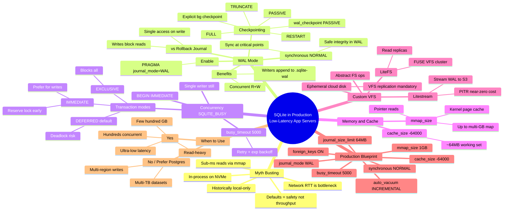

# Mindmap: SQLite in Production (WAL, Concurrency, VFS)

Source: [Micrologics article](https://micrologics.org/blog/sqlite-in-production-optimizing-wal-mode-concurrency-and-vfs-layers-for-low-latency-app-servers) (2026-07-17)

Open the interactive view: [2026-07-30-sqlite-in-production-wal-vfs.html](./2026-07-30-sqlite-in-production-wal-vfs.html)

## Key takeaways

1. **In-process on fast local storage** removes network RTT — the real bottleneck for many app servers.
2. **WAL mode** unlocks concurrent reads/writes; manage **checkpoints** explicitly under load.
3. Still **one writer** → `busy_timeout` + `BEGIN IMMEDIATE` for write transactions.
4. **Cache + mmap** keep the working set off the slow path.
5. **VFS layer** (Litestream / LiteFS) for HA and cloud durability.
6. Prefer SQLite for **read-heavy, sub-TB, latency-sensitive** apps; Postgres for multi-region writes / multi-TB.
