# Mindmap: Why Software Factories Fail

**Source:** [dexhorthy — “or: the harness is not enough”](https://x.com/dexhorthy/status/2080697380379427275) (Part 1) + [Part 2](https://x.com/dexhorthy/status/2081058573556306030)  
**Talk:** [AI Engineer World’s Fair 2026 keynote](https://www.youtube.com/watch?v=Ib5GBkD555M)  
**Audience:** Engineering leadership  
**Map style:** Thesis-first — argument first, operating model second  
**Date:** 2026-07-26

---

## How to use this

- Use the **Mermaid** diagram for a one-screen overview in docs / Notion / GitHub.
- Use the **outline** below for exec notes, RFCs, or a 10-minute staff meeting.
- Decision lens: *optimize for 2–3× safe speed inside known constraints — not 10–100× by turning lights off.*

---

## Mermaid mindmap

```mermaid
mindmap
  root((Why software factories fail<br/>Harness ≠ enough))
    The bet
      You are the bottleneck
      Models are good enough
      Code is free — ship more loops
      Lights-off factory narrative
      Risk: slop cannon + VC hype
    Warning signs
      Agent mishaps → real outages
      Codebases degrade faster
      PR review quality down
      More merges with no review
      Incidents and bugs up
      Directional signal not proof
    Not a skill issue
      Token-maxxing is not the fix
      More harness does not raise ceiling
      Vibe coding ≠ brownfield prod
      Agent-built repos struggle in 3–6 mo
    Factory evolution
      Classic 2022 factory
        Decide → ticket → build
        PR + human review
        Ship → monitor → feedback
        Front-load alignment already existed
      Agentic factory
        Agent builds in minutes
        Review becomes the bottleneck
        Agentic review + regression tests
        Incidents and feedback into the queue
      Lights-off factory
        Drop human code reading
        Bet on tests sandboxes monitoring
        Job becomes only fill the queue
        Does not work for hard systems
    Why models fail maintainability
      Cannot improve quality over time alone
        Shotgun surgery risk
        Human steering still required
      RL inside the harness
        Claude Code won via RL on real tools
        Harness without weights is weaker
        Score traces → update weights
      Benchmarks reward pass fail
        FAIL_TO_PASS + PASS_TO_PASS
        No penalty for bad design
        Try-catch and local hacks win
      Cost asymmetry
        Tests feedback in seconds
        Bad architecture costs months years
        No fast oracle for maintainability
      Frontier evals improving slowly
        Longer multi-PR tasks
        Mutation testing quality judges
        Still not bet-your-codebase ready
    Lights on operating model
      Put human review back
      Front-load to shrink hard reviews
      Four phases
        Product requirements
          User pain and success metrics
          Mock UI over long prose
          Author-opt-in review
        System architecture
          Services endpoints schemas stores
          Sequence diagrams contracts models
          Head off bad model tics early
        Program design
          Types signatures file layout
          Call-stack trees and file-tree diffs
          Decide shape before implementation
        Vertical slices
          Not horizontal stack layers
          Tracer bullets end-to-end
          Review 100–200 lines and resteer
      Right-size the process
        ~40% oneshot light feedback
        Medium one combined plan doc
        Large full four phases
      PR quality not PR volume
        Bad PRs cost intellect and emotion
        Great PRs review fast
        30 min planning saves hours review
    Leadership takeaways
      Learn constraints by using models
      Optimize systems inside the arena
      Seek leverage not infinite loops
      Read the dang code
      Aim 2–3x faster safely
      Do not bet on lights-off yet
```



---

## Hierarchical outline (staff / leadership notes)

### Center thesis

**Why software factories fail:** no amount of harness engineering, loop-maxxing, or review bots alone solves what is fundamentally a **model training and evaluation** gap. Lights-off factories remove the last reliable quality control humans still own: **reading the code**.

---

### 1. The bet everyone’s making

| Claim in the air | Leadership read |
|------------------|-----------------|
| You are the bottleneck | Throughput bottleneck may be real; quality bottleneck is not free |
| Models are good enough | Good at one-offs and greenfield; weak at multi-month maintainability |
| Code is free | Generation is cheap; ownership, review, and incidents are not |
| Ship more loops | Loops amplify whatever the model was trained to optimize |
| Lights-off (no human reads code) | Attractive story; fails when hard bugs and design debt show up |

**Cynical risk:** using “software factory” language to justify unbounded agent volume without quality brakes.

---

### 2. Warning signs (risk board, not gospel)

- Companies that “shouldn’t” have coding-agent outages **are** having them.
- Practitioners report codebases **falling apart faster**.
- Industry signals (e.g. Faros-style reports): **weaker review**, **more unreviewed merges**, **more incidents/bugs per developer**.
- Treat as **directional risk**, not audited proof — but do not dismiss as vibes-only if your own metrics rhyme.

**Question for your team:** What is our signal for “agent throughput up, system health down”?

---

### 3. This is not a skill issue

- “Token harder / stop reading code / add more adversarial bots” is common advice — and incomplete.
- Better harness **raises the floor** (catches dumb mistakes).
- It does **not raise the ceiling** past what RL taught the model about design.
- **Vibe coding a side project** and **keeping a multi-year (or even 6-month agent-built) system healthy** share almost no constraints.
- Agent-heavy codebases often start to struggle around **3–6 months** without human architectural care.

---

### 4. Factory evolution (where the constraint moved)

```text
1968 “software factory” idea
        ↓
2022 classic factory (many human loops already)
  people decide → tracker → human builds
  → PR + review → ship → monitor → user feedback → tracker
  Front-loaded planning already reduced rework
        ↓
Agentic factory
  agent builds (minutes/hours)
  review is still hours/days → review is the bottleneck
  response: agentic review, agentic regression, route incidents/feedback in
        ↓
Lights-off factory
  drop human code reading
  invest in tests, sandboxes, auto-review, monitoring, rollout, feedback
  job collapses to: how much ocean can we boil?
        ↓
Failure mode
  hard issue agents cannot fix → humans re-enter unreadable slop
  outages, angry users, rewrites
```

**Leadership point:** every automation step **moves** the bottleneck; lights-off **removes** the only control that still scores maintainability.

---

### 5. Root cause — why models erode quality over time

**Claim:** Models cannot reliably **maintain and improve codebase quality over time** without substantial human steering.

#### 5a. What “maintainability” means here

- Changing one part without breaking another becomes hard (**shotgun surgery**).
- Classics still apply: design philosophy, clean structure, deliberate refactoring — agents don’t get a free pass.

#### 5b. Why Claude-class agents got so good (and what that implies)

- Winning agents were **RL’d inside the real harness** (tools + loop), not only prompt-tuned.
- If you own **harness but not weights**, you are at a structural disadvantage vs labs that RL both.
- RL loop (simplified): generate traces → score with verifier → reinforce good traces, millions of times.

#### 5c. The scoring problem

- Benchmarks like SWE-bench-style tasks reward:
  - **FAIL_TO_PASS** — did you fix the asked bug?
  - **PASS_TO_PASS** — did you not break existing tests?
- **No penalty** for eroding design (blanket try/catch, duplicated logic, unreadable structure).
- Path to the fix is irrelevant if tests pass.

#### 5d. Cost asymmetry (the board-level constraint)

| Signal | Feedback speed | What it optimizes |
|--------|----------------|-------------------|
| Unit/integration tests | Seconds | Local correctness |
| Bad architecture | Weeks–years | Almost nothing in RL today |
| Maintainability oracle | Missing | Cannot reliably reward good design |

**Implication:** If a judge model could perfectly distinguish good design, it might have written the good design — **fast + reliable oracles for maintainability still don’t exist.**

#### 5e. Frontier work (watch, don’t bet the company)

- Longer / multi-PR tasks, compound rewards, contamination-resistant tasks, mutation testing, quality rules in judges.
- Directionally right; **not yet** “turn off human review” grade.

---

### 6. Lights-on operating model (what to run instead)

**Policy:** The judge is still human. Put **code review** back. Use AI to **front-load alignment** so reviews are short and high-signal.

#### Four phases (for changes where misunderstanding is expensive)

| Phase | Align on | Leadership value |
|-------|----------|------------------|
| **1. Product requirements** | User pain, success metrics, rough UI mocks | Stops building the wrong thing at machine speed |
| **2. System architecture** | Services, endpoints, schemas, queues, stores; diagrams | Stops cross-service mess before code exists |
| **3. Program design** | Types, signatures, file layout, call stacks | Makes implicit review decisions **early and cheap** |
| **4. Vertical slices** | End-to-end tracer bullets, not horizontal layers | Touch the system continuously; resteer every 100–200 lines |

**Vertical vs horizontal (coach the team):**

```text
Horizontal (models love this):  migrations → services → API → UI
Vertical (humans should force):  thin E2E path → iterate outward → polish

Human pre-AI habit: start mid-stack, curl/browser early, never 2k lines blind.
```

#### Right-size effort (don’t process-theater everything)

| Rough share | Process |
|-------------|---------|
| ~40% | Oneshot or 1–2 light feedback rounds |
| Medium | One combined product/tech plan; skip full phase split |
| Large / risky | Full four phases; skip product when pure refactor |
| Ongoing | 1–3 slices at a time; review as you go |

**Author-opt-in reviews** on specs: pull the eventual PR reviewer into product/tech docs *before* the expensive code review.

#### PR theory for leaders

- You don’t have too many PRs — you have too many **bad** PRs.
- ~20% rework is already painful; many AI oneshots trend worse.
- **30 minutes of planning saves hours of review** (and emotional load on both sides).

---

### 7. Leadership takeaways (print this)

1. **Learn the constraints** — build intuition by working with models on *your* codebase, not Twitter maxims.  
2. **Optimize inside the arena** — design process around what models can and cannot score.  
3. **Seek leverage** — front-load product, architecture, and program design.  
4. **Read the code** — lights-off is not a responsible default for complex production systems.  
5. **Target 2–3× faster, safely** — better than chasing 10–100× while lighting the repo on fire.  
6. **Measure health, not just velocity** — review depth, incident rate, change-fail, time-to-understand a module.

---

### 8. One-slide summary

```text
                    ┌─────────────────────────────┐
                    │  Generation is cheap        │
                    │  Maintainability is not     │
                    └──────────────┬──────────────┘
                                   │
     ┌─────────────────────────────┼─────────────────────────────┐
     ▼                             ▼                             ▼
 Loops & harness            Lights-off factory            Lights-on process
 raise the floor            removes human judge           front-load + slices
 do not raise ceiling       fails on hard debt            human reads code
                                   │                             │
                                   ▼                             ▼
                            Outages / rewrites            2–3× safe speed
```

---

## Optional metrics pack (for eng leadership)

Wire these if you run agentic factories at scale:

| Metric | Why |
|--------|-----|
| % PRs merged with no human code review | Lights-off creep |
| Median review rework rounds / AI PR | Plan quality |
| Incident rate tagged to agent-authored changes | Real risk |
| Time-to-first-understand for a “hot” module | Maintainability proxy |
| % work using product+architecture+design docs | Process adoption |
| Cycle time for small vs large changes | Right-sizing |

---

## Source map (for deeper reading)

| Topic | Pointers from the essay |
|-------|-------------------------|
| Lights-off factory | StrongDM / Dan Shapiro / Simon Willison write-ups |
| Software factory narrative | OpenAI Symphony / harness engineering talks |
| Industry quality signal | Faros AI acceleration report; practitioner outage reports |
| RL + tools | SWE-Agent tool-shape; lab RL-inside-harness story |
| Benchmark limits | SWE-bench-style pass/fail; lack of design penalty |
| Frontier evals | SWE-Marathon, DeepSWE, Frontier Code / mutation testing |
| Operating practice | Product specs, program design viz, vertical slices / tracer bullets |
| Author’s product angle | HumanLayer — blocks for factory + better maintainability verifiers |

---

## Design decisions (brainstorming log)

| Choice | Decision |
|--------|----------|
| Audience | Engineering leadership (not deep study dump) |
| Structure | Thesis-first (argument → ops model → takeaways) |
| Format | Mermaid mindmap + leadership outline + metrics pack |
| Depth | Keep RL/benchmark enough to justify policy; skip model-internals rabbit holes |
| Tone | Risk-aware, actionable; avoid pure cynicism and pure hype |
| YAGNI | No full citation dump in the diagram; sources live in the table |

---

*Synthesized from dexhorthy’s “Why Software Factories Fail” Parts 1–2 for internal planning and staff communication.*
