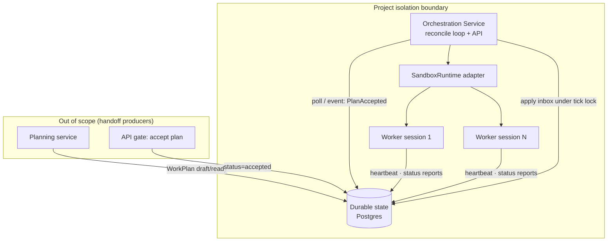
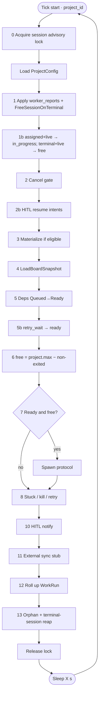
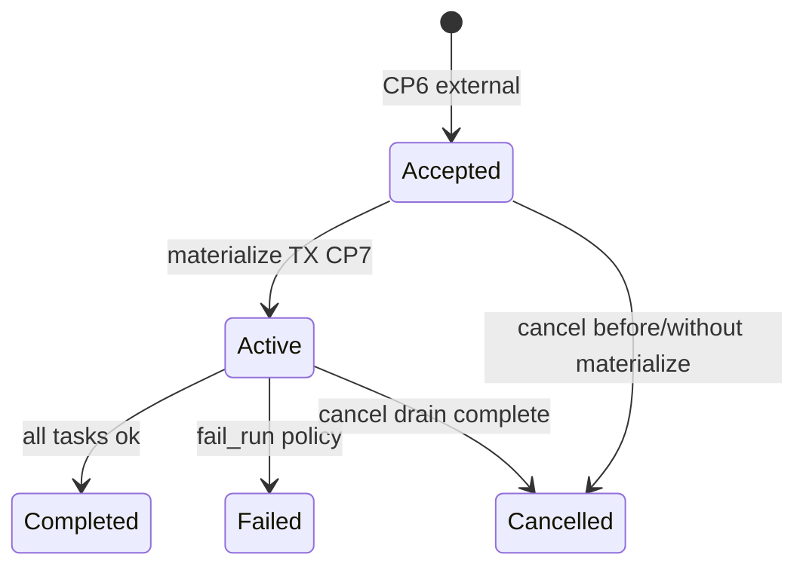
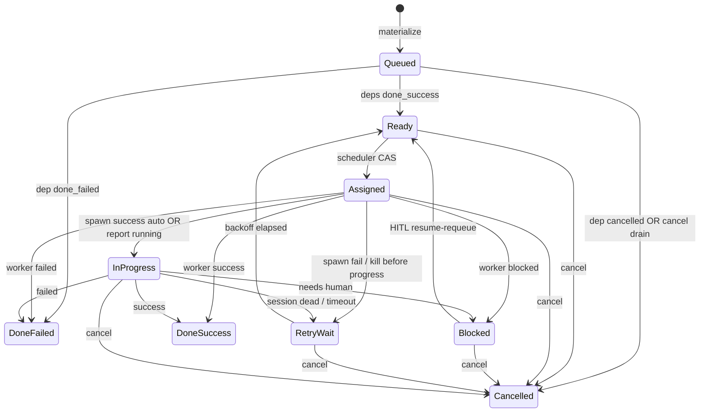
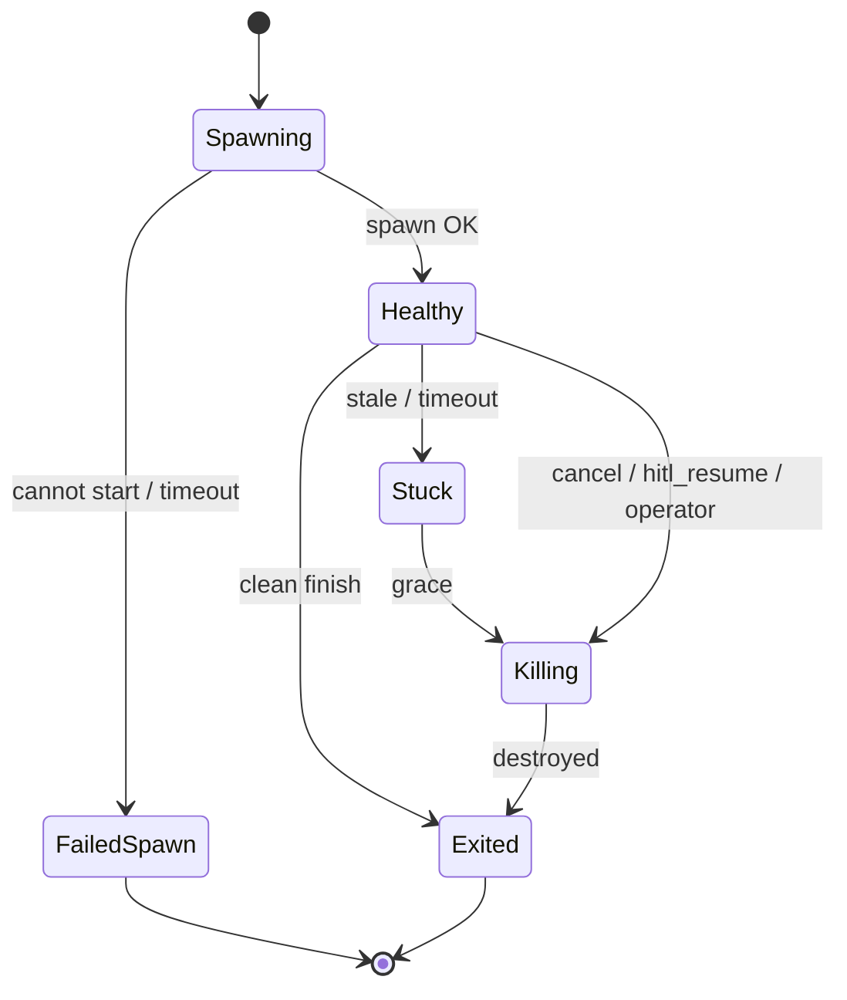
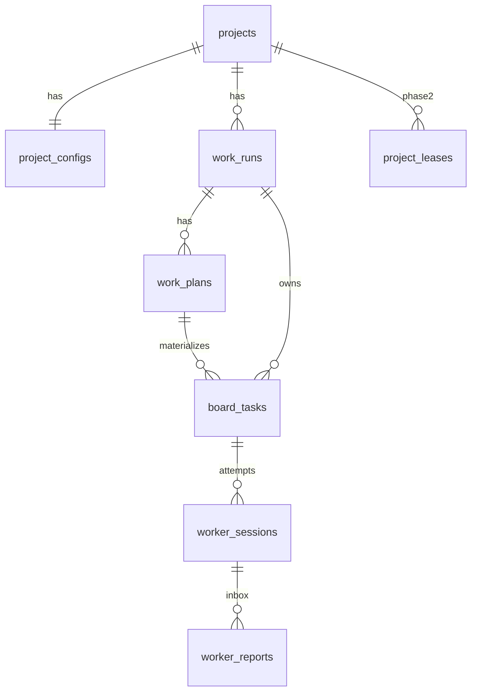

# Orchestration Service Design — Agent Fleet

| Field | Value |
| --- | --- |
| **Document** | Orchestration Service (Operator Control Plane) |
| **Author** | _TBD_ |
| **Date** | 2026-07-28 |
| **Status** | Draft (Rev 3.1 — cancel∩resume Step 2b guard) |
| **Scope** | Orchestration only — Planning is a handoff producer, out of scope except as consumer of `WorkPlan{status=accepted}` |
| **Repo** | `docs/references/old-product-visions/` (greenfield: vision + HTML artifacts only) |
| **Grounding** | `product_vision_tarun.html`, `artifacts/sandbox-orchestration-design.html`, `artifacts/diagrams/*.mmd` |

---

## Overview

Agent Fleet needs a **project-scoped control plane** that owns the lifecycle of work after a plan is accepted: materializing board cards, scheduling workers under capacity, spawning and destroying sandboxes, detecting stuck sessions, applying retries, routing HITL, rolling up run status, and (later) mechanically syncing external boards.

This document designs **only the Orchestration Service**. Planning (LLM decomposition) is a separate one-off job that produces a durable, versioned `WorkPlan`. Once that plan is `accepted`, orchestration becomes the sole leader of the run. Orchestration is **pure logic**: a deterministic, idempotent reconcile loop that runs every X seconds (plus optional wake events). **No LLM calls inside the tick.**

The MVP delivers: durable schemas, a project orchestrator process, project bootstrap + fixture-plan ingestion (no real planner), stub sandbox workers, full reconcile tick, HTTP control API, and cancel/HITL resume paths—enough to prove operator loop semantics end-to-end before real containers or Jira sync.

---

## Background & Motivation

### Current state

The repository is vision and design artifacts only:

- Product model: organizations → projects → per-project orchestrator, board, docs, capacity, fleet.
- Planning vs orchestration is already split conceptually (`artifacts/sandbox-orchestration-design.html`).
- Mermaid sources define reconcile loop, work-unit states, handoff sequence, and architecture.
- **No application code** yet—no schemas, no runtime, no APIs.

### Pain points this service solves

| Pain | Orchestration answer |
| --- | --- |
| Chat sessions don’t scale to multi-task portfolios | Durable board + continuous reconcile |
| Fire-and-forget spawns leave orphans | Desired vs observed reconciliation every tick |
| Capacity overrun / cost blowups | Project `max_agents` hard cap |
| Stuck agents burn budget silently | Heartbeat + wall-clock + grace kill |
| Plan churn / dual writers | Immutable accepted plan body; orch owns board after CP6 |
| Coupling to a single sandbox tech | Abstract `SandboxRuntime` adapter |

### Ownership boundary (initiation flow)

```
Initiate → Ingest → Plan → Accept → Materialize → Schedule → Reconcile → Done
|____ Planning / API gate ____| |________ Orchestration owns ________|
```

### Checkpoint mapping (orchestration-owned)

Vision checkpoints CP7–CP10 map to durable effects as follows:

| CP | Name | Durable effect (normative) |
| --- | --- | --- |
| **CP7** | OrchestrationOwned | `work_runs.status = active`, `orchestration_owned_at = now()` |
| **CP8** | Materialized | All plan tasks upserted; `work_plans.materialized_at = now()`, `in_force_at = now()` (status stays `accepted`) |
| **CP9** | Active (workers flowing) | **Not a separate column.** Implied by ≥1 `worker_sessions` in `{spawning,healthy}` for the run, or by `work_runs.first_spawn_at` (observability-only, set on first successful Spawn). |
| **CP10** | RunTerminal | `work_runs.status ∈ {completed,failed,cancelled}`, `terminal_at = now()` |

**Intentional merge:** CP7 and CP8 commit in the **same materialize transaction** when materializing an `accepted` run. CP9 is observational (`first_spawn_at`), not a gate.

Orchestration **reads** accepted plans (CP6) but never rewrites plan task content (`body` is immutable after accept).

---

## Goals & Non-Goals

### Goals

1. **Project-scoped operator loop** that reconciles desired vs observed state every tick.
2. **Idempotent materialize** of accepted `WorkPlan` tasks into `BoardTask` cards (stable IDs).
3. **Capacity-aware scheduling** and sandbox lifecycle (create on assign, destroy on terminal/kill).
4. **Stuck detection, kill, retry** policies driven by config—not ad-hoc process hacks.
5. **HITL surface**: detect newly `Blocked` tasks, emit notifications, resume via **resume-requeue** (MVP).
6. **Run rollup**: `WorkRun` transitions Active → Completed | Failed | Cancelled from task terminals.
7. **Crash recovery** from durable state with no duplicate cards or duplicate workers.
8. **Pluggable sandbox runtime** (stub → process → tmux/container → VM later).
9. **Implementable MVP** with fixture plans and stub workers; stack and PR plan included.

### Non-Goals (explicit)

- Planning service / LLM decomposition / plan editing UX.
- Full Jira / Monday / Linear sync (interface stub only).
- Web UI, CLI, or WebSocket streaming implementation (API shapes only).
- Multi-tenant SaaS billing, org quotas enforcement productization.
- Multi-agent coordination protocols beyond board claim semantics.
- Real worker agent loops (implement → test → report)—workers are stubs or external processes reporting status.
- Document tree storage, secrets vault crypto details (orchestrator **reads** config/secrets handles; doesn’t own vault design).
- **Multi-orchestrator HA / lease election** (phase 2). MVP is **exactly one** orchestrator process per database (see [Single-orchestrator invariant](#single-orchestrator-invariant-mvp)).

---

## Proposed Design

### High-level placement



### Core principles (normative)

1. **Planning ≠ Orchestration** — no LLM in the tick; only pure state transitions.
2. **Handoff object** — `WorkPlan` with `status = accepted` is the only start signal; **body immutable** after accept.
3. **Per-project isolation** — all queries filter by `project_id`; logical isolation minimum.
4. **Reconcile, don’t command-and-forget** — every effect is re-derivable from durable desired vs observed state.
5. **Work units** — `WorkRun`, `WorkPlan` (body read-only after accept), `BoardTask`, `WorkerSession`.
6. **Sandbox lifecycle ownership** — orchestrator creates/destroys sandboxes; never leave orphans across ticks.
7. **Workers do not claim the board** — orchestrator owns assign/CAS; workers only report heartbeat/status.
8. **Cancel never retries** — if `cancel_requested_at` is set, session exits → task `cancelled`.
9. **Terminal work frees capacity** — success/fail Destroy session in the same apply path (K28).
10. **Control-plane HTTP is intent-only** — cancel/resume set flags; tick mutates board/sessions under lock.

### Process model (MVP)

| Choice | Decision |
| --- | --- |
| Language | **Rust** (edition 2021) for orchestration service — *updated from earlier Go MVP suggestion* |
| DB | **PostgreSQL 16** (primary) |
| Deploy unit | One `fleet-orchestrator` binary; multi-project via `project_id` filter; optional `--project` single-project mode |
| Leadership | **Exactly one process per database** (MVP). Session-held advisory lock for full tick. Lease table schema reserved for phase 2. |
| Time | UTC `timestamptz` for durable times; injected `timeSource.Now()` for tests; **heartbeat ingest uses server receive time** |

**Why Rust:** memory-safe control plane, strong type system for state machines, excellent async (`tokio`) + `sqlx` for Postgres, single static binary. Domain semantics are language-agnostic; this implementation is Rust-first.

Suggested repo layout:

```
docs/references/old-product-visions/
  src/
    main.rs
    domain/         # types, CanTransition matrix, IDs
    validate/       # ValidatePlan shared
    config/
    store/          # Postgres repositories
    sandbox/        # SandboxRuntime + stub/process
    notify/         # NotificationSink (noop + log + webhook)
    sync/           # ExternalBoardSync (noop)
    orch/           # reconcile tick steps (later)
    api/            # HTTP handlers (later)
  migrations/
  schemas/workplan.v1.json
  fixtures/plans/
  tests/
  Cargo.toml
  docker-compose.yml
```

### Single-orchestrator invariant (MVP)

**Normative ops rule:** run **exactly one** `fleet-orchestrator` process against a given Postgres database (or non-overlapping `--project` partitions with **one** process per project set—still not two processes on the same project).

| Mechanism | MVP requirement |
| --- | --- |
| Startup log banner | `leadership_mode=single_process` + DSN fingerprint (host/db name, not password) |
| Metric | `fleet_orch_leadership{mode="single"}` gauge = 1 |
| Tick lock | `pg_advisory_lock(hashtext(project_id::text))` held on a **dedicated connection for the entire tick**, including Spawn side effects outside short write TXes. **Do not** use transaction-scoped advisory locks that release at COMMIT mid-tick. |
| Lock wait | If lock acquisition wait > `tick_interval_s`, log error + metric `fleet_orch_lock_wait_seconds`; skip tick for that project |
| `readyz` | DB ping only (MVP). Does **not** claim multi-instance leadership |
| Phase 2 | `project_leases` table (included in migrations now, unused) for TTL lease election |

**README / Rollout must state:** never scale orchestrator replicas against the same DB in MVP—duplicate workers will result.

### Service responsibilities

#### Does

| Area | Responsibility |
| --- | --- |
| Project bootstrap | Create project + default config (MVP admin API) |
| Handoff consume | Detect accepted plans with `materialized_at IS NULL`; claim run ownership (CP7/CP8) |
| Materialize | Upsert `BoardTask` rows; wire deps; validate plan first |
| Dependency readiness | `queued → ready` when deps `done_success`; fail-forward on dep failure |
| Capacity scheduling | Free slots; assign highest-priority Ready tasks |
| Lifecycle | Spawn sandbox + session; kill on stuck/cancel; destroy on exit |
| Report inbox | Workers append reports; tick applies under project lock |
| Stuck / kill / retry | Stale HB, wall-clock, spawn hang; grace kill; retry only if not cancelling |
| HITL | Notify on newly blocked; resume-requeue with `hitl_notes` |
| External sync | `ExternalBoardSync` noop/log stub |
| Run rollup | Terminal run status from task terminals + cancel |
| Cancel | Idempotent cancel request; drain without retry |
| Observability | Logs, metrics, tick duration |

#### Does not

- Call LLMs or decompose documents.
- Mutate `WorkPlan.body` after accept.
- Own org integration OAuth.
- Implement real Jira/Monday clients.
- Serve web UI or store screenshot binaries.
- Cross-project scheduling.
- Allow workers to CAS board status directly.

---

## Reconcile Tick Algorithm

The tick is **idempotent**, **safe under crash mid-tick**, and **bounded** in time.

**Exact step order (normative — implement in this order):**

```text
0  Acquire project session advisory lock (whole tick)
1  Apply worker_reports inbox  (+ FreeSessionOnTaskTerminal for each terminal apply)
1b Reconcile assigned+live session → in_progress; terminal task + live session → FreeSession
2  Cancel gate (incl. retry_wait → cancelled; pre-materialize cancel)
2b Apply HITL resume intents under lock — **skip if run.cancel_requested_at set**
3  Materialize (only runs still accepted, not cancelling, not terminal)
4  LoadBoardSnapshot (2 queries)
5  Dependency readiness (queued → ready | fail-forward)
5b Promote retry_wait → ready when backoff elapsed and not cancelling
6  Capacity (project max_agents only for free_slots)
7  Schedule & spawn protocol
8  Heartbeats / stuck / kill / retry (never retry if task already terminal)
9  (Precedence is part of Step 1; re-check invariants only)
10 HITL notify newly blocked
11 ExternalBoardSync stub
12 Run rollup (CP10)  — K27 cancel rollup policy
13 Orphan reap (+ terminal-session leak safety net)
   Release advisory lock
```



### Ordered steps (normative)

Prefer **per-step transactions** except materialize (one TX) and spawn protocol (specified below).

**All tick entrypoints** (periodic loop, `POST .../admin/tick`, `POST .../admin/reap`) **must** acquire the **same** per-project session-held advisory lock before running any step. HTTP waits up to `lock_wait_timeout_s` (default = `tick_interval_s`); on timeout return **409 Conflict** `{ "error": "tick_lock_held" }`. Never run two ticks concurrently for one project.

#### Step 0 — Tick context + lock

```text
ctx = { project_id, tick_id (uuid), started_at, config, server_now }
Acquire pg_advisory_lock on dedicated conn; hold until tick end (incl. Spawn/Destroy side effects).
```

#### Step 1 — Apply worker report inbox + free session on terminal

**Model A (normative) — HTTP surface rules:**

| Route class | May do | Must not do |
| --- | --- | --- |
| Worker heartbeat/status | Append `worker_reports` only | Mutate `board_tasks.status`, Spawn, Destroy |
| Cancel run | Set `cancel_requested_at` (idempotent) + wake tick | Mutate tasks/sessions, Destroy |
| HITL resume | Set resume **intent** fields + wake tick | Mutate status to ready, Destroy, Spawn |
| admin/tick, admin/reap | Acquire project tick lock then run steps | Run steps without lock |

```text
for report in worker_reports where project_id=P and applied_at IS NULL
  order by session_id, seq ASC:
  apply under CAS rules (see Precedence table / Step 9)
  set applied_at = server_now
  if task transitioned to done_success OR done_failed:
      FreeSessionOnTaskTerminal(task, exit_reason)
```

##### FreeSessionOnTaskTerminal (normative helper — K28)

Called whenever a task becomes **terminal** via worker report (`done_success` / `done_failed`), and also from Step 1b safety net / cancel paths as specified:

```text
FreeSessionOnTaskTerminal(task, exit_reason ∈ {clean, worker_failed, cancel, hitl_resume, ...}):
  1. sid = task.claimed_session_id
  2. if sid is NULL: return
  3. session = load(sid); if session.status already in {exited, failed_spawn}: clear claim; return
  4. Runtime.Destroy(session.runtime_handle)  # idempotent if handle nil/unknown
  5. session.status = exited; session.exit_reason = exit_reason; session.exited_at = server_now
  6. invalidate worker token (auth rejects; optional token_revoked_at = now)
  7. task.claimed_session_id = NULL
  8. # NEVER invoke retry policy — task is already terminal
```

**Capacity:** after this helper, session is no longer in `{spawning,healthy,stuck,killing}` → slot freed immediately for Step 6 in the same tick (if free_slots recomputed after Step 1–5b; **normative:** recompute `in_use` at start of Step 6 from current DB state).

**Stub backend:** after the worker coroutine emits terminal status into the inbox, it **does not** self-delete the handle. The tick **must** call `Destroy` via this helper (or Step 1b/13). Stub `Destroy` marks handle non-existent in the in-process map. Documented choice: **tick-owned Destroy only** (worker does not free capacity by exiting alone).

#### Step 1b — Session/task consistency repair

```text
# Partial spawn 3a crash: healthy session + assigned task
for task where status = assigned
  and claimed_session_id points to session in {spawning, healthy, stuck, killing}:
    task → in_progress
    task.started_at = COALESCE(task.started_at, session.started_at, server_now)

# Capacity leak / crash after terminal task apply without FreeSession
for task where status in (done_success, done_failed, cancelled)
  and claimed_session_id points to session in {spawning, healthy, stuck, killing}:
    FreeSessionOnTaskTerminal(task, exit_reason =
      clean if done_success else worker_failed if done_failed else cancel)
```

Crash matrix row: **task terminal, session still healthy** → next tick Step 1b forces Destroy + exited.

#### Step 2 — Cancel gate (before materialize, schedule, retry promotion)

```text
for each run where cancel_requested_at IS NOT NULL
  and status in (accepted, active):

  # Pre-materialize cancel: no board yet
  if status = accepted and no board_tasks for run:
    status = cancelled; terminal_at = now
    # plan stays accepted + materialized_at NULL forever — do NOT materialize (Step 3 filter)
    continue

  # All non-terminal task statuses, EXPLICITLY including retry_wait, blocked, assigned, …
  for task in run.tasks where status in
      (queued, ready, assigned, in_progress, blocked, retry_wait):
    if no session in {spawning, healthy, stuck, killing}:
      task → cancelled; clear claimed_session_id if any
    else:
      ensure kill path with exit_reason = 'cancel'
      # on session exited with exit_reason=cancel → task → cancelled (Step 8); never retry
```

**Idempotent cancel API:** `UPDATE work_runs SET cancel_requested_at = COALESCE(cancel_requested_at, now()), cancel_reason = COALESCE(cancel_reason, $reason) WHERE id = $id`. Second call is a no-op success. API does **not** mutate tasks (Model A control-plane intent pattern).

#### Step 2b — Apply HITL resume intents (under tick lock)

**Resume API (HTTP) only records intent — does not Destroy or flip status:**

```text
POST .../tasks/{id}/resume { "message", "artifacts" }
precondition: task.status == blocked  (else 409)
  UPDATE board_tasks SET
    hitl_notes = message,
    hitl_artifacts = artifacts,
    hitl_resume_requested_at = COALESCE(hitl_resume_requested_at, server_now)
    -- do NOT set hitl_resolved_at here; tick owns resolution
  WHERE id=? AND status='blocked'
  Wake tick
```

**Tick applies resume (K21):**

```text
for task where status = blocked
  AND hitl_resume_requested_at IS NOT NULL
  AND hitl_resolved_at IS NULL:

  # Cancel wins over resume (normative — same-tick cancel∩resume)
  if run.cancel_requested_at IS NOT NULL:
    skip   # Step 2 / 8 drain to cancelled; do NOT ready the task
    # leave hitl_* fields for audit; task will be cancelled, not scheduled
    continue

  1. If claimed session in {spawning,healthy,stuck,killing}:
       Runtime.Signal/Destroy; session → exited; exit_reason = 'hitl_resume'
  2. Clear claimed_session_id
  3. task → ready
  4. hitl_resolved_at = server_now
  5. attempt is NOT incremented (resume is not a failure)
```

**Precedence:** `cancel_requested_at` always beats HITL resume for that run. Step 2 may still be killing the session with `exit_reason=cancel` when a live session exists; Step 2b must not re-label the exit as `hitl_resume` or flip the task to `ready`.

Workers never receive in-process inject. Next Spawn reads `hitl_notes` from task / `FLEET_HITL_NOTES` only when resume actually applied (not when skipped for cancel).

#### Step 3 — Materialize accepted plans

**Eligibility (normative — prevents resurrecting cancelled runs):**

```sql
SELECT p.*
FROM work_plans p
JOIN work_runs r ON r.id = p.run_id
WHERE p.project_id = $1
  AND p.status = 'accepted'
  AND p.materialized_at IS NULL
  AND r.status = 'accepted'              -- not cancelled/completed/failed/active-already-materialized path
  AND r.cancel_requested_at IS NULL;     -- cancel wins over materialize
```

Do **not** materialize if run is already `cancelled` / `completed` / `failed` / `active` with prior materialize, or if cancel was requested. Pre-materialize cancel leaves plan unmaterialized forever (zero `board_tasks`). Test: cancel before first tick → `board_tasks` count = 0, run `cancelled`.

**Plan status enum (normative, aligned with vision handoff §8):**

```text
draft | ready | accepted | superseded
```

Operational columns (not status values): `materialized_at`, `in_force_at`.  
**Delta from `work-unit-states.mmd`:** durable statuses do **not** include `Materializing` / `InForce`. Materialize is one TX (K15); `in_force_at` marks CP8 without renaming status. Body remains immutable; only operational columns change after accept.

Materialize transaction:

```text
BEGIN;
  SELECT p.*, r.status, r.cancel_requested_at
    FROM work_plans p JOIN work_runs r ON r.id = p.run_id
    WHERE p.id=? FOR UPDATE OF p;
  if p.materialized_at IS NOT NULL: COMMIT; return;
  if r.cancel_requested_at IS NOT NULL OR r.status <> 'accepted': COMMIT; return;  -- skip
  re-check depends_on + acyclic;
  for each plan_tasks[]:
    upsert board_tasks with stable id;
  set materialized_at = now(), in_force_at = now();
  set run status = 'active', orchestration_owned_at = now();  -- CP7+CP8
COMMIT;
```

**Idempotency:** `UNIQUE (project_id, plan_id, plan_task_id)`.

**Limits (normative):**

| Limit | Value |
| --- | --- |
| Max tasks per plan | 500 |
| Max plan body size | 256 KiB |
| Max `spec_md` per task | 64 KiB |
| Max dependency fan-in | 32 |

`ValidatePlan(body)` (shared by fixture API and future plan-accepted path):

1. JSON Schema `schemas/workplan.v1.json`
2. All `depends_on` plan_task_ids exist
3. **Cycle detection** (DFS) → reject with 400
4. Size limits above

#### Step 4 — Load board snapshot (batch)

```text
// Exactly two queries — no N+1 in the tick loop
tasks    = LoadTasks(project_id)      // all non-archived tasks for project (or active runs)
sessions = LoadSessions(project_id)   // non-exited + recently exited if needed
// Join in memory by board_task_id
```

#### Step 5 — Dependency readiness

For each `board_task` in `queued`:

```text
if any depends_on status == done_failed:
  → done_failed, failure_reason = "dependency_failed"   # MVP fail-forward (K17)
if any depends_on status == cancelled:
  → cancelled, failure_reason = "dependency_cancelled"
if all depends_on status == done_success (or depends_on empty):
  → ready
else:
  remain queued
```

Metric: `fleet_tasks_blocked_on_deps` = count(queued with incomplete deps).

#### Step 5b — Promote retry_wait → ready (normative; was missing)

```text
for task where status = retry_wait
  and retry_not_before <= server_now
  and run.cancel_requested_at IS NULL
  and run.status = active:
    task → ready
# If cancel_requested: Step 2 already maps retry_wait → cancelled (or will on this tick before 5b)
# Unit-test: attempt 1 fail → retry_wait → (backoff) → ready → attempt 2
```

#### Step 6 — Capacity

**MVP (K18 revised):** project-global capacity only.

```text
# free_slots ALWAYS uses project_configs.max_agents — ignore plan.policy.max_agents_override in math
in_use = count(sessions where status in (spawning, healthy, stuck, killing) and project_id = P)
free_slots = max(0, project.max_agents - in_use)
```

- `plan.policy.max_agents_override` may be **stored** on the plan body for phase 2 / UI display but is **not applied** in MVP scheduling capacity. (Optional later: snapshot `work_runs.effective_max_agents` at accept; still not multi-run min-of-overrides.)
- Per-run concurrent caps: **out of MVP**.

**Delta from vision diagram (`orchestrator-reconcile-loop.mmd` caption “max − healthy”):**  
Design **intentionally** counts `spawning | healthy | stuck | killing`, not only `healthy`. Spawning and Killing hold slots to **prevent spawn stampede**. Terminal tasks **must** free sessions via `FreeSessionOnTaskTerminal` so completed work does not hold slots.

**Blocked sessions:** remain `healthy`/`stuck` and **do hold capacity** until Step 2b resume-requeue Destroy. Phase 2 may auto-park.

#### Step 7 — Schedule & spawn protocol

Select candidates:

```text
tasks = status=ready AND run.status=active AND run.cancel_requested_at IS NULL
order by priority DESC, created_at ASC
limit free_slots
```

**Normative spawn protocol** (race-safe for process backend):

```text
for each selected task:
  1. BEGIN;
       CAS: UPDATE board_tasks SET status='assigned', assigned_at=now(),
            attempt = attempt + 1
            WHERE id=? AND status='ready' RETURNING *;
       if no row: COMMIT; continue;
       INSERT worker_sessions (id, status='spawning', board_task_id, attempt, …)
         -- runtime_handle NULL; worker_token_hash set from minted token
       UPDATE board_tasks SET claimed_session_id = session.id;
     COMMIT;

  2. SpawnRequest includes SessionID, Env with FLEET_* contract + plaintext worker token once.
     WorkDir = filepath.Join(DATA_DIR, "projects", projectID, "sessions", sessionID)
     result, err = Runtime.Spawn(ctx, req)

  3a. On success — single DB transaction for both rows:
     BEGIN;
       UPDATE worker_sessions SET runtime_handle=?, started_at=?, status='healthy' WHERE id=?;
       UPDATE board_tasks SET status='in_progress',
         started_at=COALESCE(started_at, now())
         WHERE id=? AND status='assigned';
       UPDATE work_runs SET first_spawn_at = COALESCE(first_spawn_at, now()) WHERE id=?;
     COMMIT;
     # If crash leaves healthy+assigned: Step 1b repairs next tick

  3b. On Spawn error:
     UPDATE session status='failed_spawn', exit_reason='spawn_failed';
     apply retry-or-fail on task (unless cancelling → cancelled);
     # task not terminal-success; retry policy may set retry_wait

  4. Crash between 2 and 3a:
     Next tick: session still spawning past spawn_timeout_s →
       Runtime.Destroy best-effort (List + process backend pidfile/pgid);
       status=failed_spawn; retry-or-fail.
```

**Assigned hang closed (K16):** successful Spawn always moves task `assigned → in_progress` (same TX as healthy). Worker report `running` is **redundant**. Stub **must** emit `running` then `success` for e2e status path; board progress does not depend on `running`.

If Spawn returns success but process dies before first heartbeat, stuck detection applies.

#### Step 8 — Heartbeats, stuck, kill, retry

**Heartbeat time (K19):** when applying heartbeat reports:

```text
last_heartbeat_at = server_now()   -- NEVER trust worker body.ts for stuck math
worker_ts stored only in report payload for skew metrics
```

Stuck predicates (any):

| Condition | Predicate |
| --- | --- |
| Stale heartbeat | `server_now - coalesce(last_heartbeat_at, started_at, created_at) > heartbeat_stale_s` |
| Wall-clock | `server_now - session.started_at > task.timeout_s` |
| Spawn hang | `status=spawning && server_now - created_at > spawn_timeout_s` |
| Loop budget | report flag `loop_budget_exceeded` |

**Skip stuck/kill** if task already terminal (`done_*` / `cancelled`) — instead call `FreeSessionOnTaskTerminal` if session still live.

Kill:

```text
if stuck and not killing and task not terminal:
  status = killing; exit_reason = stale|timeout|spawn_hang|budget|cancel
  Runtime.Signal(SIGTERM); kill_grace_deadline = now + kill_grace_s
if killing and now > grace and still alive:
  Runtime.Signal(SIGKILL) or Destroy
if dead:
  status = exited; Destroy idempotent
  release claimed_session_id if matches
  if task already terminal:
      # no retry — only ensure claim cleared
  else:
      → Retry policy
```

**Retry policy (K20) — `max_retries` = max re-assignments after first failure:**

```text
total_attempts_allowed = max_retries + 1
# attempt is incremented on each assign; first assign → attempt=1

on abnormal exit:
  # Preconditions — all must hold or skip retry entirely:
  if task.status in (done_success, done_failed, cancelled):
    return  # NEVER retry terminal tasks
  if run.cancel_requested_at IS NOT NULL OR exit_reason in (cancel, hitl_resume, clean, worker_failed):
    # clean/worker_failed should not reach here if FreeSessionOnTaskTerminal ran first;
    # cancel → cancelled; hitl_resume handled in Step 2b
    if exit_reason == cancel OR run.cancel_requested_at IS NOT NULL:
      task → cancelled
    return
  if task.attempt < max_retries + 1:
    task → retry_wait; retry_not_before = now + retry_backoff_s
    # promotion to ready is Step 5b — not inline here
  else:
    task → done_failed; failure_reason = max_retries_exceeded|timeout|spawn_failed
```

Examples with `max_retries=2` → **3** attempts max (attempt values 1,2,3).  
`max_retries=0` → single attempt only.

Unit-test matrix: 0, 1, 2; plus attempt1 fail → retry_wait → Step5b → ready → attempt2.

#### Step 9 — Status apply precedence

Applied from inbox (Step 1). Re-checked only for invariant metrics after kill.

**Columns:** `board_tasks.last_report_seq INT`, reports carry monotonic `seq` per session.

```sql
-- Conceptual CAS when applying report
UPDATE board_tasks SET ... , last_report_seq = $seq
WHERE id = $id
  AND (last_report_seq IS NULL OR last_report_seq < $seq)
  AND status = ANY($allowed_from);
```

**On successful CAS to `done_success` / `done_failed`:** immediately invoke `FreeSessionOnTaskTerminal` (see Step 1).

**Precedence table (normative):**

| Situation | Winner |
| --- | --- |
| `cancel_requested` and task non-terminal | **Cancel** → `cancelled` (+ free session) |
| Worker `success`/`failed` applied while session `healthy` | **Terminal worker status** + **Destroy/exit session** |
| Worker `success` while session `killing`, task not terminal | Terminal worker status if seq CAS wins; then FreeSession |
| Task already `cancelled` | Reject later success/failed reports |
| Session killed `exit_reason=cancel` | Task **cancelled**, no retry |
| Session killed stuck/timeout, task non-terminal | Retry policy |
| Session killed, task already terminal | FreeSession only; no retry |
| Duplicate / lower `seq` | Ignore |
| HTTP worker routes | Append-only reports; **never** Spawn/Destroy |
| HTTP resume/cancel | Intent fields only; tick applies under lock |

#### Step 10 — HITL notify (newly blocked)

```text
for tasks newly → blocked since last notify (hitl_notified_at IS NULL and status=blocked):
  NotificationSink.Notify(BlockedEvent{...})  # noop/log in MVP
  hitl_notified_at = now()
```

Resume application is **Step 2b**, not this step.

#### Step 11 — External board sync (stub)

```go
type ExternalBoardSync interface {
    SyncTaskStatus(ctx context.Context, task BoardTask) error
}
```

Noop/log if `auto_sync_external`. No real Jira client.

#### Step 12 — Run rollup (CP10)

For each run in `{active}` or with `cancel_requested_at` set and not yet terminal:

```text
tasks = all board_tasks for run
if any status not in (done_success, done_failed, cancelled):
  continue  # still running (blocked counts as non-terminal — run stays active)

# K27 — cancel rollup policy (normative):
# If the operator requested cancel, terminal run status is always `cancelled`
# once every task is terminal — even if every task is done_success
# (cancel-during-tail-success still yields cancelled; e2e must assert that).
if cancel_requested_at IS NOT NULL:
  run → cancelled
else if any done_failed AND policy.on_task_fail == fail_run:
  run → failed
else if any done_failed AND policy.on_task_fail == leave:
  run → completed  # partial failure allowed; summary counts failures
else if all done_success:
  run → completed
else:
  # mix of done_success + cancelled without cancel_requested: invariant_violation → failed
  run → failed
set terminal_at = now(); write summary JSONB; outbox RunTerminal
```

Blocked tasks keep run **active** indefinitely in MVP (alert via HITL metrics, not auto-fail).

#### Step 13 — Orphan sandbox reaping

```text
# Safety net for terminal task + live session (also Step 1b)
for task terminal with live claimed session:
  FreeSessionOnTaskTerminal(...)

for sessions in spawning|healthy|stuck|killing:
  if handle known and !Runtime.Status(handle).Exists:
    mark exited
    if task non-terminal: apply retry/cancel policy
    else: clear claim only
for handle in Runtime.List(project_id):
  if no session row with that handle:
    Destroy  # labeled orphan
# process backend: scan DATA_DIR/projects/{pid}/sessions/*/pid for timed-out spawning
```

#### Cancel algorithm (numbered, complete)

```text
CANCEL_REQUEST(run_id, reason):  # API, idempotent intent only
  1. UPDATE cancel_requested_at = COALESCE(cancel_requested_at, now()),
            cancel_reason = COALESCE(cancel_reason, reason)
  2. Wake tick
  # does NOT materialize, mutate tasks, or Destroy

EACH_TICK (Steps 2, 3, 5b, 7, 8, 12):
  1. If status=accepted, cancel_requested, no board_tasks:
       → run cancelled (CP10); skip materialize forever for this run
  2. Step 3 materialize filter excludes cancel_requested / non-accepted runs
  3. Skip schedule for this run (cancel_requested_at IS NULL filter)
  4. For each non-terminal task INCLUDING retry_wait:
       a. No live session → status=cancelled
       b. Live session → kill exit_reason=cancel → on exit task=cancelled (never RetryWait)
  5. FreeSessionOnTaskTerminal for any terminalized tasks still holding sessions
  6. When all tasks terminal → run=cancelled (K27), even if all done_success
```


---

## State Machines

### WorkRun (orchestration-relevant)



### WorkPlan

| Status | Meaning | Orch may set |
| --- | --- | --- |
| `accepted` | Immutable body; handoff legal | `materialized_at`, `in_force_at` only |
| `superseded` | Newer version exists (Planning/API) | No (read-only ignore for new materialize) |

### BoardTask (single source of truth)



**Terminal:** `done_success`, `done_failed`, `cancelled`.

### WorkerSession



Sessions are **append-only**: retry = new row with `attempt+1`.

### Appendix: CanTransition matrix (BoardTask)

Implement `CanTransition(from, to) bool` from this table only (tests generate from same struct).

| From \ To | ready | assigned | in_progress | blocked | retry_wait | done_success | done_failed | cancelled |
| --- | --- | --- | --- | --- | --- | --- | --- | --- |
| queued | ✓ deps | | | | | | ✓ dep_fail | ✓ |
| ready | | ✓ | | | | | | ✓ |
| assigned | | | ✓ | ✓ | ✓ | ✓ | ✓ | ✓ |
| in_progress | | | | ✓ | ✓ | ✓ | ✓ | ✓ |
| blocked | ✓ resume | | | | | | | ✓ |
| retry_wait | ✓ | | | | | | | ✓ |
| done_* / cancelled | | | | | | | | |

---

## Data Model

### ER overview



### Tables

#### `projects`

| Column | Type | Notes |
| --- | --- | --- |
| `id` | UUID PK | client or server generated |
| `org_id` | UUID NOT NULL | |
| `name` | TEXT NOT NULL | |
| `created_at` | TIMESTAMPTZ | |

#### `project_configs`

| Column | Type | Default |
| --- | --- | --- |
| `project_id` | UUID PK | |
| `max_agents` | INT | 3 |
| `tick_interval_s` | INT | 5 |
| `heartbeat_stale_s` | INT | 60 |
| `spawn_timeout_s` | INT | 30 |
| `kill_grace_s` | INT | 15 |
| `default_task_timeout_s` | INT | 3600 |
| `default_max_retries` | INT | 2 |
| `retry_backoff_s` | INT | 10 |
| `on_task_fail` | TEXT | `fail_run` |
| `auto_sync_external` | BOOLEAN | false |
| `hitl_webhook_url` | TEXT | NULL |
| `sandbox_backend` | TEXT | `stub` |
| `stub_duration_s` | INT | 3 |
| `config_version` | INT | 1 |
| `updated_at` | TIMESTAMPTZ | |

#### `work_runs`

| Column | Type | Notes |
| --- | --- | --- |
| `id` | UUID PK | |
| `project_id` | UUID NOT NULL | |
| `status` | TEXT NOT NULL | |
| `source` | TEXT | fixture\|… |
| `goal_snapshot` | TEXT | |
| `accepted_at` | TIMESTAMPTZ | |
| `orchestration_owned_at` | TIMESTAMPTZ | CP7 |
| `first_spawn_at` | TIMESTAMPTZ | CP9 observability |
| `terminal_at` | TIMESTAMPTZ | CP10 |
| `cancel_requested_at` | TIMESTAMPTZ | idempotent set |
| `cancel_reason` | TEXT | |
| `summary` | JSONB | terminal counts |
| `created_at` / `updated_at` | TIMESTAMPTZ | |

Indexes: `(project_id, status)`, `(project_id, created_at DESC)`.

#### `work_plans`

| Column | Type | Notes |
| --- | --- | --- |
| `id` | UUID PK | |
| `project_id` | UUID NOT NULL | |
| `run_id` | UUID NOT NULL | |
| `version` | INT NOT NULL | |
| `status` | TEXT NOT NULL | **`draft\|ready\|accepted\|superseded` only** |
| `source` | TEXT | |
| `body` | JSONB NOT NULL | **immutable after accepted** |
| `accepted_at` | TIMESTAMPTZ | |
| `materialized_at` | TIMESTAMPTZ | CP8 |
| `in_force_at` | TIMESTAMPTZ | operational; same TX as materialize |
| `created_at` | TIMESTAMPTZ | |

`UNIQUE (run_id, version)`. Index `(project_id, status) WHERE materialized_at IS NULL`.

#### Plan body schema

```json
{
  "plan_id": "uuid",
  "project_id": "uuid",
  "run_id": "uuid",
  "version": 1,
  "status": "accepted",
  "source": "fixture",
  "tasks": [
    {
      "plan_task_id": "t1",
      "title": "Implement login API",
      "summary": "...",
      "spec_md": "# Spec\n...",
      "depends_on": [],
      "worker_profile": "coding",
      "acceptance": ["unit tests pass"],
      "priority": 100,
      "external_ref": {"provider": "jira", "key": "WEB-184"},
      "timeout_s": 1800,
      "max_retries": 2
    }
  ],
  "policy": {
    "max_agents_override": null,
    "on_task_fail": "fail_run",
    "auto_sync_external": false
  }
}
```

Canonical schema file: `schemas/workplan.v1.json` (shared validation).

#### `board_tasks`

| Column | Type | Notes |
| --- | --- | --- |
| `id` | UUID PK | UUIDv5(ns, `project_id:plan_id:plan_task_id`) |
| `project_id` | UUID | |
| `run_id` | UUID | |
| `plan_id` | UUID | |
| `plan_task_id` | TEXT | |
| `title` / `summary` / `spec_md` | TEXT | |
| `status` | TEXT | snake_case only |
| `depends_on` | UUID[] | |
| `priority` | INT | higher first |
| `worker_profile` | TEXT | |
| `acceptance` | JSONB | |
| `external_ref` | JSONB | |
| `timeout_s` | INT | |
| `max_retries` | INT | default 2; **retries after first failure** |
| `attempt` | INT | 0 until first assign; increments on assign |
| `claimed_session_id` | UUID | |
| `last_report_seq` | INT | CAS for reports |
| `progress_pct` | INT | |
| `block_reason` | TEXT | |
| `hitl_notes` | TEXT | human resume message (set by resume API) |
| `hitl_artifacts` | JSONB | |
| `hitl_resume_requested_at` | TIMESTAMPTZ | intent flag; API sets, tick clears via resolved |
| `hitl_notified_at` / `hitl_resolved_at` | TIMESTAMPTZ | notify once; tick sets resolved on apply |
| `failure_reason` | TEXT | |
| `artifacts` | JSONB | worker artifacts |
| `retry_not_before` | TIMESTAMPTZ | |
| `assigned_at` / `started_at` / `terminal_at` | TIMESTAMPTZ | |
| `created_at` / `updated_at` | TIMESTAMPTZ | |

`UNIQUE (project_id, plan_id, plan_task_id)`.  
Indexes: `(project_id, status, priority DESC)`, `(project_id, run_id)`.

#### `worker_sessions`

| Column | Type | Notes |
| --- | --- | --- |
| `id` | UUID PK | minted before Spawn |
| `project_id` / `run_id` / `board_task_id` | UUID | |
| `attempt` | INT | |
| `status` | TEXT | |
| `runtime_backend` | TEXT | |
| `runtime_handle` | TEXT NULL | set after Spawn success |
| `worker_token_hash` | TEXT NOT NULL | SHA-256 (hex/raw) of session token; constant-time compare |
| `worker_profile` | TEXT | |
| `last_heartbeat_at` | TIMESTAMPTZ | **server receive time** |
| `progress_pct` | INT | |
| `exit_reason` | TEXT | cancel\|stale\|timeout\|spawn_failed\|hitl_resume\|clean\|… |
| `kill_grace_deadline` | TIMESTAMPTZ | |
| `work_dir` | TEXT | absolute path if process backend |
| `started_at` / `exited_at` / `created_at` | TIMESTAMPTZ | |

`UNIQUE (board_task_id, attempt)`. Indexes: `(project_id, status)`.

#### `worker_reports` (inbox)

| Column | Type | Notes |
| --- | --- | --- |
| `id` | BIGSERIAL PK | |
| `project_id` | UUID | |
| `session_id` | UUID | |
| `board_task_id` | UUID | |
| `seq` | INT NOT NULL | monotonic per session |
| `kind` | TEXT | heartbeat\|status |
| `payload` | JSONB | includes optional worker `ts` |
| `received_at` | TIMESTAMPTZ | server now |
| `applied_at` | TIMESTAMPTZ NULL | |

`UNIQUE (session_id, seq)`. Index `(project_id) WHERE applied_at IS NULL`.

#### `orchestration_events` (outbox)

| Column | Type |
| --- | --- |
| `id` BIGSERIAL, `project_id`, `run_id`, `tick_id`, `event_type`, `payload` JSONB, `created_at`, `delivered_at` |

#### `idempotency_keys`

PK `(project_id, key)` → `request_hash`, `response` JSONB, `created_at`.

#### `project_leases` (phase 2 reserved)

| Column | Type |
| --- | --- |
| `project_id` UUID PK, `owner` TEXT, `expires_at` TIMESTAMPTZ, `updated_at` |

Created in migrations; unused in MVP.

### Status enums (canonical snake_case)

```text
WorkRun:    intent_received | sources_resolved | ingested | planning | plan_ready |
            accepted | active | completed | failed | cancelled
WorkPlan:   draft | ready | accepted | superseded
BoardTask:  queued | ready | assigned | in_progress | blocked | retry_wait |
            done_success | done_failed | cancelled
WorkerSession: spawning | healthy | stuck | killing | exited | failed_spawn
```

### Migration strategy

- **PR3** owns baseline migrations (not PR1).
- Tool: **`sqlx::migrate!`** (`migrations/` folder).
- Forward-only; greenfield allows clean breaks until first external deploy.

---

## Interfaces

### Inputs

| Input | Mechanism |
| --- | --- |
| Create project | `POST /v1/projects` |
| Plan accepted | Poll or `POST .../internal/plan-accepted` wake |
| Worker heartbeat/status | `POST .../workers/{sid}/heartbeat\|status` → **inbox only** |
| HITL resume intent | `POST .../tasks/{tid}/resume` → sets `hitl_resume_requested_at`; tick applies |
| Cancel run | `POST .../runs/{rid}/cancel` (idempotent) |
| Fixture inject | `POST .../runs/fixture` |
| Config update | `PUT .../config` |

### Outputs

| Output | Mechanism |
| --- | --- |
| Spawn/kill | `SandboxRuntime` only from tick |
| Board updates | DB under tick lock |
| HITL | `NotificationSink` |
| Metrics | `/metrics` |
| Terminal events | outbox |

### Worker protocol

**Workers do not CAS the board.** They only POST reports.

Heartbeat:

```json
{ "seq": 1, "progress_pct": 40, "message": "running tests", "loop_budget_exceeded": false, "ts": "optional-worker-clock" }
```

Status:

```json
{ "seq": 3, "status": "success|failed|blocked|running", "reason": "...", "artifacts": [{"type":"screenshot","uri":"..."}] }
```

Auth: `Authorization: Bearer <session worker_token>`; path `session_id` must match token. Token invalidated when session `exited`/`failed_spawn` (hash kept for audit; auth fails).

---

## Worker / Sandbox Adapter Interface

```go
package sandbox

import (
    "context"
    "time"
)

type Handle string

type SpawnRequest struct {
    ProjectID     string
    SessionID     string
    RunID         string
    BoardTaskID   string
    WorkerProfile string
    SpecMD        string
    WorkDir       string            // orchestrator-chosen absolute path; Runtime creates
    Env           map[string]string // must include FLEET_* contract
    Labels        map[string]string // fleet.project, fleet.session, fleet.task
}

type SpawnResult struct {
    Handle     Handle
    StartedAt  time.Time
    AttachInfo string
}

type RuntimeStatus struct {
    Exists   bool
    Running  bool
    ExitCode *int
}

type Runtime interface {
    Spawn(ctx context.Context, req SpawnRequest) (SpawnResult, error)
    Signal(ctx context.Context, h Handle, sig Signal) error
    Destroy(ctx context.Context, h Handle) error // idempotent if unknown
    Status(ctx context.Context, h Handle) (RuntimeStatus, error)
    List(ctx context.Context, projectID string) ([]Handle, error)
}

type Signal int
const ( SigTerm Signal = iota; SigKill )
```

### Normative worker environment contract

Every Spawn **must** set:

| Env var | Value |
| --- | --- |
| `FLEET_PROJECT_ID` | project UUID |
| `FLEET_SESSION_ID` | session UUID |
| `FLEET_TASK_ID` | board task UUID |
| `FLEET_RUN_ID` | run UUID |
| `FLEET_API_BASE` | e.g. `http://127.0.0.1:8080` |
| `FLEET_WORKER_TOKEN` | session token (plaintext once) |
| `FLEET_STUB_DURATION_S` | stub only |
| `FLEET_HITL_NOTES` | optional; notes from resume |
| `FLEET_WORK_DIR` | same as WorkDir |

**WorkDir / DATA_DIR (normative):**

| Config | Default | Meaning |
| --- | --- | --- |
| `DATA_DIR` | absolute path; default `./data` resolved at process start | Root for all session work dirs; **must be stable across restarts** |

```text
WorkDir = filepath.Join(DATA_DIR, "projects", projectID, "sessions", sessionID)
```

Orchestrator chooses WorkDir; Runtime creates the directory; process backend writes `pidfile` at `WorkDir/pid` for reaping; large `spec_md` may be written as `spec.md`. Never rely on process CWD after startup — resolve `DATA_DIR` once to an absolute path.

### Process backend crash recovery

1. Spawn uses `Setpgid` so the process group is killable.
2. Write `work_dir/pid` after start, before returning SpawnResult.
3. `List` scans session work dirs for pidfiles whose session row is missing or spawning-timed-out.
4. `Destroy` with unknown handle: no-op success.
5. On restart: tick reaps via List + spawning timeout path.

### Implementations

| Backend | MVP | Notes |
| --- | --- | --- |
| `stub` | **Yes** | In-process; List tracks map; emits running→success after duration |
| `process` | PR7 | exec + pgid + pidfile |
| `tmux` / `docker` | Later | Labels for List |

---

## Capacity & Scheduling Policy

- **Project-global only (MVP):** `free_slots = project.max_agents − count(non-exited sessions)`. Do **not** use `plan.policy.max_agents_override` in capacity math (K18). Override may be stored for phase 2.
- Sort: `priority DESC`, `created_at ASC`.
- No multi-run fairness or per-run caps in MVP.
- CAS assign as specified.
- Terminal tasks must free sessions (`FreeSessionOnTaskTerminal`) so capacity is not leaked.
- Optional: `SELECT … FOR UPDATE SKIP LOCKED` is an **implementation detail** inside CAS/batch assign—not a separate architecture.

---

## Stuck Detection & Kill Policy

Defaults: `heartbeat_stale_s=60`, `default_task_timeout_s=3600`, `spawn_timeout_s=30`, `kill_grace_s=15`.

Timeline: `Healthy → Stuck → Killing → Exited`.

After kill: release claim; cancel-or-retry per `exit_reason` and `cancel_requested_at`.

---

## Idempotency & Crash Recovery

| Failure | Recovery |
| --- | --- |
| Crash mid-materialize | TX abort; full retry |
| Crash after session insert before Spawn | spawning timeout → failed_spawn → retry/cancel |
| Crash after Spawn before handle write | spawning timeout + List/pidfile Destroy |
| Crash after session healthy before task in_progress | Step 1b: assigned+live → in_progress |
| Task terminal, session still healthy | Step 1b / Step 13 FreeSessionOnTaskTerminal |
| Crash during kill | remain killing; re-signal |
| Duplicate PlanAccepted | materialize no-op via materialized_at |
| Cancel before materialize | run cancelled; materialize eligibility excludes run; zero cards |
| Duplicate report seq | ignore |
| Double tick / admin/tick overlap | same advisory lock; 409 if wait times out |

---

## API Sketch

Base: `/v1`. Auth: admin bearer `ADMIN_TOKEN` for control plane; worker session token for worker routes.

**Auth modes:**

| Mode | Config | Behavior |
| --- | --- | --- |
| `token` (default) | `AUTH_MODE=token` | Admin + worker tokens required |
| `none` | `AUTH_MODE=none` | **Dev-only**; process refuses to start unless `HTTP_ADDR` is loopback |

### Projects (bootstrap)

```http
POST /v1/projects
{
  "id": "optional-uuid",
  "org_id": "uuid",
  "name": "demo",
  "config": { "max_agents": 3 }   // optional overrides
}
→ 201 { "id", "config": { …defaults… } }

GET /v1/projects/{project_id}
GET /v1/projects/{project_id}/config
PUT /v1/projects/{project_id}/config
```

Fixture returns **404** if project missing.

### Runs

```http
POST /v1/projects/{project_id}/runs/fixture
Idempotency-Key: optional
{ "plan": { … }, "run_id": "optional" }
→ 201 { "run_id", "plan_id", "status": "accepted" }
# validates ValidatePlan; inserts run accepted + plan accepted

GET  /v1/projects/{project_id}/runs
GET  /v1/projects/{project_id}/runs/{run_id}
POST /v1/projects/{project_id}/runs/{run_id}/cancel
{ "reason": "user_stop" }   # idempotent
```

### Internal handoff

```http
POST /v1/projects/{project_id}/internal/plan-accepted
{ "plan_id", "run_id" } → 202 { "woke": true }
```

### Board / HITL

```http
GET  /v1/projects/{project_id}/tasks?run_id=&status=
GET  /v1/projects/{project_id}/tasks/{task_id}
POST /v1/projects/{project_id}/tasks/{task_id}/resume
{ "message": "API key is in vault ref X", "artifacts": [] }
# Intent only: sets hitl_notes + hitl_resume_requested_at; tick Step 2b applies
# 409 if task not blocked
```

### Workers

```http
GET  /v1/projects/{project_id}/workers
GET  /v1/projects/{project_id}/workers/{session_id}
POST /v1/projects/{project_id}/workers/{session_id}/heartbeat
POST /v1/projects/{project_id}/workers/{session_id}/status
# both append worker_reports only
```

### Ops

```http
GET  /healthz
GET  /readyz
GET  /metrics
POST /v1/projects/{project_id}/admin/tick    # acquires same project tick lock; 409 if lock wait timeout
POST /v1/projects/{project_id}/admin/reap    # same lock; runs Step 13 only (or full tick — implement full tick preferred)
```

### Fixture happy path

```bash
PID=$(curl -s -X POST localhost:8080/v1/projects -H "Authorization: Bearer $TOKEN" \
  -d '{"org_id":"…","name":"demo"}' | jq -r .id)
curl -s -X POST localhost:8080/v1/projects/$PID/runs/fixture \
  -H "Authorization: Bearer $TOKEN" -d @fixtures/plans/two_task_chain.json
# → completed after ticks
```

---

## Config Knobs

| Knob | Default | Description |
| --- | --- | --- |
| `tick_interval_s` | 5 | Reconcile period |
| `max_agents` | 3 | Capacity hard cap |
| `heartbeat_stale_s` | 60 | Stuck if no HB |
| `spawn_timeout_s` | 30 | Spawning hang |
| `kill_grace_s` | 15 | SIGTERM grace |
| `default_task_timeout_s` | 3600 | Wall clock |
| `default_max_retries` | 2 | Re-assignments after first failure |
| `retry_backoff_s` | 10 | RetryWait duration |
| `on_task_fail` | fail_run | Rollup policy |
| `auto_sync_external` | false | Sync stub |
| `sandbox_backend` | stub | Adapter |
| `stub_duration_s` | 3 | Fake work time |
| `http_addr` | :8080 | Listen |
| `data_dir` | ./data (abs at start) | Session work dir root |
| `lock_wait_timeout_s` | = tick_interval_s | HTTP tick lock wait; then 409 |
| `database_url` | required | DSN |
| `admin_token` | required | Control API |
| `auth_mode` | token | token\|none |
| `log_level` | info | slog |

Plan overrides: per-task `timeout_s` / `max_retries`; policy `on_task_fail`, `auto_sync_external`. **`max_agents_override` stored but ignored in MVP capacity math (K18).**

---

## MVP Scope vs Later

### MVP

| Include | Exclude |
| --- | --- |
| Rust binary + Postgres migrations | Planning/LLM |
| Project create + fixture API | Real Jira |
| Full tick + cancel + resume-requeue | Web UI / WS |
| Stub workers + session tokens | Multi-orch leases |
| Report inbox model | Mid-flight replan |
| Noop notify + noop sync | Auto-park blocked sessions |
| GitLab CI e2e | |

### Phase 2

Process/tmux backends proven; WebSockets; `project_leases` leadership; one external sync provider; mid-flight replan policy.

### Phase 3

Docker/VM; multi-run fairness; org rollups; park-on-blocked capacity reclaim.

---

## Alternatives Considered

### 1. Event-sourced orchestrator (Kafka/NATS primary)

Reject for MVP: infra weight; weaker transactional assign/spawn. Postgres + outbox sufficient.

### 2. Kubernetes Job / CRD per task

Reject as core: couples to K8s; poor laptop/tmux fit. Optional later backend.

### 3. Orchestration embedded in Planning worker

Reject: violates Planning ≠ Orchestration; LLM blocks control loop.

### 4. Go instead of Rust for MVP

**Rejected for this repo:** Go was the earlier design suggestion for ship speed. **Rust is the chosen language** for memory safety and state-machine typing; CRUD cost is acceptable greenfield.

### 5. SQLite-only for MVP

Reject as primary: concurrent writers and advisory locks weaker. Postgres via Compose.

### 6. Temporal / Cadence (or similar) workflow engine

**Idea:** each WorkRun is a workflow; activities spawn workers; timers for stuck detection.

| Pros | Cons |
| --- | --- |
| Mature timers, retries, audit history | Heavy ops dependency for greenfield |
| | Conflicts with vision portability (laptop tmux, simple binary) |
| | Dual source of truth vs board SQL |

**Decision: Reject for MVP.** Home-grown tick matches vision “operator service loop” and stays one binary + Postgres. Revisit only if multi-region HA workflows become a product requirement.

**Note:** `FOR UPDATE SKIP LOCKED` may be used **inside** Step 7 batch assign as a SQL tactic—not as a separate “queue product” architecture.

---

## Security & Privacy Considerations

| Threat | Severity | Mitigation |
| --- | --- | --- |
| Unauthorized spawn/cancel | High | Admin bearer; later platform RBAC |
| Worker spoofing | High | **Session token** minted at session insert; hash stored; plaintext only in Spawn Env; required on HB/status; invalid on exit |
| Secret leakage | High | No secrets in spec_md; Env not logged |
| Cross-project access | High | `project_id` on every query; path must match row |
| Sandbox escape | High later | Stub none; container policies later |
| Auth none on network | High | `AUTH_MODE=none` binds loopback only |

**Session token mint (normative):**

```text
On INSERT worker_sessions:
  token = random(32 bytes) urlsafe
  worker_token_hash = SHA-256(token)   # NOT bcrypt/argon2 — high-frequency HB path
  # verify: SHA-256(presented) constant-time-compare hash
  return token once into SpawnRequest.Env[FLEET_WORKER_TOKEN]
On Exited/FailedSpawn / FreeSessionOnTaskTerminal: auth rejects token
Admin token NEVER equals worker token.
# Password KDFs reserved for human credentials only
```

---

## Observability

### Logging

JSON `slog`; per-tick: `tick_id`, `project_id`, duration_ms, counts; per-transition: entity, from, to, reason.

### Metrics

| Metric | Type | Labels |
| --- | --- | --- |
| `fleet_orch_tick_duration_seconds` | histogram | project_id |
| `fleet_orch_ticks_total` | counter | project_id, result |
| `fleet_orch_lock_wait_seconds` | histogram | project_id |
| `fleet_orch_leadership` | gauge | mode |
| `fleet_board_tasks` | gauge | project_id, status |
| `fleet_worker_sessions` | gauge | project_id, status |
| `fleet_spawns_total` | counter | project_id, backend, result |
| `fleet_session_kills_total` | counter | project_id, reason |
| `fleet_retries_total` | counter | project_id |
| `fleet_cancels_total` | counter | project_id |
| `fleet_materialize_total` | counter | project_id, result |
| `fleet_transition_rejected_total` | counter | project_id, reason |
| `fleet_runs` | gauge | project_id, status |
| `fleet_hitl_blocked_total` | counter | project_id |
| `fleet_tasks_blocked_on_deps` | gauge | project_id |

### Alerting

Tick p99 > 2s; killing > 5m; no successful tick with active runs; spawn fail rate > 50%; lock wait > tick interval.

---

## Rollout Plan

1. Feature flags: `ORCH_ENABLED`, `ORCH_FIXTURE_API` (dev).
2. Stage 0: Compose Postgres + **single** orchestrator; create project + fixture demo.
3. Stage 1: dogfood stub workers.
4. Stage 2: process/tmux on agent hosts.
5. **Rollback:** stop the single orchestrator; state durable; restart reaps orphans via Step 13 (or `POST .../admin/reap`). Cancel active runs first if desired.
6. **Never** run two orchestrator replicas on one DB in MVP.

---

## Open Questions (phase 2+)

1. **Mid-flight replan:** cancel in-progress vs finish under old plan when superseded?
2. ~~Dependency failure policy~~ → **Decided K17** fail-forward.
3. ~~HITL resume attach vs requeue~~ → **Decided K21** resume-requeue.
4. **Multi-instance leadership mechanism** details (lease vs session lock fleet-wide)?
5. ~~max_agents_override direction~~ → **Decided K18** lower only.
6. **Blocked run SLA** — auto-fail after N hours?
7. ~~Status casing~~ → **Decided** snake_case only.
8. **Artifact object store** vs local paths beyond MVP?

---

## Key Decisions

| # | Decision | Rationale |
| --- | --- | --- |
| K1 | Orchestration pure logic; no LLM in tick | Predictable control; product split |
| K2 | Handoff = durable `accepted` WorkPlan; **body immutable**; status enum `draft\|ready\|accepted\|superseded`; operational `materialized_at`/`in_force_at` | Align vision handoff; no `in_force` status drift |
| K3 | Postgres source of truth + periodic reconcile | Greenfield simplicity |
| K4 | **Rust** binary for orchestrator (`fleet-orchestrator`) | Safety + async control plane; replaces earlier Go MVP suggestion |
| K5 | Stable board task IDs from plan coordinates | Idempotent materialize |
| K6 | Append-only WorkerSessions per attempt | Clean audit/retry |
| K7 | Abstract SandboxRuntime; ship `stub` first | Unblock tick semantics |
| K8 | Capacity counts spawning\|healthy\|stuck\|killing | Prevent stampede (delta vs vision “healthy only”) |
| K9 | Stuck = stale HB OR wall-clock OR spawn hang | Cover silent death |
| K10 | Kill = SIGTERM grace then force Destroy | Clean then force |
| K11 | Fixture plan API for MVP demos | No planner dependency |
| K12 | External board sync interface stub only | Scope control |
| K13 | Session-held advisory lock per project for whole tick; **single process per DB** | Prevent double-schedule |
| K14 | `on_task_fail` default `fail_run` | Conservative success |
| K15 | Materialize is one DB transaction | CP7/CP8 atomicity |
| K16 | Spawn success auto-transitions task `assigned → in_progress` | Close Assigned hang |
| K17 | Dep `done_failed`/`cancelled` fail-forwards dependents | Deterministic MVP |
| K18 | MVP capacity uses **project.max_agents only**; plan `max_agents_override` stored, not applied | Avoid multi-run ambiguity |
| K19 | `last_heartbeat_at = server_now()` on ingest | Clock skew safety |
| K20 | `max_retries` = max re-assignments after first failure; total attempts = max_retries+1 | Unambiguous fixtures |
| K21 | HITL **resume-requeue via intent**: API sets `hitl_resume_requested_at`+notes; **tick Step 2b** Destroy + `blocked→ready` under lock; **skip Step 2b if `run.cancel_requested_at` set** (cancel wins) | Model A + no ready-under-cancel flicker |
| K22 | Cancel never retries; `exit_reason=cancel` → task `cancelled` | Clean drain |
| K23 | Worker routes append-only inbox; control-plane resume/cancel are **intents**; tick applies under lock | Race-safe Model A |
| K24 | Session-scoped worker tokens (hash in DB) | Stop session spoofing |
| K25 | Cycle-reject at ValidatePlan; plan size limits | Avoid forever-queued cycles |
| K26 | CP9 = observational `first_spawn_at`, not a gate | Honest checkpoint mapping |
| K27 | If `cancel_requested_at` set, terminal run status is always `cancelled` once all tasks terminal (even all `done_success`) | Predictable operator cancel semantics |
| K28 | Terminal task apply **must** `Destroy` session, mark exited, clear claim (`FreeSessionOnTaskTerminal`); never retry | Capacity leak fix |
| K29 | Step **5b** promotes `retry_wait→ready` when backoff elapsed | Retries actually run |
| K30 | Materialize only if run `status=accepted` AND `cancel_requested_at IS NULL` | No resurrect cancelled work |
| K31 | Worker token = SHA-256 hash at rest; constant-time compare | Hot-path HB auth |
| K32 | `DATA_DIR` absolute root for WorkDir/pidfiles | Stable reaping across restarts |
| K33 | All tick entrypoints (loop, admin/tick, admin/reap) take the same project advisory lock; HTTP 409 on wait timeout | No overlapping ticks |

---

## Risks

| Risk | Severity | Mitigation |
| --- | --- | --- |
| Stub hides real kill bugs | Med | PR7 process backend + crash window tests |
| Tick god-function | Med | Split PR5a/b/c; pure step funcs |
| Orphan processes | High | Session-first insert, pidfile, List, admin/reap |
| Two orchestrator replicas | High | Ops invariant + lock + README |
| Plan schema drift | Med | `schemas/workplan.v1.json` |
| Blocked capacity deadlock | Med | Document; resume-requeue frees; phase 2 park |
| Terminal session capacity leak | High | K28 FreeSessionOnTaskTerminal + Step 1b/13 |
| Clock skew | Low | Server receive time only for stale |

---

## References

- `docs/references/old-product-visions/product_vision_tarun.html`
- `docs/references/old-product-visions/artifacts/sandbox-orchestration-design.html` (§8 handoff, checkpoints, reconcile)
- `artifacts/diagrams/orchestrator-reconcile-loop.mmd` (capacity caption delta noted)
- `artifacts/diagrams/planning-orchestration-architecture.mmd`
- `artifacts/diagrams/work-unit-states.mmd` (Materializing/InForce treated as non-durable)
- `artifacts/diagrams/task-initiation-flow.mmd`
- `artifacts/diagrams/system-architecture.mmd`
- `artifacts/diagrams/planning-handoff-sequence.mmd`
- `artifacts/diagrams/worker-operator-sequence.mmd`

---

## PR Plan

### PR1 — Repo skeleton & module bootstrap

- **Title:** `chore: bootstrap Rust crate and fleet-orchestrator binary`
- **Files:** `Cargo.toml`, `src/main.rs`, `src/config`, `Makefile`, `.gitignore`, Compose Postgres, `ORCHESTRATOR.md` **single-orchestrator warning**
- **Dependencies:** none
- **Description:** Env config; migrations deferred to PR3.

### PR2 — Domain types, transitions, plan schema

- **Title:** `feat(orch): domain types, CanTransition matrix, workplan schema`
- **Files:** `src/domain/*`, `schemas/workplan.v1.json`, `src/validate`, unit tests (retries 0/1/2, cancel vs retry, cycles)
- **Dependencies:** PR1
- **Description:** Enums, transition table, stable IDs, ValidatePlan, max_retries semantics.

### PR3 — Database migrations & store layer

- **Title:** `feat(orch): postgres schema and repositories`
- **Files:** `migrations/*.sql` (all tables including `worker_reports`, `project_leases`, token hash), `src/store/*`, `LoadBoardSnapshot` (2 queries), `tests/store_integration.rs`
- **Dependencies:** PR2
- **Description:** CRUD + CAS assign + materialize TX helpers + inbox append/list unapplied.

### PR4 — SandboxRuntime + stub + noop sinks

- **Title:** `feat(orch): sandbox runtime, stub workers, noop notify/sync`
- **Files:** `src/sandbox/*`, `src/notify/*`, `src/sync/*`
- **Dependencies:** PR2
- **Description:** Runtime trait; stub with FLEET_* env; noop NotificationSink + ExternalBoardSync for tick to call.

### PR5a — Tick: materialize, deps, rollup

- **Title:** `feat(orch): reconcile materialize deps and run rollup`
- **Files:** `src/orch/{tick,materialize,deps,rollup}.rs`, tests
- **Dependencies:** PR3, PR4 (noops)
- **Description:** Lock, materialize TX, deps fail-forward, rollup without spawn. Force-tick test with pre-seeded terminal tasks optional.

### PR5b — Tick: schedule, spawn, stuck, retry

- **Title:** `feat(orch): reconcile schedule spawn stuck retry`
- **Files:** `src/orch/{schedule,spawn,stuck,retry,inbox}.rs`, crash-window tests
- **Dependencies:** PR5a
- **Description:** Spawn protocol, auto in_progress (same TX), FreeSessionOnTaskTerminal, stuck/kill, retry vs cancel, Step 5b retry promotion, inbox apply, materialize cancel filter, Step 2b HITL resume intents. Crash tests: terminal+healthy session, partial 3a, cancel-before-materialize.

### PR5c — Tick: cancel drain + orphan reap

- **Title:** `feat(orch): cancel drain and orphan reaping`
- **Files:** `src/orch/{cancel,reap}.rs`, tests cancel mid-run
- **Dependencies:** PR5b
- **Description:** Full cancel algorithm; Step 13 reap; admin/reap handler can land in PR6.

### PR6 — HTTP API (projects, fixture, workers, cancel, resume)

- **Title:** `feat(orch): HTTP control and worker APIs`
- **Files:** `src/api/*`, `api/openapi.yaml`, auth middleware (`token`/`none`+loopback)
- **Dependencies:** PR5c
- **Description:** Project bootstrap, fixture (ValidatePlan), inbox endpoints, cancel intent, resume **intent** (not Destroy), admin tick/reap with same lock + 409, healthz/readyz.

### PR7 — Process sandbox backend

- **Title:** `feat(orch): process sandbox backend`
- **Files:** `src/sandbox/process.rs`, `src/bin/fleet-stub-worker.rs`, pidfile/pgid tests
- **Dependencies:** PR5b
- **Description:** Real kill/orphan paths. **Not required for MVP DoD.**

### PR8 — Observability & webhook notify

- **Title:** `feat(orch): metrics and HITL notify sink`
- **Files:** `src/observe/*`, `src/notify/{log,webhook}.rs`, `/metrics`
- **Dependencies:** PR5c, PR6
- **Description:** Full metric set including cancels/retries/rejected/lock wait; log+webhook sinks.

### PR9 — Fixtures, demo, GitLab CI

- **Title:** `chore(orch): fixtures, e2e demo, GitLab CI`
- **Files:** `fixtures/plans/*.json`, `scripts/demo-orch.sh`, `.gitlab-ci.yml`
- **Dependencies:** PR6 (notify may be noop; **does not require PR8**)
- **Description:** E2E matrix: happy dependency chain; fail-and-retry; **cancel mid-run**; **blocked+resume**; **double force-tick idempotency**. Unit + migration + e2e jobs on GitLab.

### PR10 — External board sync stub wiring

- **Title:** `feat(orch): external board sync interface in tick`
- **Files:** `src/sync/*` already noop; tick call site + logging adapter
- **Dependencies:** PR5a
- **Description:** Gated by `auto_sync_external`; no Jira client.

### Suggested merge order

```text
PR1 → PR2 → PR3 → PR4 → PR5a → PR5b → PR5c → PR6 → PR9
                              ↘ PR7 (optional)
                              ↘ PR10 (parallel)
                     PR6 → PR8 (metrics/webhook polish)
```

**MVP definition of done:** empty DB → `POST /v1/projects` → fixture plan → tasks materialize → stub workers complete chain → sessions **exited** and capacity freed → run `completed`; fail→retry_wait→ready→success; cancel mid-run → run `cancelled`; cancel-before-tick → zero board_tasks; blocked+resume (intent→tick) green; double-tick/admin-tick no overlap; **single** orchestrator in Compose.

---

*End of Orchestration Service Design Document (Rev 3.1)*
